# 실습 04 — 합성 고분자 가공: PDMS·PUA 플레이트 제작 (2026-10-08)

> 상태: 초안 (전사본 + 영상 7개 + 사진 21장 + 팀원 보고서 초안·수정 요청 반영) / 캡처 자리 10개 중 완료 9 / 부분 1 (PDMS 혼합·완성품 없음)
> 보고서 제출: 조별 1부, 한글 파일, 20쪽 이내, 원리 위주 — 마감 **2026-10-15**
> 원리 심화 `[보충]`: 재료·PUA 공정 추가 (출처는 맨 아래 참고 자료, 원문 확인 완료)
> 이번 회차 보고서는 팀원이 만든 docx 초안을 기준으로 하고, 이 README는 근거 기록으로 유지한다

## 1. 실습 목적

- `[수업]` 지난 회차까지 장비를 다 배웠고, 이번에는 연구실에서 가장 많이 쓰는 **폴리머(고분자) 가공**을 배운다. 짧은 이론 설명 뒤 직접 제작한다.
- `[수업]` 조마다 대표적인 재료 두 가지를 한 시간씩 나눠 만든다: **PDMS** 플레이트와 **PUA** 플레이트. ❓확인: 우리 조가 PDMS도 직접 만들었는지 (전사본은 PUA 시간이 대부분)
- `[수업]` 각 조에서 대표 한 명이 앉아 작업하고 나머지는 뒤에서 돕는 방식으로 진행했다.

## 2. 공통 주의사항

- `[수업]` 장갑을 낀다. 패턴이 있는 실리콘 웨이퍼는 특히 조심해서 다룬다 (값이 비싸다).
- `[수업]` PUA 용기는 쓰고 나면 뚜껑을 바로 닫는다. 열어 두면 주변 빛(실내·실외 UV)에 용기 안에서 굳을 수 있다.
- `[수업]` 지문·먼지·흠집이 있으면 패턴과 표면이 깨끗하게 나오지 않는다.

## 3. 고분자 분류와 재료

### 3-1. 천연 고분자와 합성 고분자 `[수업]`

| 구분 | 수업에서 든 예 | 비고 |
|---|---|---|
| 천연 고분자 | 콜라겐(사람·돼지 조직), 키토산(갑각류), 알지네이트(전사본 "안네이트"로 추정) | ❓확인: 전사본에 "그래핀"도 함께 나옴 — 그래핀은 고분자가 아니라 탄소 소재라 오인식이거나 예시 범위가 다른 것으로 보임 |
| 합성 고분자 | PDMS, PUA, PCL, PLGA 등 플라스틱 계열 | 전사본의 "PG/PJ/PL"은 보관 상자 라벨 "PLGA Nano"로 보아 **PLGA**(사진 확인) |

- `[수업]` 연구실은 천연 고분자를 만들기보다 합성 고분자를 주로 제작하므로 이번 실습도 합성 고분자를 다룬다.
- `[수업]` 연구실에서 가장 많이 쓰는 것은 PDMS와 PUA이고, 그다음으로 PCL과 PLGA를 쓴다.

### 3-2. 재료 한눈에 보기

| 재료 | 정식 이름 | 굳는 방식 | 수업에서 말한 특징 |
|---|---|---|---|
| PDMS | 폴리디메틸실록산 (polydimethylsiloxane) | 열경화 | 실리콘 계열. 베이스 : 경화제 = 10 : 1. 변형·손상이 적어 플레이트를 여러 번 재사용 가능. 인체 삽입물(실리콘 보형물 등)에 쓰일 만큼 몸에 무리가 적음 |
| PUA | 폴리우레탄 아크릴레이트 (polyurethane acrylate, 전사본 "폴리우레탄 성질") | UV 경화 | 제품명 **MINS-301RM / MINS-311RM** (사진 확인). 제조사는 미뉴타텍으로 추정(전사본 "미유타", S4에서 확인). 301은 더 부드럽고(유연), 311은 더 단단함 |
| PCL | 폴리카프로락톤 (polycaprolactone, 전사본 "폴리카폴로 라터") | 용매에 녹여 압력·열로 성형 | 부드럽고 유연해서 패치로 다루기 편함. 알갱이 형태 원료 ❓확인: 전사본에 "소호성"과 "친수성"이 모두 나옴 — 어느 쪽인지 |
| PLGA | 폴리(락트산-글리콜산) 공중합체 (poly(lactic-co-glycolic acid)) | 용매에 녹여 압력·열로 성형 | PCL보다 단단하고 깨지기 쉬움(경고함). 가루 형태 원료 |

- `[수업]` PCL과 PLGA는 DCM(전사본 "DC나 DCM") 같은 **용매**에 녹이고, 2회차에 배운 **교반기(마그네틱 바)**로 섞어 용액을 만든 뒤, 압력이나 열로 넓은 필름(대면적)으로 만든다. 이번에는 만들지 않고 실물만 보여 주었다.
- `[수업]` PCL 실물: 한쪽 면에 나노 패턴이 있고 반대쪽은 없다(앞면 = 패턴 면).

**원리 심화 (PCL·PLGA)** `[보충]`
- PCL과 PLGA는 조직공학에 쓰이는 **생분해성 폴리에스터**다(PLGA는 공중합 폴리에스터). [C1]
- 같은 논문은 PCL·PLGA를 **디클로로메탄(DCM)** 계열 용매에 녹여 전기방사하거나, 용액을 몰드에 붓고 용매를 증발시키는 **용매 캐스팅**으로 지지체를 만들었다. 수업의 "DCM에 녹여 섞은 뒤 필름으로 만든다"는 설명과 맞는다. [C1]
- PCL은 유리전이온도가 약 **−60 °C**, 녹는점이 **59–64 °C**로 낮다. 그래서 상온에서 유연하다. 또 **소수성**이라 표면에 세포가 덜 붙는다. [C2]
  - 그래서 전사본의 "소호성/친수성" 상충은 **소수성**으로 정리한다(출처 기준).
- PLGA가 PCL보다 단단하다는 것은 수업 설명이다. 이 회차에서 원문으로 따로 확인하지는 않았다.

| PDMS 베이스(A) | PDMS 경화제(B)로 보이는 작은 병 |
|---|---|
|  |  |

- 사진 확인: 큰 병 라벨은 **Silicone Elastomer Base(A)**, 성분 Dimethyl siloxane dimethylvinyl-terminated, Dimethylvinylated and trimethylated silica, Tetra(trimethylsiloxy)silane, VOC 8 g/L. 판매사 라벨은 **iNexus (www.4science.net)**이다. 소분 판매 제품이다. ❓확인(S4): 원제품이 SYLGARD 184인지
- 사진 확인: 작은 병도 Silicone Elastomer 라벨이고 "Directions: by weight … add one part of Curing Agent"로 읽히는 줄이 있다. 경화제(B)로 보인다. 베이스와 경화제를 무게비로 섞는다는 표기로, 수업의 10 : 1과 맞는다(라벨이 흐려 비율 숫자는 읽히지 않음).

| PUA 두 제품 (301RM / 311RM) | 우리 조 작업대의 PUA (311RM 두 병) |
|---|---|
| 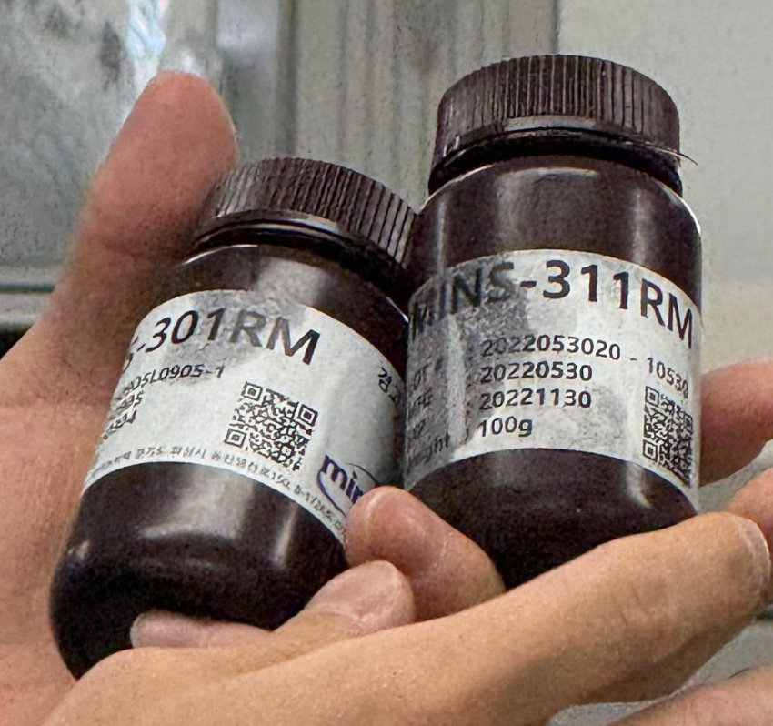 |  |

- 사진 확인: PUA 라벨은 **MINS-301RM**, **MINS-311RM**, 용량 100 g이다. 301RM 라벨 아래에 회사 로고 "min…"과 경기도 주소가 보인다.
- 사진 확인: 우리 조 작업대에 놓인 병은 두 개 모두 **MINS-311RM**이다. 우리 조는 311(단단한 쪽)을 쓴 것으로 보인다. 팀원 보고서 초안도 사용 수지를 MINS-311RM으로 적었다.

**원리 심화 (PUA 301RM·311RM)** `[보충]`
- 301RM과 311RM은 Minuta Tech(미뉴타텍, 한국)의 PUA다. 301RM은 **soft PUA**, 311RM은 **hard PUA**로 구분한다. [M1], [M3]
- 경화 후 영률은 hard(311RM) 약 **320 MPa**, soft(301RM) 약 **20 MPa**이고, 끊어질 때까지 늘어나는 비율은 각각 **9 %**, **45 %**다. 311RM이 16배 단단하지만 덜 늘어난다. [M1]
- 같은 연구는 PUA 방울을 몰드에 떨어뜨리고 **PET 필름**으로 덮은 뒤 **365 nm UV(200 mJ/cm²)**로 경화했다. 이어서 남은 라디칼을 없애려고 **UV를 3시간 더** 쬐었다. 수업의 "하루 정도 더 경화"와 같은 목적(후경화)으로 볼 수 있다(추정). [M1]

| PCL·PLGA 나노 패턴 디스크 (보관 상자) |
|---|
|  |

- 사진 확인: 왼쪽 상자 라벨은 "NANO PCL", 오른쪽은 "PLGA Nano 48 well 사이즈(9 mm)"로 읽힌다. 48웰 플레이트에 넣을 수 있게 지름 약 9 mm 원형으로 자른 디스크이고, 디스크마다 나노 패턴 때문에 무지개색이 보인다. ❓확인: 오른쪽 라벨의 "사이즈" 부분 글자

📷 캡처 필요 #1 — (부분) 베이스·경화제 라벨 확보. 남음: 10 : 1 혼합 장면 또는 완성된 PDMS 플레이트
📷 캡처 필요 #2 — ✅ 위 사진
📷 캡처 필요 #3 — ✅ 위 사진

## 4. 제작 방법과 원리

### 4-1. PDMS 플레이트 (열경화)

- `[수업]` 베이스와 경화제를 **10 : 1**(연구실 최적 비율)로 섞어 틀(몰드)에 붓고 열로 굳히면 PDMS 플레이트가 나온다.
- ❓확인: 우리 조의 PDMS 작업 내용 (혼합량, 탈포 여부, 경화 온도·시간). 2회차의 진공 탈포·핫플레이트 경화와 이어지는 부분

**원리 심화** `[보충]`
- **혼합비:** 대표 상용 제품 SYLGARD 184는 베이스와 경화제를 **무게비 10 : 1**로 손으로 섞도록 안내한다. 실온 또는 가열로 경화하며, 경화 온도가 높을수록 인장강도·경도·영률이 커진다. [D1]
- **성질과 용도:** 같은 자료는 SYLGARD 184가 **소수성** PDMS 막을 만들고 소프트 리소그래피(미세유체 칩 등)에 쓰인다고 설명한다. [D1]
  - 주의: 이 제품 페이지에는 투명성과 생체적합성에 대한 문장이 없다. 보고서에 "투명하다"는 사진 관찰로, "생체적합성"은 다른 출처가 있을 때만 쓴다.
- **실습 제품:** 소분 라벨에 원제품명이 없어 SYLGARD 184와 같은 제품인지는 확인하지 못했다. 성분 표기와 무게비 혼합 문구는 같은 계열임을 보여 준다(추정).
- **PDMS를 몰드로:** 경화된 PDMS는 패턴 복제용 몰드로 쓰인다. 311RM·301RM PUA를 PDMS 몰드 위에 떨어뜨려 복제한 연구가 있다. [M1]

### 4-2. PUA 플레이트 (UV 경화) — 이번 실습의 중심

**준비 `[수업]`**
- 실리콘 웨이퍼 = 패턴을 새긴 실리콘 원판(마스터). 패턴 웨이퍼는 한 장에 200만~300만 원 정도라 깨지면 부담이 커서, 이번에는 패턴 없는 **플랫(flat) 웨이퍼**로 만든다. 원하는 조는 패턴 웨이퍼로 해도 된다.
- 웨이퍼 위에 바르는 기판은 **PET**(페트병 소재) 필름이다.

| 패턴이 있는 실리콘 웨이퍼 (마스터) | 웨이퍼 보관 케이스 |
|---|---|
|  |  |

- 사진 확인: 반원 모양 실리콘 웨이퍼 가운데에 직사각형 패턴 영역이 있고, 보는 각도에 따라 초록색 등으로 보인다. 3회차의 나노 패턴 필름과 같은 회절 현상이다.
- 사진 확인: 웨이퍼는 세워 꽂는 전용 케이스에 보관하고 가장자리를 잡아 꺼낸다.

**제작 순서 `[수업]`**
1. 실리콘 웨이퍼를 **아세톤과 에탄올로 세척**하고 오븐에서 약 5분 말린다. 패턴 웨이퍼를 꺼낼 때는 오염과 손상을 막기 위해 **장갑**을 낀다.
2. 말리는 동안 PET 필름을 웨이퍼 크기의 **2~3배**로 자른다. 너무 작으면 PUA가 밖으로 삐져나와 다 붙어 버린다.
3. PET를 빛에 비춰 **흠집(기스)·지문이 없는 깨끗한 부분**만 골라 자른다.
4. PET 표면의 **먼지를 털어 낸다** (원래는 메탄올·세척 등을 하지만 이번에는 간단히 먼지만 제거). 사진 확인: 고무 에어 블로어로 바람을 불어 먼지를 날렸다. 깨끗한 면이 위로 먼지가 붙지 않게 내려놓는다.
5. 마른 웨이퍼를 **A4 종이 위**에 놓는다(사진 확인). 덮을 때 PUA가 바깥으로 퍼져 나오는데, 종이가 없으면 책상에 굳어 떼어지지 않기 때문이다.
6. 웨이퍼 위에 **피펫으로 PUA를 떨어뜨린다.** 사진 확인: 100–1000 µL 피펫(2회차에 배운 피펫)으로 병에서 바로 빨아 웨이퍼 위에 여러 방울로 나눠 떨어뜨렸다.
7. PET의 깨끗한 면을 아래로 해서 덮는다. PUA가 스스로 퍼지도록 잠깐 기다린다.
8. **롤러**(전사본 "밀링 기")로 밀어 PUA를 고르게 펴고 **기포를 없앤다.** 빛에 비춰 기포나 하얗게 덜 퍼진 부분이 없는지 확인한다. 끊어서 밀지 말고 이어서 민다.
   - `[실습 관찰]` (팀원 보고서) 우리 조 웨이퍼는 실습 전부터 **가장자리 일부가 파손**되어 있어, 그 부위의 기포는 롤러로 밀어도 완전히 없애기 어려웠다.
9. **UV 경화 챔버**에 넣고 **5~10분** 둔다. 넣을 때 타이머·전등이 켜져 있는지 확인한다. 웨이퍼 한쪽이 들리면 PET와 수지 사이에 기포가 들어갈 수 있으니 **수평을 유지한 채** 넣는다.
   - 사진 확인: 챔버 서랍 안에 여러 조의 시편이 종이째 놓여 있고, 일부는 알루미늄 포일로 덮여 있다. ❓확인: 포일을 덮은 이유 (빛 차단으로 보임)
10. 꺼낸 직후에는 완전히 굳지 않았을 수 있으니 패턴이 생겼는지 확인한 뒤 **PET 필름을 웨이퍼에서 떼어 낸다.** PUA가 PET 쪽에 붙어 플랫(또는 패턴) 면이 생긴다.
11. 앞면(패턴 면)을 헷갈리지 않게 **이름표(라벨링)**를 붙인다. 조·플랫/패턴 여부를 적는다.
12. 그대로 **하루 정도 더 경화**해 완전히 굳힌다(변형이 안 생기도록). ❓확인: 하루 동안 어디서 어떻게 두는지 (UV 챔버 추가 노광인지, 실온 보관인지)

- `[수업]` 경화가 덜 된 상태로 떼면 플레이트가 아니라 액체 그대로 나온다.
- `[수업]` 조마다 301 또는 311을 나눠 썼다. 우리 조(5조)는 작업대 사진으로 보아 **311RM**을 쓴 것으로 보인다.

**원리 심화 (UV 광중합과 조사량)** `[보충]`
- **광중합:** 라디칼 광개시제는 짧은 파장 또는 가시광을 받으면 분해되어 라디칼을 만든다. 라디칼이 단량체의 탄소–탄소 이중결합에 붙으며 반응이 시작되고, 결국 가교가 많이 된 고분자 그물 구조가 만들어진다. [P1]
- **문제점:** 산소가 라디칼을 없애는 **산소 저해**, 굳으며 부피가 줄어드는 **수축과 응력**이 대표적인 문제다. [P1]
- **조사 세기와 조사량:** 조사 세기(irradiance)는 단위 면적에 들어오는 빛의 세기(W/cm², mW/cm²)이고 라디칼이 생기는 속도를 정한다. 조사량(dose, mJ/cm²)은 조사 세기를 시간에 대해 적분한 값으로, 세기가 일정하면 세기 × 시간이다. [P2]
  - 계산 예: 세기가 10 mW/cm²로 일정하면 20초 조사 시 조사량은 200 mJ/cm²다(가정값, [M1]의 조사량과 같은 크기).
  - 같은 조사량이라도 결과가 같다고 보장되지 않는다. 조사량만으로 가교 정도를 다 설명할 수 없고, 파장이 다르면 같은 조사량도 광화학적으로 같지 않다. [P2]
  - 그래서 "몇 분"보다 파장·세기·시간을 함께 기록해야 공정을 재현할 수 있다.
- **복제(나노임프린트):** 원판의 오목한 부분은 복제면에서 볼록하게, 볼록한 부분은 오목하게 옮겨져 형상이 서로 반대(상보적)가 된다. 경화 후 PET를 떼는 단계에서는 PUA가 PET에는 붙어 있고 원판과는 떨어져야 한다 [M2]. 3회차 [U3] 나노임프린트 설명과 이어진다.

| 웨이퍼 건조 오븐 (설정 90 °C) | PET 필름 자르기 |
|---|---|
|  | 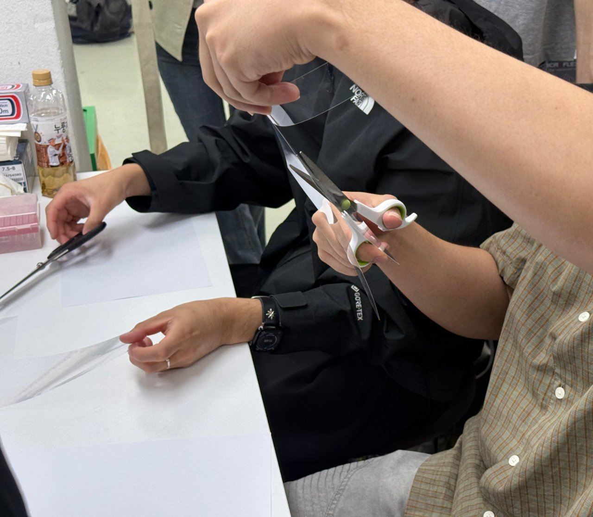 |

- 사진 확인: DAIHAN Scientific **Air Dry Oven**, 화면 Temp SV 90 °C(설정), Temp PV 92 °C(현재). 세척한 웨이퍼를 말린 오븐으로 보인다 ❓
- 사진 확인: 흰 종이를 깐 책상에서 가위로 PET 필름을 자른다.

| 세척용 세척병 (에탄올 등) | 에어 블로어로 PET 먼지 제거 |
|---|---|
| 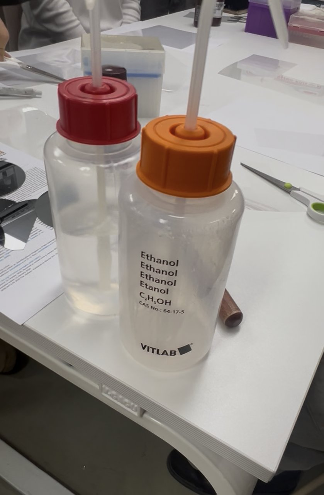 | 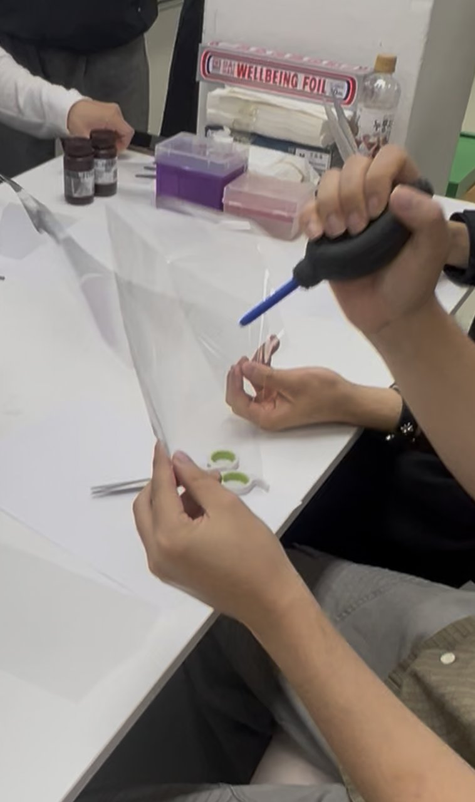 |

- 사진 확인: 오른쪽 세척병은 **Ethanol (C₂H₅OH, CAS 64-17-5, VITLAB)**이다. 왼쪽 빨간 뚜껑 병은 라벨이 보이지 않는다. ❓확인: 왼쪽 병이 아세톤인지 (수업은 아세톤·에탄올 세척)

| 피펫으로 311RM 빨아올리기 | 웨이퍼 위에 PUA 떨어뜨리기 |
|---|---|
| 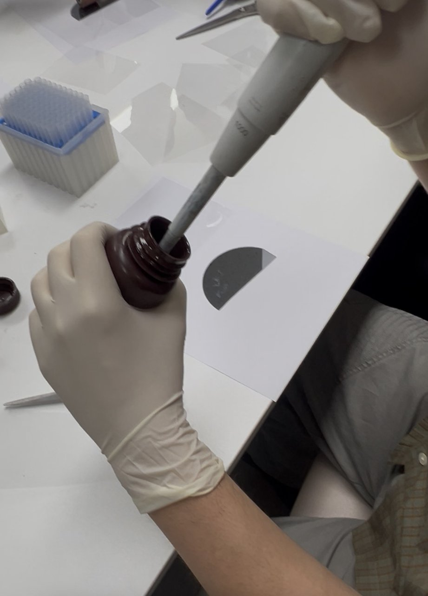 | 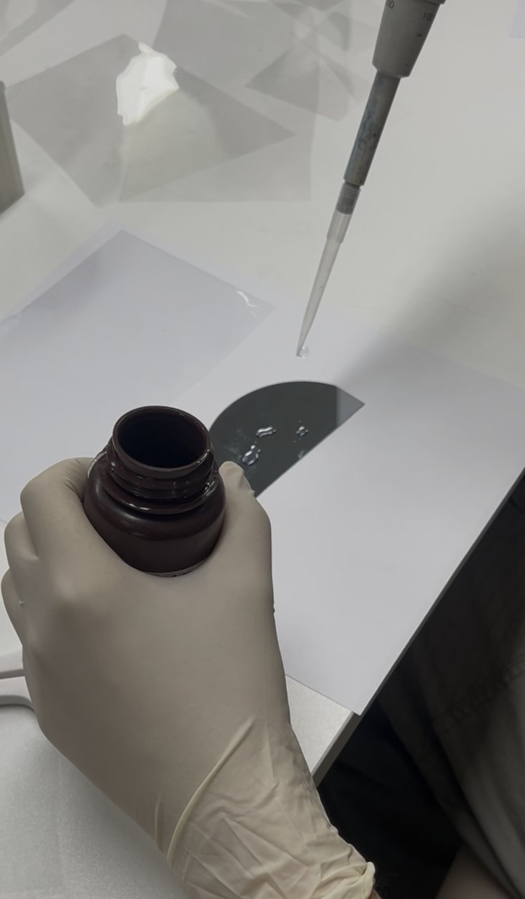 |

| 롤러로 PUA 펴기 | UV-A 경화 챔버 타이머 | 챔버 서랍 안 시편들 |
|---|---|---|
| 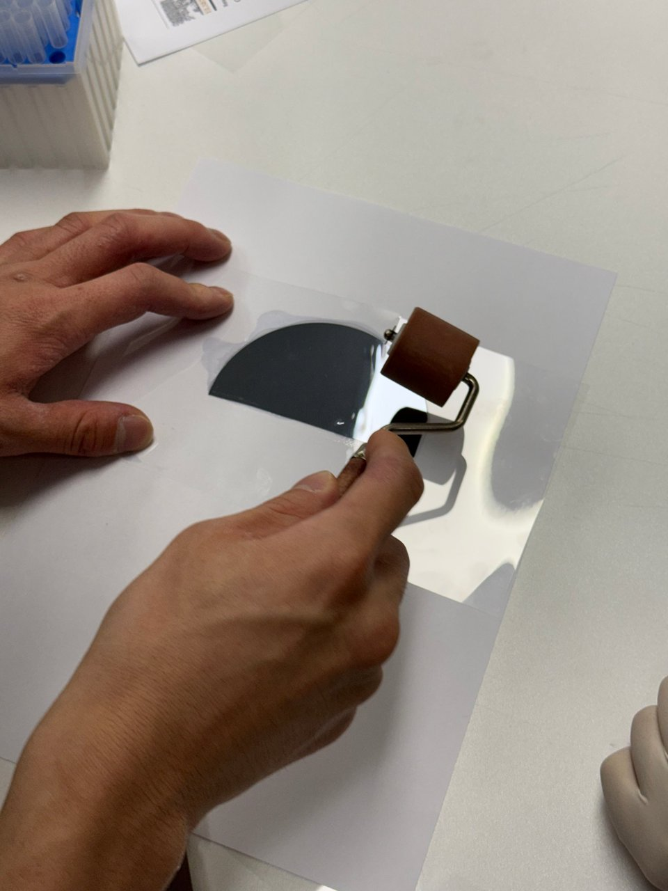 |  | 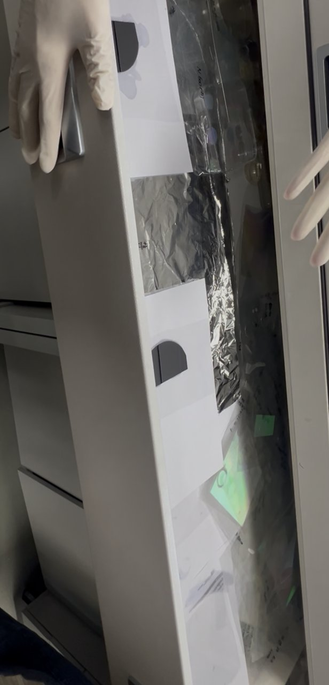 |

- 사진 확인: 웨이퍼 아래에 **흰 A4 종이**를 깔았다(5단계의 "AF/A4"는 A4 종이). PET를 덮은 뒤 고무 롤러로 민다. 웨이퍼 둘레로 PUA가 번져 나온 자국이 보인다.
- 사진 확인: 챔버 패널은 **U.V-A CURING CHAMBER**(3회차와 같은 장비), POWER·LAMP 1·LAMP 2가 모두 켜져 있고 타이머가 **40.0**을 표시한다. ❓확인: 40.0의 단위(초/분)와 이번 경화 시간 (수업 설명은 5~10분). 팀원 보고서도 단위를 확인하지 못했다고 적었다.
- 참고 `[보충]`: 같은 MINS-311RM을 실리콘 원판에 떨어뜨리고 **PET 필름 너머로 365 nm UV를 30초** 쬐어 경화한 뒤 떼어 낸 예가 있다 [M2]. 필요한 시간은 광원 세기와 시편 위치에 따라 달라지므로 이 값을 이번 실습 조건으로 쓰지는 않는다.

| PET 떼어 내기 | 떼어 낸 뒤 종이 위 웨이퍼 |
|---|---|
| 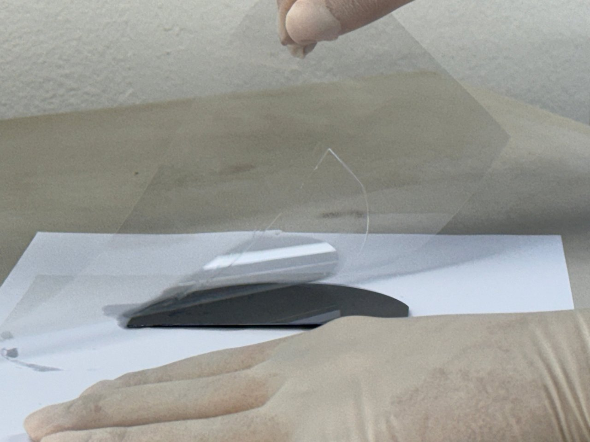 | 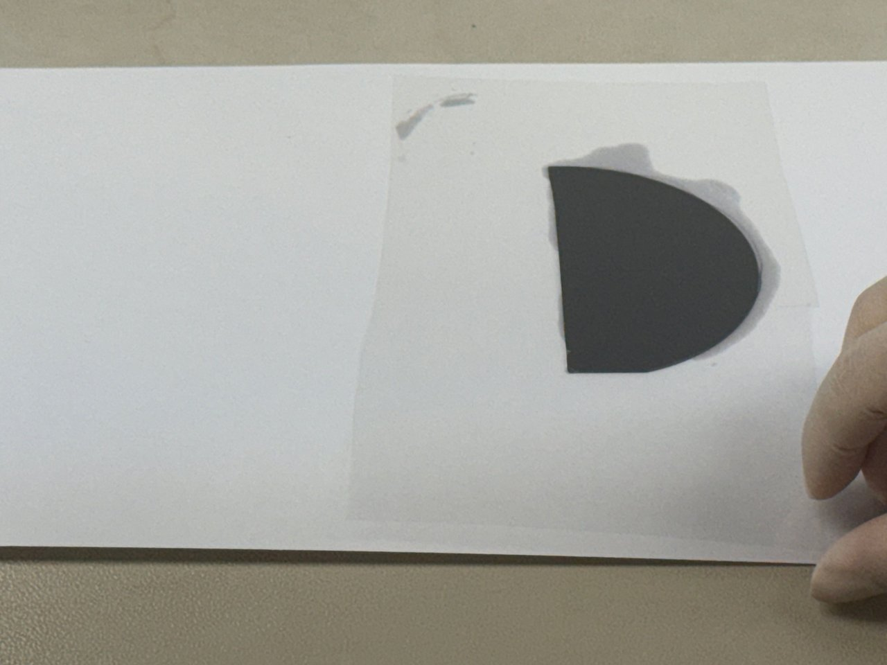 |

- 사진 확인: 경화 후 PET를 한쪽 끝부터 들어 올리면 굳은 PUA가 PET 쪽에 붙어 웨이퍼에서 떨어진다. 웨이퍼 모양의 경계선이 PET 위에 남는다.
- 사진 확인: 떼어 낸 뒤 종이에 웨이퍼 둘레로 번진 PUA 자국이 남아 있다. 종이를 깔지 않았다면 이 부분이 책상에 굳어 붙었을 것이다(수업 설명과 같은 이유).

| 완성된 플랫 PUA 필름 | 라벨 쓰기 |
|---|---|
| 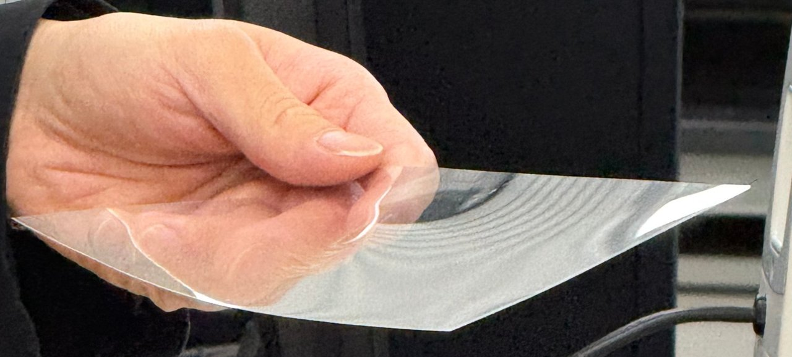 | 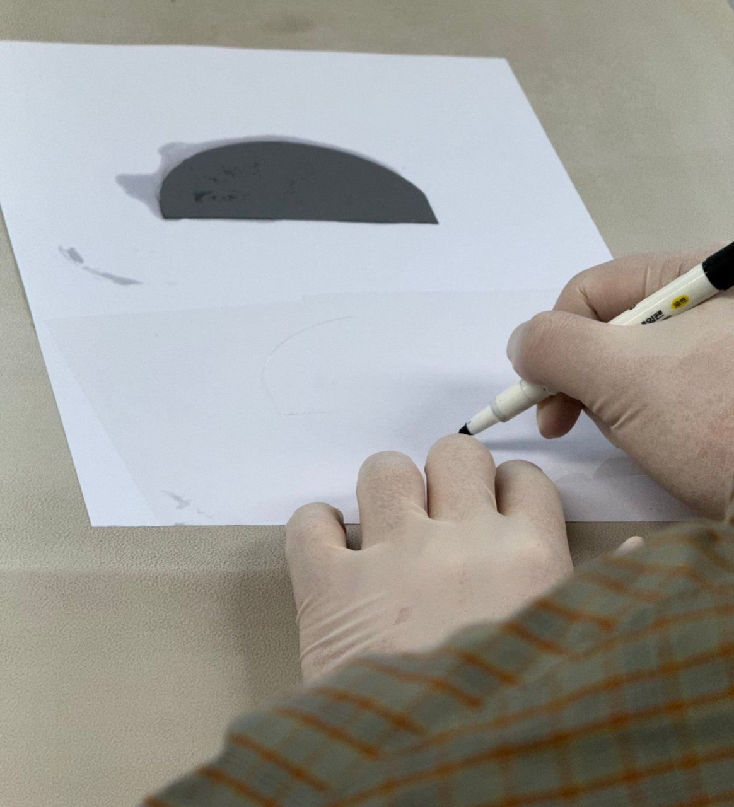 |

- 사진 확인: 플랫 웨이퍼로 만든 필름은 투명하고 무늬가 없다.
- 사진 확인: 장갑을 낀 채 웨이퍼 옆 종이·필름에 마커로 표시한다.

| 패턴 웨이퍼로 만든 PUA 필름 (표시 "N 600nm") |
|---|
|  |

- 사진 확인: 패턴 웨이퍼로 찍은 필름은 직사각형 패턴 부분이 무지개색으로 보이고, 필름에 **"N 600nm"**이라고 적혀 있다. 패턴 간격 600 nm로 보인다(3회차의 "N 600/800" 표시 의문도 이것으로 풀림, 추정). 사진 두 장 모두 확대하면 "N 600nm"로 읽힌다. 팀원 보고서는 "800 nm로 보이는 손글씨"라고 적었는데, 다른 필름(N 800)이었을 수 있다 ❓ 600 nm는 가시광 파장 범위(400–700 nm)라 색이 잘 갈라진다.

📷 캡처 필요 #4 — ✅ 오븐·세척병·에어 블로어 (세척하는 손 장면은 없음)
📷 캡처 필요 #5 — ✅ PET 자르기
📷 캡처 필요 #6 — ✅ 피펫으로 떨어뜨리기
📷 캡처 필요 #7 — ✅ 롤러
📷 캡처 필요 #8 — ✅ 타이머
📷 캡처 필요 #9 — ✅ 박리·완성품
📷 캡처 필요 #10 — ✅ 라벨

## 5. 결과

| 재료 | 한 일 | 관찰·결과 | 근거 |
|---|---|---|---|
| PUA (MINS-311RM으로 보임) | 플랫 웨이퍼 위 PET에 PUA 도포 → 롤러 → UV 경화 → 박리 → 라벨 | 투명하고 무늬 없는 플랫 필름. 종이에 PUA 번짐 자국. 패턴 웨이퍼 필름(N 600nm)은 무지개색 | 녹음·사진 |
| PDMS | 재료(베이스·경화제) 소개 | 라벨 확인. 혼합·경화 장면 사진 없음 | 녹음·사진 |

## 6. 고찰 (보고서용 아이디어)

- **굳는 방식의 차이**: PDMS는 열로 가교하고(2회차 핫플레이트·진공 탈포와 이어짐), PUA는 UV로 몇 분 안에 굳는다(3회차 UV 챔버와 이어짐). 같은 "플레이트"라도 공정 시간과 장비가 다르다.
- **기포와 먼지**: 2회차 PDMS는 진공 챔버로 기포를 뺐고, 이번 PUA는 롤러로 밀어서 뺀다. 둘 다 표면 품질을 위해서다.
- **부드러움과 단단함**: PUA 301(부드러움)과 311(단단함), PCL(유연)과 PLGA(단단·잘 깨짐) — 용도(패치 다루기, 패턴 유지)에 따라 고른다.
- **원판(마스터)과 복제**: 비싼 실리콘 웨이퍼 패턴을 PUA로 여러 번 복제해 쓰는 구조 (3회차 나노임프린트와 연결).
- **원판 상태가 결과를 좌우**: 가장자리가 파손된 웨이퍼는 그 부위 기포가 빠지지 않았다(팀원 관찰). 도포량·롤러만큼 원판 상태 점검이 필요하다.
- **soft vs hard**: 311RM(320 MPa, 9 %)은 형상을 잘 지키지만 덜 늘어나고, 301RM(20 MPa, 45 %)은 유연하다 [M1]. 이번에는 311RM만 써서 둘을 비교하지는 못했다.
- **생체재료로서**: PCL·PLGA는 생분해성이라 조직공학 지지체에 쓰이지만 [C1], PCL은 소수성이라 세포 부착이 떨어져 표면 처리가 필요할 수 있다 [C2]. 이번 실습에서는 세포 실험을 하지 않았다.

## 7. 확인 필요 목록

- [x] 실습 날짜 2026-10-08(목), 마감 2026-10-15
- [ ] 우리 조가 PDMS도 직접 만들었는지, 만들었다면 과정·조건
- [x] 우리 조 PUA 제품 → 311RM으로 보임 (작업대 사진)
- [x] PUA 제품명 → MINS-301RM / 311RM (라벨), 회사명은 S4에서 확인
- [x] 단단한 고분자 → PLGA (상자 라벨)
- [x] PCL → 소수성 [C2]
- [x] 웨이퍼 아래 까는 것 → A4 종이 (사진)
- [ ] 하루 추가 경화 방법 (참고: 문헌은 UV 3시간 추가 노광 [M1])
- [ ] 왼쪽 세척병이 아세톤인지, UV 서랍 속 포일의 용도
- [ ] 패턴 필름 표시 600 nm(사진) vs 800 nm(팀원 보고서)
- [ ] 천연 고분자 예의 "그래핀"
- [ ] UV 경화 시간 — 타이머 40.0의 단위
- [ ] 오븐 90 °C가 웨이퍼 건조용인지
- [ ] PDMS 원제품 (SYLGARD 184?)

## 8. 팀원 보고서 초안·수정 요청 검증 (2026-10-13)

| 항목 | 검증 결과 | 반영 |
|---|---|---|
| 사용 수지 311RM, 301RM=soft·311RM=hard | 작업대 사진 + [M1] 원문 일치 | 반영 |
| SYLGARD 184 10 : 1, 소수성 [5] | Sigma 페이지 원문 일치 | 반영 |
| PDMS "투명하고 생체적합성이 알려져 있다 [5]" | Sigma 페이지에 투명성·생체적합성 문장 **없음** | 출처 붙이지 않음. 투명은 사진 관찰로만 |
| PCL Tg −60 °C, 녹는점 59–64 °C, 소수성·세포 부착 저하 [7] | 원문 일치 (IJMF 2024, 11(3), 21–27) | 반영 |
| PCL·PLGA 생분해성 폴리에스터, 조직공학 [6] | 원문 일치, DCM 용매 사용도 확인 | 반영 |
| MINS-311RM, 365 nm, PET 너머 30초 [8] | 원문 일치 (Jang et al., J. Mater. Chem. C 2014 SI) | 참고값으로만 반영 |
| [9] Kim et al. c6tc02660e | MINS 301=soft, 311=hard 언급만, 경화 조건 없음 | 명칭 근거로만 |
| 빛에 비춰 흠집 확인, 장갑, A4 종이, 수평 유지, 5–10분 대기 후 확인·박리, 하루 추가 경화 | 전사본·사진과 일치 | 반영 |
| 웨이퍼 가장자리 파손으로 기포 제거 어려움 | 팀원 현장 관찰 (사진 없음) | `[실습 관찰]`로 반영 |
| 패턴 필름 "800 nm" 손글씨 | 사진 두 장은 "N 600nm"로 읽힘 | ❓로 남김 |
| [2] Polymers 2022 광중합 리뷰 | MDPI 원문 일치 (PMC는 reCAPTCHA로 막힘) | 반영 |
| [3] Opsytec 조사 세기·조사량 | 원문 일치 | 반영 |
| [4] Newport 회절격자 식 | 페이지 본문이 열리지 않음 | 3회차 [U4] LibreTexts로 대체 권장 |

## 참고 자료

모두 원문을 열어 해당 문장을 확인한 출처다.

- [D1] MilliporeSigma, *SYLGARD 184 Silicone Elastomer Kit* (제품 페이지) — https://sigmaaldrich.com/product/aldrich/761036
- [C1] Rosalia M. et al., *Investigation on Electrospun and Solvent-Casted PCL-PLGA Blends Scaffolds Embedded with Induced Pluripotent Stem Cells for Tissue Engineering*, Pharmaceutics 15(12), 2736 (2023) — https://doi.org/10.3390/pharmaceutics15122736
- [C2] Dolatkhahan M., Peiravi M., Sherafat Z., *Morphology and Mechanical Properties of 3D Porous PLA/PCL Scaffolds*, Iranian Journal of Materials Forming 11(3), 21–27 (2024) — https://ijmf.shirazu.ac.ir/article_7767_7a5e5afabc0729125185e581023f9bf5.pdf
- [M1] Seong M., Park H.-H., Hwang I., Jeong H. E., *Strong and Reversible Adhesion of Interlocked 3D-Microarchitectures*, Coatings 9(1), 48 (2019) — https://www.mdpi.com/2079-6412/9/1/48
- [M2] Jang S. et al., *10 nm scale nanopatterning on flexible substrates by secondary sputtering phenomenon …*, J. Mater. Chem. C (2014), Supporting Information — https://www.rsc.org/suppdata/tc/c4/c4tc00012a/c4tc00012a1.pdf
- [M3] Kim S. M. et al., *Repeated Shape Recovery of Clustered Nanopillars by Mechanical Pulling*, J. Mater. Chem. C, Supporting Information — https://www.rsc.org/suppdata/c6/tc/c6tc02660e/c6tc02660e1.pdf
- [P1] Lang M., Hirner S., Wiesbrock F., Fuchs P., *A Review on Modeling Cure Kinetics and Mechanisms of Photopolymerization*, Polymers 14(10), 2074 (2022) — https://www.mdpi.com/2073-4360/14/10/2074
- [P2] Opsytec Dr. Gröbel, *UV Curing and Photopolymerization* — https://www.opsytec.com/uv-applications/uv-processes/uv-curing-photopolymerization
- 3회차 참고: [U3] UV 나노임프린트, [U4] 회절격자 (labs/03 README)
