# 실습 05 — PDMS 계량·혼합·열경화 (2026-10-15)

> 상태: 초안 (전사본 + 사진 13장 + 주인 기억·확인 10-27) / 📷 캡처 자리 4개 중 0개 채움, #1은 해당 없음(우리 조는 탈형 안 함)
> 보고서 제출: 조별 1부, 한글 파일, 20쪽 이내, 원리 위주 — 마감 **2026-10-29**
> 사진은 모두 우리 조(5조) 작업이며, 계량·혼합은 주인이 직접 했다 (주인 확인 10-27)
> 원리 심화 `[보충]`: S4에서 채움 (10-27, 출처는 맨 아래, 모두 원문 확인)
> 4회차와의 관계: 4회차에는 PDMS 재료 소개만 하고 우리 조는 PUA만 만들었다. 이번이 PDMS 실제 제작이다. PDMS 재료 원리는 4회차 §4-1, 진공 탈포 원리는 2회차 §4-5와 이어진다.

## 1. 실습 목적

- `[수업]` 지난 시간의 PUA(UV 경화)에 이어, 이번에는 열로 굳는 **PDMS**(폴리디메틸실록산)를 직접 만든다.
- `[수업]` 베이스와 경화제를 알맞은 비율로 섞어 틀에 붓고 열로 굳히면, 떼어냈을 때 틀의 모양이 그대로 옮겨진 PDMS가 나온다.
- `[수업]` PDMS는 실리콘 계열이라 변형이 잘 되지 않아 연구에서 반복해서 쓸 수 있다.

## 2. 공통 주의사항

- `[수업]` PDMS를 바닥에 흘리면 잘 닦이지 않는다. 최대한 조심해서 따르고, 흘릴 자리에 휴지를 깔아 둔다.
- `[수업]` 저울은 문을 닫고 영점을 잡는다 (2회차 저울 사용법).
- `[수업]` 양이 너무 많으면 기포 빼는 데 오래 걸린다. 조마다 10~20 g 사이로 만든다.
- `[실습 관찰]` 쓴 스패출러는 70 % 에탄올을 뿌려 닦는다 (주인 확인, 사진 03_mix_clean-spatula).
- `[실습 관찰]` 장갑을 끼고 작업했다 (사진 전체).

## 3. 재료·장비 한눈에

| 재료·장비 | 이번 실습에서 한 일 | 핵심 원리 |
|---|---|---|
| PDMS 베이스(A) | 큰 병. 먼저 계량 | 비닐 말단 실록산 사슬 (라벨 성분) [D2] |
| PDMS 경화제(B) | 작은 병. 베이스의 1/10 무게 | 가교제 + 백금 촉매 [D2] |
| 분석 저울 (Sartorius) | 웨잉 디쉬 영점 → 베이스 → 영점 → 경화제 | 용기 무게 빼기(영점), 최소 표시 0.1 mg |
| 스패출러 | 수백 번 저어 혼합 | 경화제를 골고루 퍼뜨려야 고르게 가교된다 |
| 진공 챔버 | 혼합 중 생긴 기포 제거 | 감압 → 기포 팽창 → 떠올라 터짐 (2회차) |
| 몰드 (케이스 + 돌기 판) | 미리 준비된 몰드 위에 붓고 눌러 모양 잡기, 기포 터뜨리기 | 형상 복제 (몰딩) |
| 핫플레이트 | 열경화 | 온도를 올리면 가교가 빨라진다 [D3] |

## 4. 방법과 원리

### 4-1. 재료

| 재료 확인 |
|---|
| 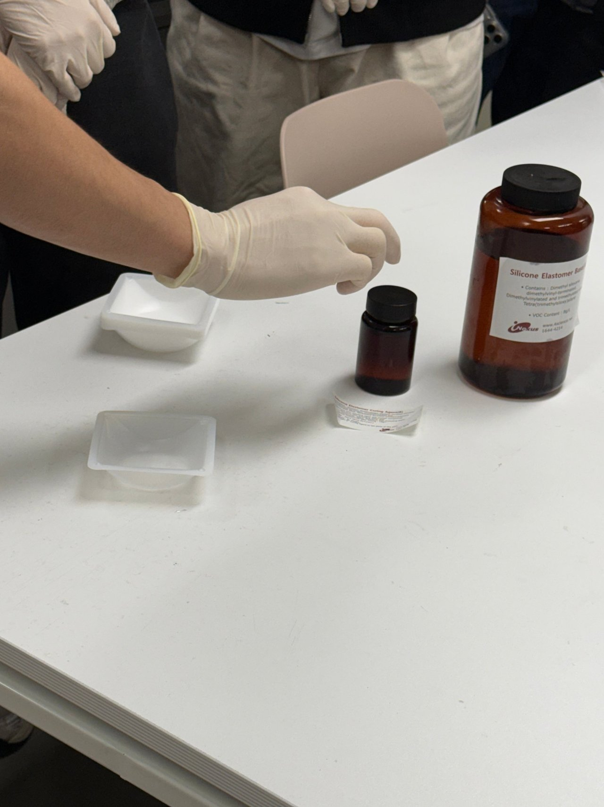 |

- 사진 확인: 큰 갈색 병 라벨은 "Silicone Elastomer Base", 성분 "Dimethyl siloxane, dimethylvinyl-terminated / Dimethylvinylated and trimethylated silica / Tetra(trimethylsiloxy)silane". 작은 갈색 병이 경화제(Curing Agent)다. 플라스틱 웨잉 디쉬 2개가 놓여 있다.
- 4회차 §4-1과 같은 재료다. 소분 라벨에 원제품명이 없어 SYLGARD 184와 같은 제품인지는 확인하지 못했다(4회차와 같은 판단, 추정).
- `[보충]` SYLGARD 184 베이스 MSDS의 성분 세 가지(dimethylvinyl-terminated 디메틸실록산 60 % 초과, dimethylvinylated and trimethylated silica 30~60 %, tetra(trimethylsiloxy)silane 1~5 %)가 우리 병 라벨 성분과 이름이 그대로 같다 [D4]. 같은 계열이라는 근거가 하나 더 생겼지만, 원제품명은 여전히 추정이다.
- `[보충]` 경화제 MSDS에는 dimethyl, methylhydrogen siloxane이 들어 있다 [D5]. 이름의 "hydrogen"이 Si–H기이고, 이것이 베이스의 비닐기와 이어지는 쪽이다 [D2].

### 4-2. 계량 (10 : 1)

**사용 순서**
1. `[수업]` 저울 문을 닫고 영점을 잡는다. 웨잉 디쉬를 올리고 다시 영점을 잡는다.
2. `[수업]` 저울 안에서 바로 따르면 더 정확하지만 불편하고 흘리기 쉽다. 영점을 잡아 두었으니 디쉬를 꺼내 휴지를 깐 저울 밖에서 따라도 된다. 조금의 오차는 상관없다.
3. `[수업]` **베이스를 먼저** 10~20 g 따른다.
4. `[수업]` 다시 영점을 잡고 경화제를 베이스의 1/10 무게만큼 넣는다. 시연: 베이스 9 g → 경화제 0.9 g. 다른 조 예: 15 g → 1.5 g, 17 g → 1.7 g.

| (a) 디쉬 올리고 영점 | (b) 디쉬를 꺼낸 상태 |
|---|---|
| 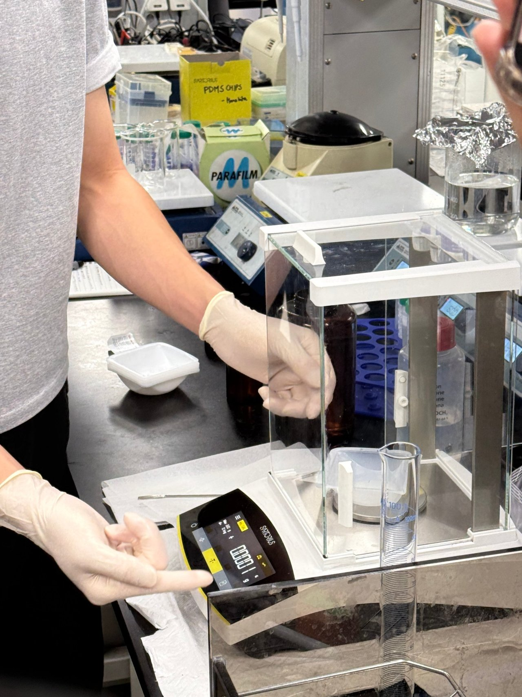 | 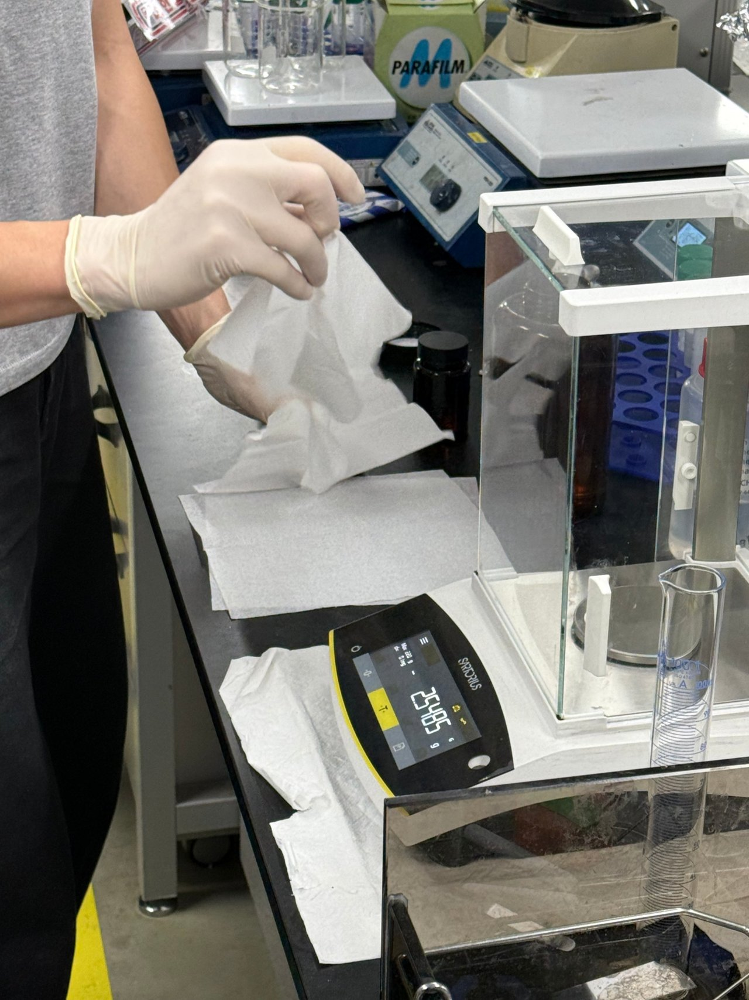 |
| (c) 저울 밖에서 베이스 따르기 | (d) 영점 후 경화제 넣기 |
| 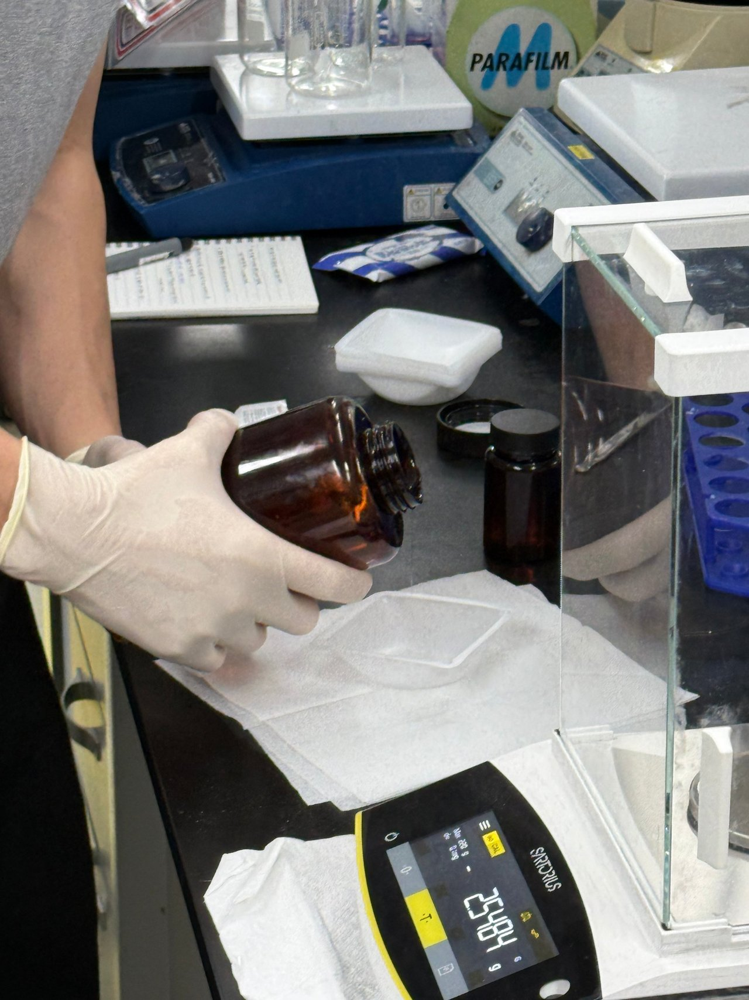 | 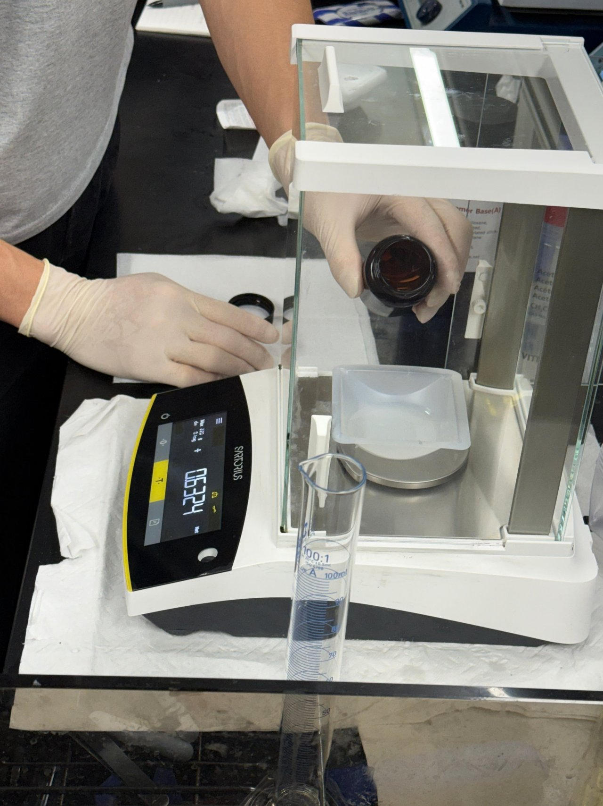 |

- 사진 확인 (a): Sartorius 분석 저울, 표시 "Max 220 g, d = 0.1 mg". 디쉬를 올리고 영점을 잡아 **0.0001 g**.
- 사진 확인 (b)(c): 디쉬를 저울에서 꺼내자 **−2.5485 g**, 베이스를 따르는 동안 −2.5484 g. 디쉬 무게만큼 마이너스가 표시된다. 디쉬를 다시 올리면 베이스 무게만 남는다.
- 사진 확인 (d): 경화제를 넣는 중 **+0.6324 g, Net 표시**. 베이스를 올린 뒤 다시 영점을 잡았다는 뜻이다. 넣는 도중이라 최종값은 아니다.
- `[실습 관찰]` 우리 조는 **베이스 15 g + 경화제 1.5 g**을 목표로 넣었다. 약간의 오차는 있을 수 있다 (주인 기억 10-27). 전사본에서 5조 차례에 "15로 할까요? … 1.5"라고 한 대목과 맞는다. 사진 (d)의 0.6324 g은 1.5 g을 향해 넣는 도중의 값이다.

**왜 베이스를 먼저 넣나**
- `[수업]` 베이스가 점도가 더 높다. 경화제를 먼저 놓고 베이스를 따르면 둘이 층으로 나뉘어 뜨는 것을 시연으로 보여 주었다.
- `[실습 관찰]` 점도 높은 베이스를 먼저 맞춰 놓고, 점도 낮은 경화제를 나중에 넣으면 많이 넣었을 때 덜어내기 편하다 (주인 기억 10-27).

**원리**
- 영점(tare): 저울은 현재 하중을 0으로 기억하고 그 뒤의 변화만 보여 준다. 용기를 올린 채 영점을 잡으면 용기 무게가 빠진다. 용기를 내리면 그만큼 음수가 뜨는 것도 같은 이유다 (사진 b). 2회차 저울 원리와 이어진다.
- 무게비: [D1] SYLGARD 184는 베이스와 경화제를 **무게비 10 : 1**로 섞도록 안내한다. 10 : 1이면 경화제는 전체의 1/11 ≈ 9.1 %다 (10 %가 아니다).
- `[보충]` 점도 차이: 베이스 5000 cSt [D4], 경화제 110 cSt [D5]. 베이스가 약 45배 끈적하다 (5000 ÷ 110 = 45.5). 수업의 "베이스가 점도가 더 높다"와 주인 기억(묽은 경화제를 나중에 넣어야 덜어내기 쉽다)을 수치로 뒷받침한다.
- `[보충]` 비중: 베이스 1.05 [D4], 경화제 1.03 [D5]으로 거의 같다. 그래서 무게비 10 : 1을 부피비로 바꾸면 9.81 : 1로 거의 같다 (계산). 옛 데이터시트가 "무게나 부피로 10 : 1"이라고 쓴 것도 이 때문으로 보인다 [D6]. 그래도 끈적한 베이스는 부피를 정확히 재기 어렵고 0.1 mg까지 읽는 저울이 있으니 무게로 잰다.
- `[보충]` 혼합비와 단단함: 10 : 1 대신 비율을 바꾸면 굳은 PDMS의 성질이 달라진다 [D2]. Johnston 등은 선행 연구(Khanafer 등)를 인용해 탄성계수가 9 : 1 근처까지는 커지다가 그 뒤로는 작아진다고 정리했다 [J1]. 우리 조 15 g + 1.5 g은 경화제 9.09 %로 정확히 10 : 1이다 (계산).

### 4-3. 혼합

| 스패출러로 섞기 | 스패출러 세척 |
|---|---|
| 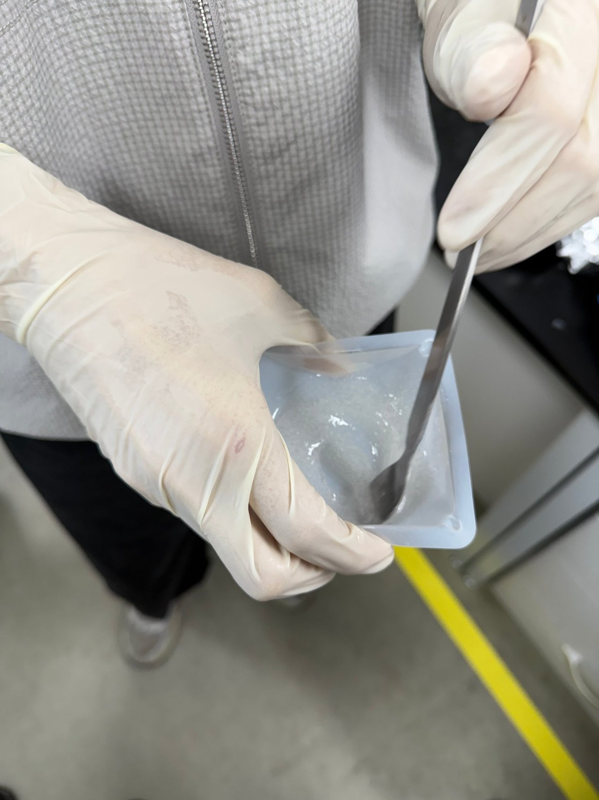 | 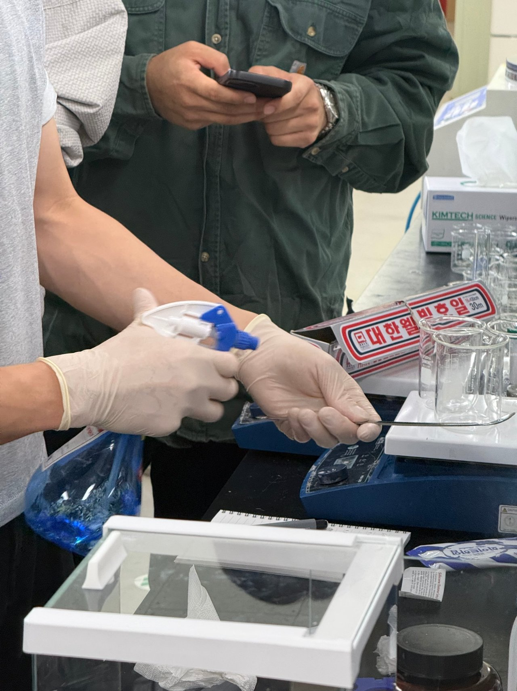 |

- `[수업]` 많이 섞어야 한다. 예전에는 500번에서 1000번 정도 섞었다. 최소 300번 정도.
- `[수업]` 섞으면 기포가 생긴다.
- `[실습 관찰]` 오랫동안 저으니 기포가 생겼다 (주인 기억). 사진 확인: 섞은 PDMS가 뿌옇게 기포로 차 있다.
- 사진 확인: 분무기(70 % 에탄올, 주인 확인)로 스패출러를 닦는다.
- `[보충]` 왜 오래 섞어야 하나: 제조사는 "충분히 섞은" 혼합물을 붓고, 섞을 때 공기가 갇히는 것을 줄이라고 안내한다 [D6]. 경화제 속 Si–H 가교제와 백금 촉매가 베이스 전체에 퍼져야 가교망이 고르게 생긴다 [D2]. 덜 섞였을 때의 결과는 제조사 자료에 적혀 있지 않아 단정하지 않는다.
- `[보충]` 시간 여유: 섞은 뒤 점도가 두 배가 되기까지(가사 시간, pot life) 2시간 넘게 걸린다 [D6]. 오래 젓고 탈포·붓기까지 해도 실온에서 굳기 시작할 걱정은 적다.

### 4-4. 진공 탈포

| 진공 챔버에 넣기 | 밸브로 기압 조절 | 탈포 후 |
|---|---|---|
| 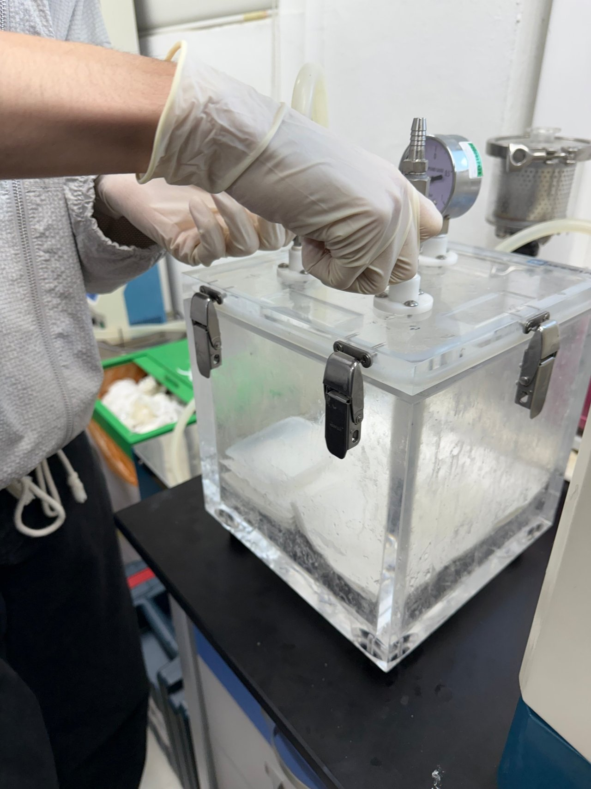 | 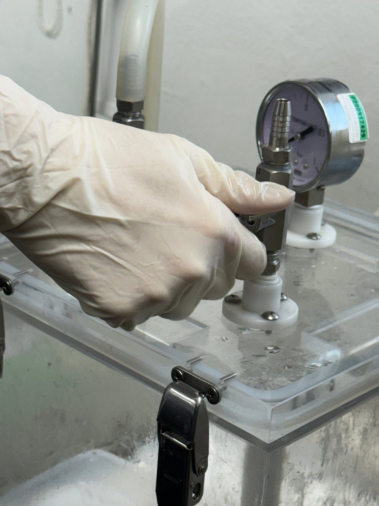 | 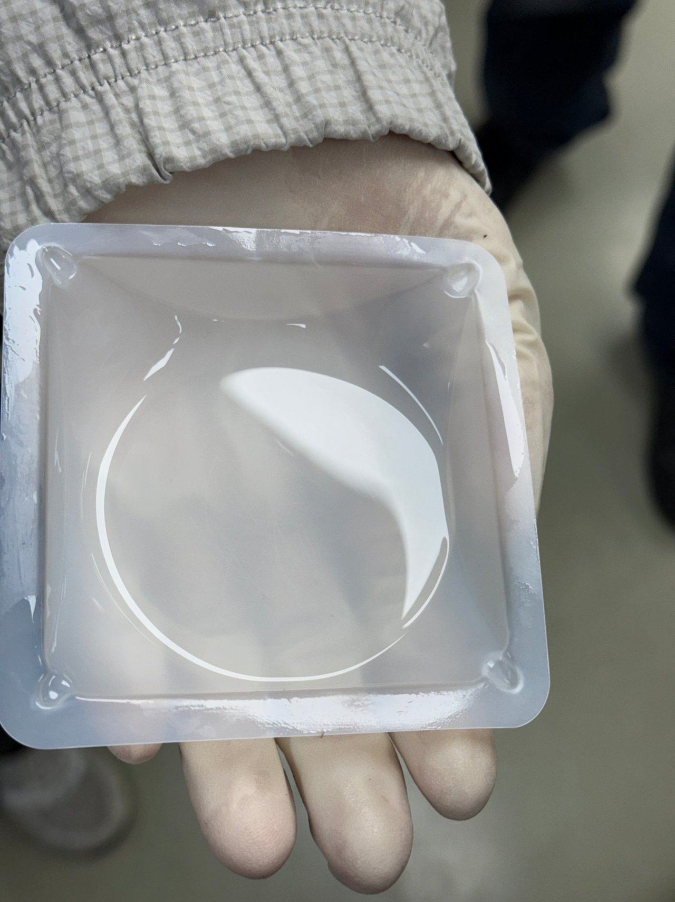 |

- `[수업]` 섞은 PDMS를 진공 챔버에 넣어 기포를 잡는다.
- `[실습 관찰]` 기포가 부풀어 거품이 디쉬 밖으로 넘치지 않는 선에서 밸브로 기압을 조절하며 공기를 뺐다 (주인 기억).
- 사진 확인: 아크릴 진공 챔버(걸쇠 4개, 게이지·밸브). 게이지는 Compound gauge(bar). 밸브를 조절하는 사진에서 바늘이 **0과 0.5 눈금 사이**에 있다. 2회차처럼 끝(1)까지 뺀 상태가 아닌 중간 상태로, 넘치지 않게 조절했다는 기억과 맞는다. ❓확인: 이 게이지에서 바늘이 움직인 쪽이 진공 눈금인지 (2회차 기록은 왼쪽이 진공)
- 사진 확인: 탈포 후 PDMS는 투명하고 눈에 띄는 기포가 없다.
- 원리 (2회차 §4-5): 감압하면 기포가 커지고(보일 법칙), 커진 기포는 빨리 떠올라(스토크스 법칙: 떠오르는 속도 ∝ 반지름² / 점도) 표면에서 터진다.
- `[보충]` 거품이 넘칠 뻔한 이유: 감압하면 갇힌 기포가 커져 떠오르고 표면에서 터지는데, 그동안 혼합물이 원래 부피의 약 2~6배까지 부풀었다가 가라앉는다. 그래서 용기에 부풀 자리를 남겨 두라고 한다 [V1]. 조마다 10~20 g으로 양을 제한하고, 넘치지 않게 밸브로 감압 속도를 조절한 것이 이 때문이다.
- `[보충]` 제조사는 기포가 잘 갇히는 형상이면 부은 뒤에도 진공을 걸라고 안내한다 [D6]. 우리 조는 붓기 전에 탈포하고, 부은 뒤 돌기 사이 기포는 팁으로 터뜨렸다.
- `[보충]` 참고: 연구에서는 진공 데시케이터에서 30분 탈포한 예가 있다 [J1]. 우리 조 탈포 시간은 기록하지 않았다.

📷 캡처 필요 #2 — 진공 챔버 안에서 기포가 부풀어 오르는 중간 장면 (영상에 있으면)

### 4-5. 틀에 붓기·모양 잡기

| 틀에 붓기 | 기포 터뜨리기 |
|---|---|
| 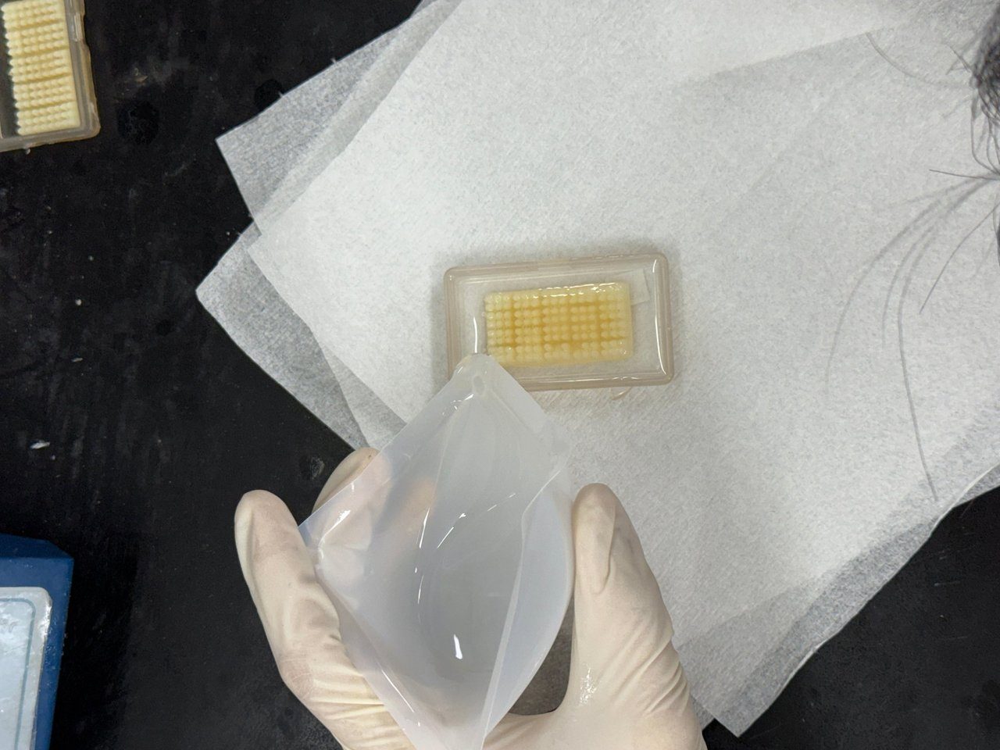 | 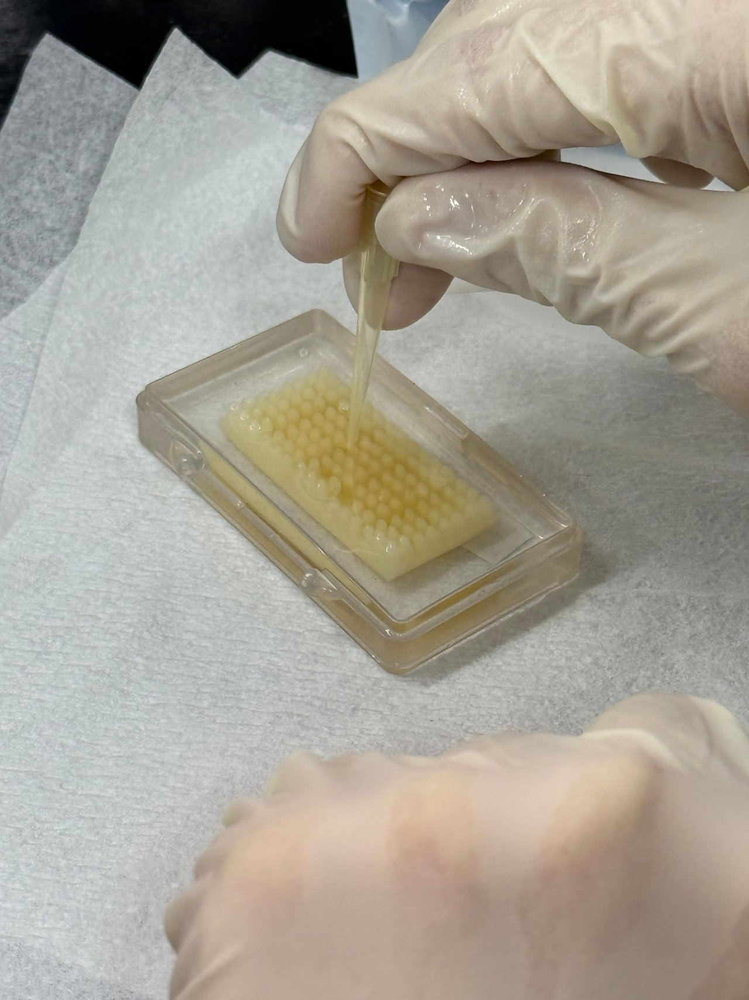 |

- `[실습 관찰]` 틀(mold)을 놓고 그 위에 탈포한 PDMS를 붓는다. 굳기 좋게 눌러서 모양을 잡는다 (주인 기억).
- `[실습 관찰]` 모양을 잡는 동안 생긴 기포는 터뜨리는 방향으로 진행했다 (주인 기억). 전사본의 "눌러, 터트려"가 이 장면이다.
- 사진 확인: 틀은 투명 플라스틱 케이스 안에 노란 **돌기 무늬 판**이 들어 있는 구조다. 붓고 난 뒤 돌기 사이에 기포가 보이고, 피펫 팁으로 터뜨린다.
- `[실습 관찰]` 돌기 판은 우리가 만든 것이 아니라 실습용으로 준비된 **몰드**다 (주인 확인). 재질과 제작 방법은 모른다.
- `[보충]` 몰딩(replica molding) 원리: 액체 상태의 PDMS를 무늬가 있는 원판(master)에 부어 굳히면 원판과 맞물리는 반대 모양이 찍힌다. 같은 원판으로 PDMS를 최소 50번 넘게 복제할 수 있다 [R1]. 이번 몰드의 돌기는 PDMS에서 오목한 구멍으로 찍힌다(반대 모양, 논리적 귀결).
- `[보충]` PDMS는 탄성체라 표면에 밀착해 아주 작은 무늬까지 따라간다 [R1]. 돌기 사이처럼 좁은 틈은 공기가 빠져나가기 어려워, 기포가 남으면 그 자리 무늬가 빠진다. 그래서 붓고 난 뒤 기포를 터뜨렸다.
- `[보충]` 경화 방해: 아민·황·유기주석 화합물·우레탄 같은 물질에 닿으면 PDMS가 굳지 않을 수 있다 [D6]. 몰드 재질을 몰라 이번에 해당되는지는 판단하지 않는다.

### 4-6. 열경화

| 핫플레이트 위 경화 |
|---|
| 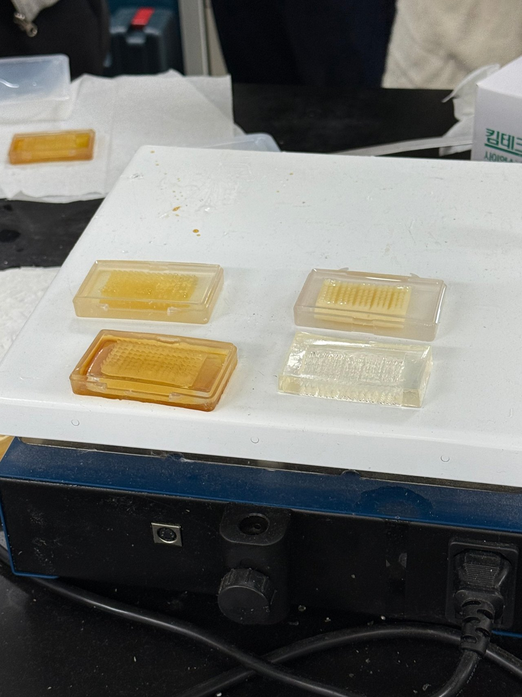 |

- `[수업]` PDMS는 열로 굳는 물질이다. ❓확인: 전사본 "한 100도씨 … 50도 이상에서는 …" — 수업에서 말한 온도가 불명확하다.
- 사진 확인: 오븐이 아닌 **핫플레이트** 위에 몰드 4개를 올려 굳힌다. 오른쪽 아래의 투명하고 무늬가 찍힌 블록은 다른 조가 올려 둔 것이다 (주인 확인).
- `[실습 관찰]` 우리 조는 핫플레이트에 올리는 데까지 했고, 굳은 PDMS를 떼어내지는 않았다 (주인 확인). 따라서 우리 조 결과물 사진·관찰은 없다.
- 핫플레이트 온도와 시간은 기록하지 못했다 (미확인).
- `[보충]` 제조사 기준 경화 조건: 25 °C 48시간, 100 °C 35분, 150 °C 10분 [D3]. 2007년판 데이터시트(Form No. 06-1009-01)는 100 °C 45분, 125 °C 20분으로 적어 판마다 다르고, 부품 크기·가열 속도에 따라 달라지는 첫 추정치라고 밝힌다 [D6]. 연구 프로토콜 중에는 60 °C 12시간 예도 있다 [R1].
- `[보충]` 경화 온도와 단단함: 25~200 °C에서 굳힌 SYLGARD 184의 영률은 1.32~2.97 MPa로, 경화 온도가 높을수록 거의 직선으로 커졌다 [J1]. 25 °C → 200 °C에서 약 2.25배다 (계산). 같은 재료라도 굳히는 온도가 기계적 성질을 바꾼다. 우리 조 핫플레이트 온도를 기록하지 못해 이 범위 중 어디인지는 모른다.

- 📷 캡처 필요 #1 — 해당 없음: 우리 조는 떼어내지 않았다
- 📷 캡처 필요 #3 — 핫플레이트 온도 표시나 다이얼
- 📷 캡처 필요 #4 (선택) — 시연에서 경화제가 위에 층으로 뜬 장면

## 5. 결과

| 단계 | 한 일 | 관찰·측정값 | 근거 |
|---|---|---|---|
| 계량 | 웨잉 디쉬 영점 → 베이스 → 영점 → 경화제 (10 : 1) | 베이스 15 g + 경화제 1.5 g 목표(약간 오차 가능). 디쉬 −2.5485 g, 경화제 넣는 중 0.6324 g | 사진·녹음·주인 |
| 혼합 | 스패출러로 수백 번 저음 | 기포로 뿌옇게 됨 | 사진·주인 |
| 탈포 | 진공 챔버, 넘치지 않게 기압 조절 | 투명, 기포 없음. 게이지 0~0.5 사이 | 사진·주인 |
| 붓기 | 준비된 몰드 위에 붓고 눌러 모양 잡기 | 돌기 사이 기포 → 팁으로 터뜨림 | 사진·주인 |
| 경화 | 핫플레이트에 올림 | 온도·시간 미기록. 우리 조는 탈형하지 않아 결과물 관찰 없음 | 사진·주인 |

## 6. 고찰 (보고서용 아이디어)

- **장비가 하나의 공정으로**: 2회차에 따로 배운 저울·진공 챔버·핫플레이트가 이번에는 "계량 → 혼합 → 탈포 → 성형 → 경화" 한 줄로 이어졌다.
- **열경화 vs UV 경화**: 4회차 PUA는 UV로 몇 분 만에 굳었고, PDMS는 열로 굳는다. 열경화는 시간이 더 걸리지만 두꺼운 덩어리도 속까지 굳는다(빛이 닿아야 하는 UV와 비교) — S4에서 근거 확인.
- **무게비 10 : 1과 점도**: 무게로 재는 이유(점도가 높아 부피로 재기 어렵다는 가설 — 확인 필요), 점도 순서대로 넣는 이유.
- **탈포의 균형**: 진공을 세게 걸수록 기포는 빨리 빠지지만 거품이 넘친다. 그래서 밸브로 조절했다.
- **틀 복제**: 돌기 무늬가 PDMS에 반대 모양으로 찍힌다. 4회차 "원판을 복제해 여러 번 쓰는 구조"와 이어진다.

## 7. 확인 필요 목록

- [x] 실습 날짜 2026-10-15, 마감 2026-10-29
- [x] 사진 13장 모두 우리 조, 계량·혼합은 주인 (주인 확인)
- [x] 분무기 액체 → 70 % 에탄올 (주인 확인)
- [x] 진행 순서 → 베이스 먼저 → 경화제 → 오래 젓기 → 진공 탈포(기압 조절) → 틀에 붓기·누르기·기포 터뜨리기 → 열경화 (주인 기억)
- [x] 우리 조 계량값 → 15 g + 1.5 g, 약간 오차 가능 (주인 기억 + 전사본)
- [x] 노란 돌기 판 → 실습용으로 준비된 몰드, 재질 모름 (주인 확인)
- [ ] 핫플레이트 온도·시간 → 미기록. 보고서 한계로
- [x] 결과물 → 우리 조는 탈형 안 함. 사진의 투명 블록은 다른 조 것 (주인 확인). 보고서 한계로
- [ ] 게이지 바늘 방향 (진공 쪽 눈금)
- [ ] 수업에서 말한 경화 온도 ("100도 / 50도 이상")
- [ ] PDMS 원제품 (SYLGARD 184?) — 4회차부터 이어진 미확인

## 참고 자료

모두 원문을 열어 해당 문장을 확인한 출처다. [D1]~[D3]은 4회차에서, 나머지는 이번(10-27)에 확인했다.

- [D1] MilliporeSigma, *SYLGARD 184 Silicone Elastomer Kit* (제품 페이지) — https://sigmaaldrich.com/product/aldrich/761036
- [D2] Brounstein Z., Zhao J., Geller D., Gupta N., Labouriau A., *Long-Term Thermal Aging of Modified Sylgard 184 Formulations*, Polymers 13(18), 3125 (2021) — https://www.mdpi.com/2073-4360/13/18/3125
- [D3] Dow, *SYLGARD 184 Silicone Elastomer Kit* (제품 페이지) — https://www.dow.com/en-us/pdp.sylgard-184-silicone-elastomer-kit.01064291z.html (경화 48 hr @ 25 °C, 35 min @ 100 °C, 10 min @ 150 °C / 점도 3500 cps)
- [D4] Dow Corning, *SYLGARD 184 Silicone Elastomer Base*, MSDS No. 02680068 (2001-11-13) — https://uwaterloo.ca/giga-to-nanoelectronics-centre/sites/default/files/uploads/files/sylgard_184_-_base.pdf (점도 5000 cSt, 비중 1.05, 성분·함량)
- [D5] Dow Corning, *SYLGARD 184 Silicone Elastomer Curing Agent*, MSDS No. 01015311, Ver. 1.6 (2008-12-17) — https://uwaterloo.ca/giga-to-nanoelectronics-centre/sites/default/files/uploads/files/sylgard_184_-_curing_agent.pdf (점도 110 cSt, 비중 1.03, 성분)
- [D6] Dow Corning, *Sylgard 184 Silicone Elastomer* 제품 정보, Form No. 06-1009-01 (2007) — https://www.cnfusers.cornell.edu/sites/default/files/Equipment-Resources/Sylgard_184_data_sheet.pdf (충분한 혼합·공기 최소화, 진공 붓기, 가사 시간 >2 h, 경화표, 경화 방해 물질)
- [J1] Johnston I. D., McCluskey D. K., Tan C. K. L., Tracey M. C., *Mechanical characterization of bulk Sylgard 184 for microfluidics and microengineering*, J. Micromech. Microeng. 24(3), 035017 (2014) — https://uhra.herts.ac.uk/id/eprint/3211/1/906746.pdf
- [V1] LACO Technologies, *Vacuum Degassing: Epoxy & Silicone*, Application Note 06-14 — https://lacotech.com/wp-content/uploads/2025/06/ANLVS-App-06-14_Vacuum-Degassing-Epoxy-and-Silicone-B1.pdf (부피 2~6배 팽창, 용기 여유)
- [R1] Qin D., Xia Y., Whitesides G. M., *Soft lithography for micro- and nanoscale patterning*, Nature Protocols 5(3), 491–502 (2010) — https://dash.harvard.edu/server/api/core/bitstreams/7312037e-0bf7-6bd4-e053-0100007fdf3b/content
- 2회차 참고: 저울 원리 §4-2, 진공 챔버 원리 §4-5 (labs/02 README)
