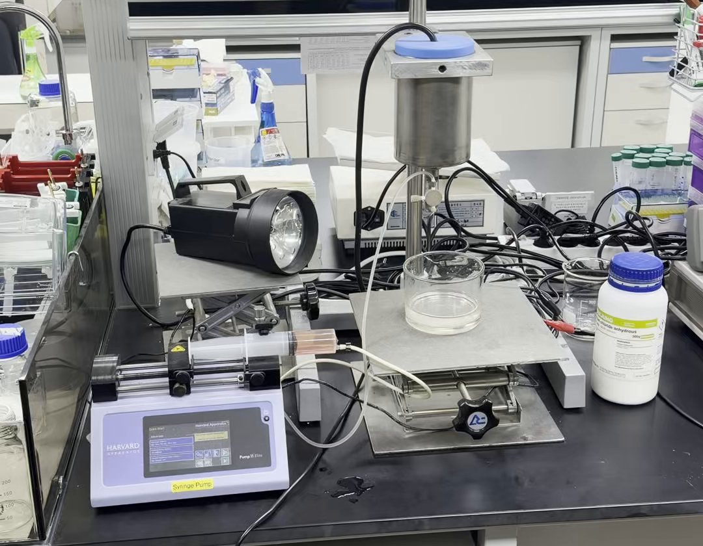
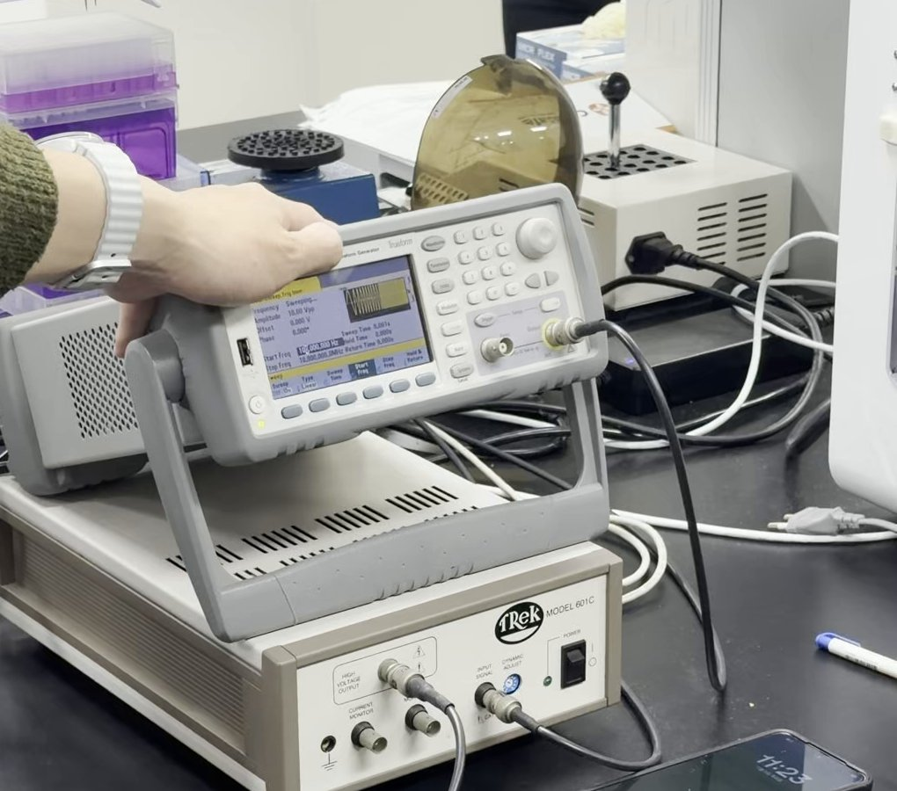
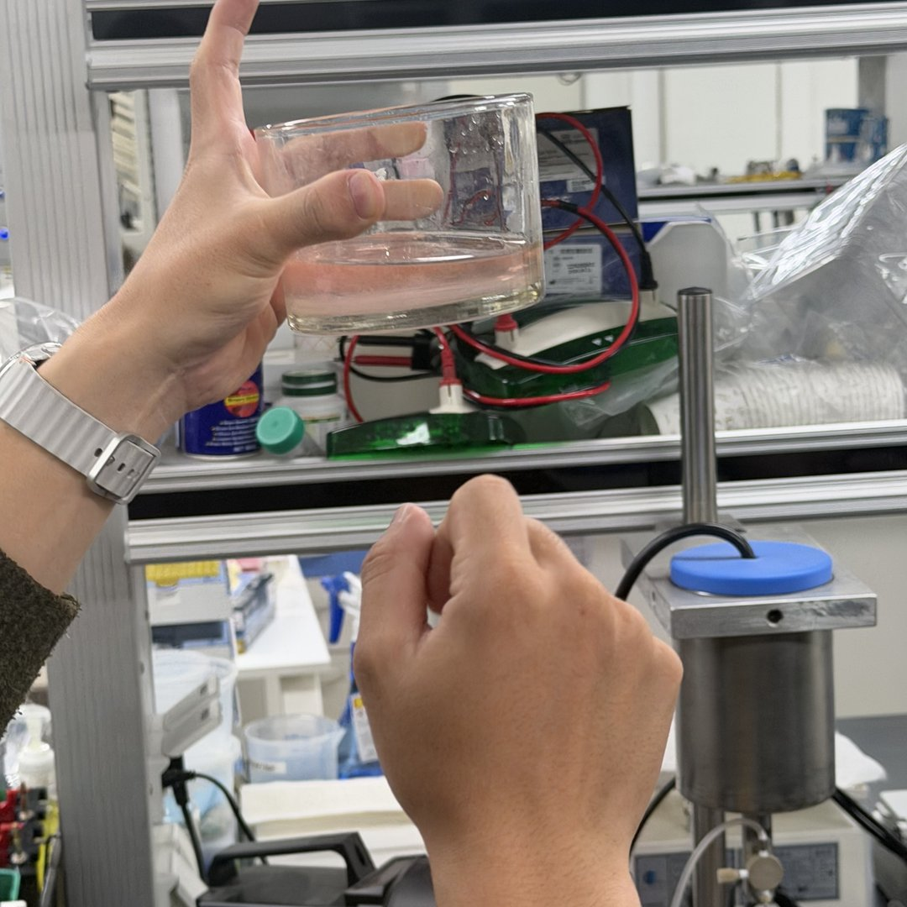
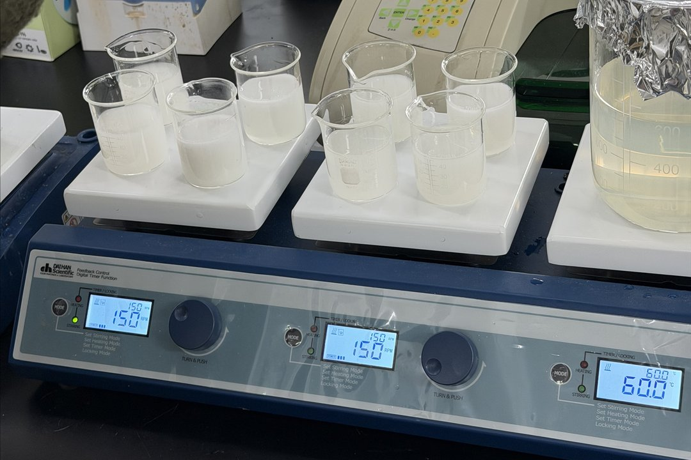
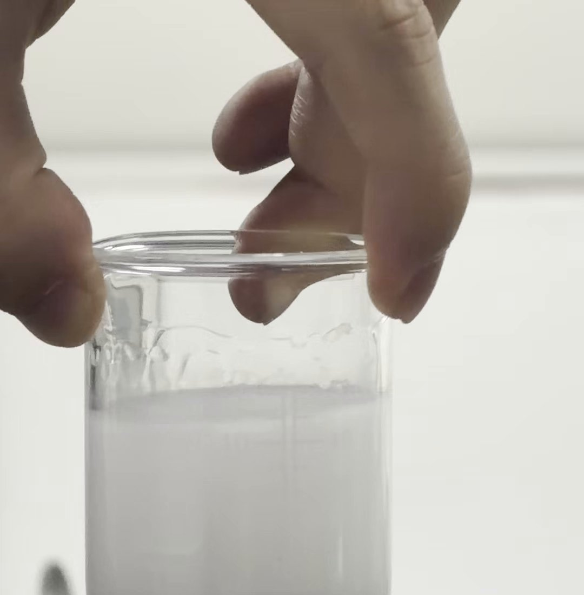
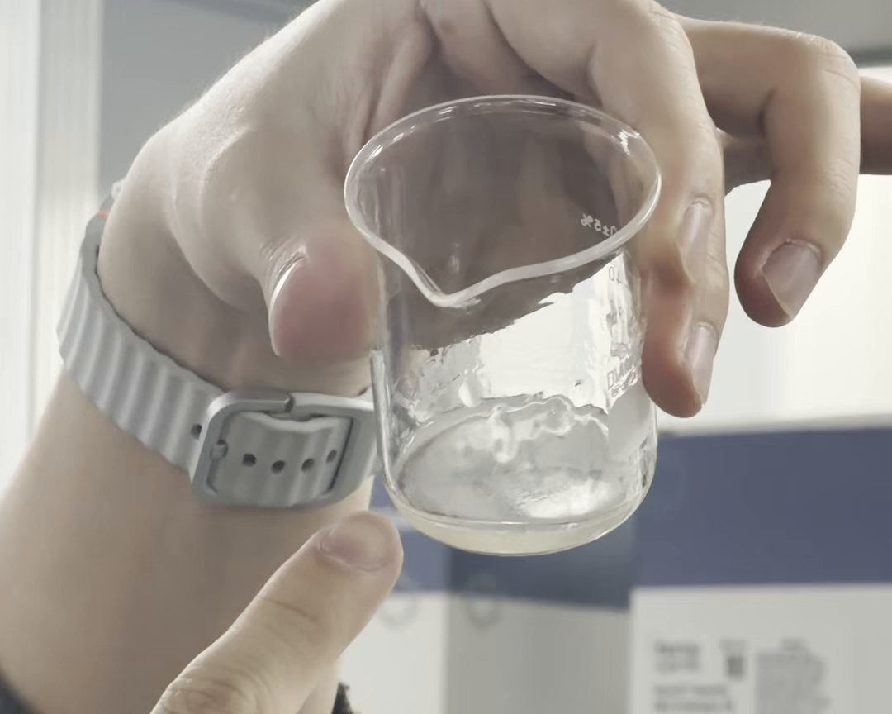
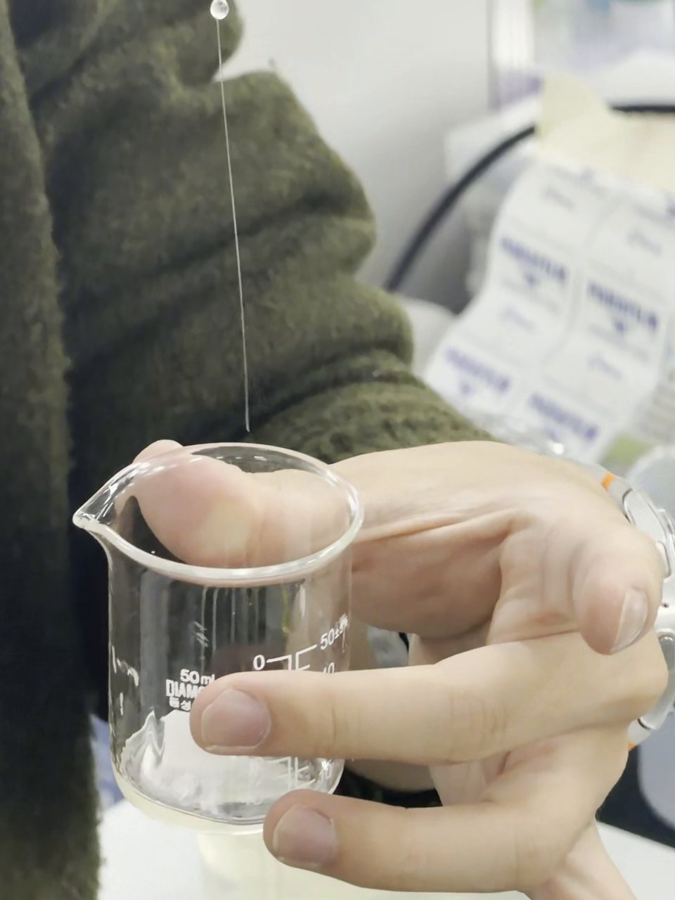
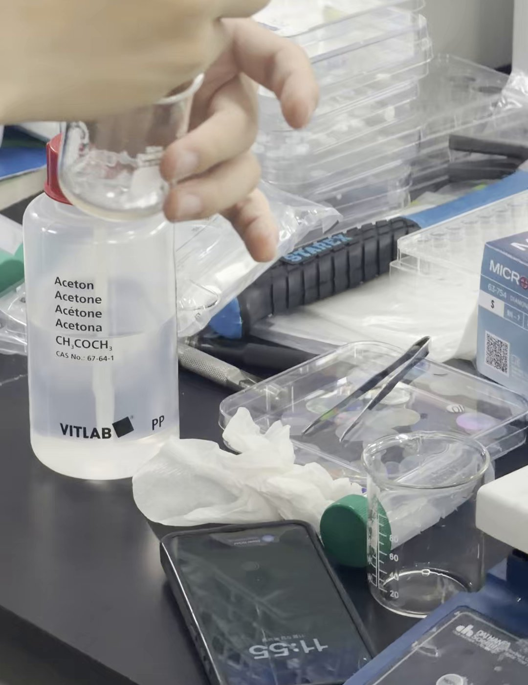
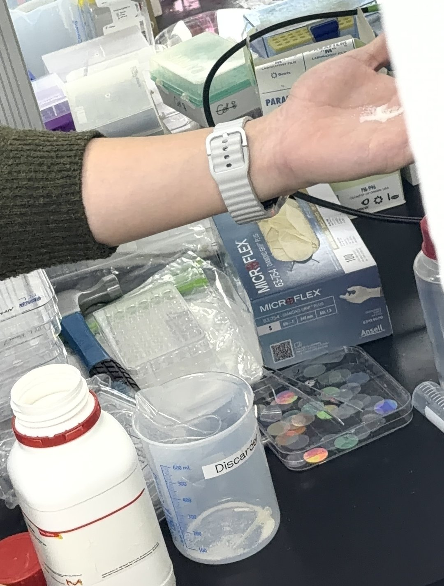

# 실습 06 — 마이크로·나노 입자 제조 (2026-11-05)

> 상태: 초안 (전사본 11-10 + 사진 4장·영상 11개 11-11) / 📷 캡처 자리 6개 중 4개 채움, 1개 부분, 1개 없음(#2 줄기 분열 장면은 영상에 없음)
> 사진은 영상 캡처·주인 사진에서 골랐다. 다른 학생·진행자 얼굴이 나온 컷은 쓰지 않았다.
> 진행: 이번 회차와 다음 회차는 김장호 교수 연구실 대학원생(입자 연구)이 진행한다.
> 보고서: 조별 1부, 진행자에게 메일 제출. **분량 제한 없음** (처음엔 최대 2쪽 → 11-10 공지로 변경). 마감 ❓
> 평가 기준(11-10 공지): 설명한 내용을 더 깊게 공부해 정리 + **이 플랫폼의 응용 연구·적용 분야 조사**를 녹여 쓰기. 의미 없는 분량 채우기, 같은 사진 여러 장은 피한다 `[수업]`.
> 범위: 다음 회차에 젤라틴 나노입자의 다음 단계를 보여 주고 전 과정 원리(pH를 맞추는 이유 등)는 그 보고서에서 다룬다 `[수업]`. 이번 기록은 2차 탈용매화 이후를 흐름만 적는다.

## 1. 실습 목적

- `[수업]` 마이크로·나노 공학 기술로 입자를 합성하고, 만든 입자에 조직과 생체 안의 여러 역할을 부여해 적용하는 연구를 소개한다.
- `[수업]` 이번 실습은 두 가지다. (1) PPF 장비로 마이크로 입자를 만드는 과정 시연 (2) 젤라틴 나노입자 제조 공정 중 첫 단계(고분자량 젤라틴 얻기) 직접 실습.
- `[수업]` 입자의 지름에 따라 용도·역할·효율이 달라지기 때문에, 목적에 맞게 크기를 조절해 일정하게 만드는 것이 핵심이다.

## 2. 공통 주의사항

- `[수업]` 젤라틴은 인체에 무해한 생체 고분자다.
- `[수업]` 나노입자 형태를 고정하는 가교제(글루타르알데하이드)는 실습에서 쓰기 위험해 이번에는 다루지 않았다.
- ❓확인 아세톤 취급(환기, 화기) 안내가 있었는지 — 전사본에는 없음.

## 3. 장비·재료 한눈에

| 장비·재료 | 이번 실습에서 한 일 | 핵심 원리 |
|---|---|---|
| PPF 시스템 | 알지네이트 용액을 노즐로 흘려 보내며 진동을 줌 (시연) | 진동이 액체 줄기를 일정한 간격으로 끊어 같은 크기의 방울을 만든다 |
| └ 파형 발생기 (Trueform 계열) | 진동 파형(주파수·진폭) 설정 | 신호를 만든다 |
| └ 증폭기 (TREK Model 601C) | 파형 신호를 받아 노즐 쪽으로 출력 | 신호를 큰 전압으로 키운다 (단자 이름 기준, 추정) |
| └ 시린지 펌프 (Harvard Apparatus Pump 11 Elite) | 빨간 용액이 든 주사기를 밀어 노즐로 보냄 | 일정한 유량 공급 |
| └ 노즐부 (스테인리스 원통 + 아래 노즐) | 받침대 위 유리 접시로 줄기를 내림 | 진동이 전달되는 곳 |
| └ 램프 (노즐 쪽을 비춤) | ❓ 용도 미확인 | ❓ 스트로보스코프로 추정 |
| 알지네이트 용액 (빨간색) | 노즐로 흘려 보낸 용액 | 갈조류 유래 음이온 고분자, Ca²⁺와 만나면 굳는다 [A1] |
| CaCl₂ 용액 | 방울이 떨어지는 유리 접시(챔버) | Ca²⁺를 공급해 이온 가교 [A1] |
| 젤라틴 용액 (노란색, 25 mL) | 비커에 미리 준비됨 | 콜라겐 가수분해물, 분자량이 넓게 섞여 있다 [G3] |
| 아세톤 (25 mL) | 세척병에서 눈금 실린더로 덜어 비커(50 mL)에 한 번에 부음 | 탈용매화제, 고분자량 젤라틴을 침전시킨다 [G1][G2] |
| 핫플레이트 교반기 (DAIHAN) | 비커를 올려 둠, 큰 비커는 60 °C 가열 | 젤라틴을 녹일 때 열을 준다 [G2] |
| 스패출러 | 덜 섞였을 때 저음 | — |
| 젤라틴 원료 분말 / 완성 나노입자 분말 | 손으로 만져 촉감 비교 | 입자 크기 차이를 간접 비교 |

## 4. 방법과 원리

### 4-1. PPF로 알지네이트 마이크로입자 만들기 (시연)

**장비 구성 `[수업]`**
- PPF = Precision Particle Fabrication. 정확하고 일정하게 입자를 만드는 시스템이다.
- 위쪽 장치(파형 발생기, waveform generator)에서 진폭(amplitude), 구동 시간 같은 변수를 맞춰 파형을 만들고, 아래쪽 장치가 그 파형대로 실제 진동(초음파 대역)을 만든다. 여러 선이 하나로 모여 노즐 쪽으로 진동이 전달된다.
- 진폭을 크게 하면 귀에 들리는 소리로도 만들 수 있다.

**사진으로 확인한 장비 구성**
- 사진 확인: 파형 발생기 화면에 "Trueform" 표기, Sweep(주파수 쓸기) 모드, Amplitude 10.00 Vpp, Offset 0.000 V, Sweep Time 0.001 s. 시작 주파수는 10,000 Hz(10 kHz)로 보이나 글자가 흐려 ❓. 이 설정이 입자를 만들 때 값인지, 소리를 들려 준 시연용 값인지는 알 수 없다 ❓.
- 사진 확인: 파형 발생기 출력선이 아래 TREK Model 601C의 INPUT SIGNAL 단자로 들어가고, 601C 앞면에 HIGH VOLTAGE OUTPUT·CURRENT MONITOR 단자가 있다. 파형 신호를 큰 전압으로 키워 노즐부로 보내는 증폭기로 보인다(추정, 매뉴얼 미확인).
- 사진 확인: 시린지 펌프(Harvard Apparatus Pump 11 Elite, "Syringe Pump" 라벨) 위 주사기에 빨간 용액이 들어 있고, 튜브가 노즐부로 이어진다. 전사본의 "용액을 준비해 주고 노즐로 천천히 흘러 들어간다"에서 흐름을 만드는 장치가 이 펌프다.
- 사진 확인: 노즐부는 받침대에 고정된 스테인리스 원통(파란 뚜껑, 케이블 연결)이고, 아래 노즐이 높이 조절 받침(lab jack) 위 유리 접시를 향한다. 오른쪽에 "...chloride anhydrous 500g" 병이 있어 CaCl₂(무수 염화칼슘)로 보인다(라벨 앞부분 가려짐).
- 사진 확인: 노즐 쪽을 비추는 검은 램프가 있다. 진동에 맞춰 깜빡이는 빛으로 떨어지는 방울을 멈춘 것처럼 보이게 하는 스트로보스코프로 추정되나 수업에서 설명은 없었다 ❓.
- 전사 정정: 전사본의 "화염", "파염"은 모두 "파형"의 오인식이다.

| (a) PPF 전체 구성 | (b) 파형 발생기와 증폭기 |
|---|---|
|  |  |
| (c) 시연 후 CaCl₂ 접시 | |
|  | |

- (a) 왼쪽 아래 시린지 펌프 → 튜브 → 가운데 노즐부 → 받침 위 유리 접시, 왼쪽 위 램프, 오른쪽 CaCl₂ 병. (b) 위가 파형 발생기, 아래가 TREK 601C. (c) 시연 뒤 접시 용액이 연분홍빛을 띤다. 빨간 알지네이트 입자가 퍼져 있는 것으로 보이며, 입자 하나하나는 사진에서 구분되지 않는다.

**사용 순서 `[수업]`**
1. 알지네이트 용액을 준비하고, 챔버에 CaCl₂ 용액을 담는다.
2. 파형 변수를 맞춘다.
3. 용액을 노즐로 천천히 흘려 보낸다. 진동을 주지 않으면 그냥 줄기로 흘러내리거나 뚝뚝 떨어진다.
4. 진동을 켜면 노즐 아래 일정 지점부터 줄기가 갈라지며 방울이 하나씩 만들어진다.
5. 방울이 CaCl₂ 챔버에 떨어지면 굳어서 입자가 된다. 챔버 위에 조금씩 떠다니는 것이 마이크로입자다(눈으로 잘 보이지는 않는다).

**원리 `[수업]`**
- 물이 뚝뚝 떨어질 때 방울마다 떨어지는 시간·무게·모양이 다르다. 그래서 그냥 떨어뜨려서는 일정한 입자를 만들 수 없다.
- 파형은 결국 진동이다. 내려오는 줄기를 진동으로 일정하게 "건드려" 주면 같은 크기의 방울로 끊어진다 (수업 비유: 진동으로 물방울을 썬다. 실제로 자르는 것은 아니다).
- 진동 조건을 바꿔 수 µm부터 수백 µm(눈에 거의 보일 정도)까지 입자 크기를 조절한다.

**원리 심화 — 진동이 어떻게 방울을 고르게 자르나 `[보충]`**

1. 줄기는 원래 끊어지려 한다. 액체는 표면장력 때문에 표면적을 줄이려 한다. 가늘고 긴 원기둥 줄기는 같은 부피의 방울 여러 개보다 표면적이 커서 불안정하다. 떨어지는 물줄기는 길이가 지름의 약 3.13~3.18배(거의 π배)를 넘으면 방울로 끊어진다(Plateau의 관찰) [P2].
2. 어떤 흔들림이 커지나. 줄기 표면에는 늘 작은 흔들림(물결)이 있다. 잘록한 부분은 표면장력 때문에 압력이 높아져 액체를 볼록한 쪽으로 밀어내고, 그래서 물결이 점점 깊어진다. 이렇게 커지는 물결은 파장이 줄기 둘레(2πa, a는 줄기 반지름)보다 긴 것뿐이다. 그중 가장 빨리 크는 물결이 결국 줄기를 끊고 방울 크기를 정한다 [P2]. 이 현상을 Plateau–Rayleigh 불안정성이라 한다.
3. 그냥 흘리면 왜 제각각인가. 자연 상태의 흔들림은 여러 파장이 무작위로 섞여 있어서, 끊어지는 간격과 방울 크기가 매번 조금씩 다르다. 수업에서 말한 "떨어지는 시간·무게·모양이 다르다"가 이것이다 `[수업]`.
4. 진동을 주면 왜 고르게 되나. 노즐을 주파수 f로 흔들면 줄기에 일정한 간격의 물결을 일부러 새긴다. 줄기 속도를 v라 하면 새긴 물결의 파장은 λ = v / f다. 이 λ가 위 2의 "커지는 범위" 안에 있고 진동이 충분히 세면, 새긴 물결이 무작위 흔들림보다 먼저 자라 줄기가 진동 한 주기마다 한 번씩 끊어진다. 그래서 방울이 모두 같은 크기가 된다. 잉크젯 프린터(연속식)도 압전 소자의 진동으로 잉크 줄기를 일정한 간격의 방울로 끊는 같은 원리를 쓴다 [P3].
5. 크기는 무엇이 정하나 (계산, 질량 보존). 한 주기에 방울 하나가 생기므로 방울 부피 = 유량 Q ÷ 주파수 f, 지름 d = (6Q / πf)^(1/3). 주파수를 8배 올리면 지름은 0.5배다. 진폭은 이 식에 없다. 진폭은 새긴 물결이 무작위 흔들림을 이길 만큼 센지를 정한다고 보는 것이 자연스럽다. 진행자의 "진폭을 줄이면 방울이 커진다"는, 진동이 약해 주기마다 끊어지지 못하면 두 주기 분량이 한 방울로 합쳐지는 등 큰 방울이 생긴다는 뜻으로 해석된다(추정, 원문 확인 필요).

**장비와 원리 연결 (사진 + 계산)**

| 식 속 변수 | 정하는 장비 |
|---|---|
| 유량 Q | 시린지 펌프 |
| 주파수 f | 파형 발생기 |
| 진폭 (끊어짐을 주기에 맞추는 세기) | 파형 발생기 Amplitude + 증폭기(TREK 601C) |
| 줄기 반지름 a (쓸 수 있는 f 범위를 정함) | 노즐 |
| 끊어짐이 주기에 맞는지 확인 | 노즐 쪽 램프 — 스트로보스코프라면 진동과 같은 주기로 깜빡여 방울이 멈춘 듯 보인다 (추정 ❓) |

- 계산 확인: Rayleigh의 비점성 줄기 분석식 ω² ∝ x(1−x²)I₁(x)/I₀(x) (x = 2πa/λ)을 코드로 최대화하면 x = 0.697, 가장 빨리 크는 파장 λ = 9.01a = 지름의 4.51배다. 이때 한 파장 분량이 방울 하나가 되면 방울 지름은 줄기 지름의 1.89배다. 커질 수 있는 가장 짧은 파장(λ = 2πa)이면 1.68배다. 즉 진동만으로 만드는 방울은 줄기 지름의 약 2배 근처다. (분석식 자체는 원문 미확인 ❓ — 위키 문서에서 식이 보이지 않았다)
- 계산 예시(가정값, 우리 장비 값 아님): 노즐 지름 100 µm, 유량 1 mL/min → 줄기 속도 약 2.1 m/s. 커지는 물결은 λ > 314 µm이므로 f < 약 6.8 kHz, 가장 빨리 크는 λ = 451 µm는 f ≈ 4.7 kHz. 이때 방울 지름 ≈ 189 µm. 식 d = (6Q/πf)^(1/3)로 5 kHz를 넣으면 185 µm로 맞는다.
- ❓ 수업의 "수 µm"까지 내리려면 줄기 자체를 노즐보다 가늘게 만들어야 한다(방울 ≈ 줄기 지름 2배이므로). PPF 원논문은 노즐 둘레에 다른 액체를 흘려 줄기를 잡아 늘이는 방식(carrier stream)을 쓴다고 알려져 있으나 원문을 열지 못해 확인 전이다 [P1].

**알지네이트가 굳는 원리**
- `[수업]` 알지네이트와 CaCl₂는 전하가 달라 만나면 정전기적으로 결합한다. (수업 중 진행자도 부호를 헷갈려 함)
- `[보충]` 알지네이트는 갈조류에서 얻는 음이온 고분자다. M(만누론산)과 G(굴루론산) 단위가 블록으로 이어진 사슬이며, Ca²⁺ 같은 2가 양이온은 G 블록에만 결합해 이웃 사슬의 G 블록끼리 이어 준다. 이를 egg-box 모델이라 한다 [A1].
- 정정: 결합하는 것은 CaCl₂ 분자 전체가 아니라 물에서 나뉜 Ca²⁺(양전하)이고, 알지네이트 쪽이 음전하다 [A1].
- `[보충]` CaCl₂는 가장 흔히 쓰는 이온 가교제이며 젤화가 빠르게 일어나 속도를 조절하기 어렵다 [A1]. 방울이 챔버에 닿는 순간 바로 굳어 방울 모양이 유지되는 것은 이 빠른 젤화 덕분으로 보인다(연결은 추정).
- `[보충]` 알지네이트 수용액을 CaCl₂ 수용액에 떨어뜨려 젤 비드를 만드는 방법이 실제 연구에서 쓰인다 [A1].

- 📷 #1 PPF 장비 전체 → 완료 (a)(b)
- 📷 캡처 필요 #2 — 진동을 켰을 때 노즐 아래 줄기가 갈라지는 장면 → 받은 영상에 없음. 보고서는 원리 그림으로 대신한다
- 📷 #3 챔버 속 입자 → 부분 (c), 입자 개별 식별 불가

### 4-2. 젤라틴 — 재료와 분자량

- `[수업]` 제품명은 "gelatin from porcine skin"(돼지 피부 유래). 복잡하게 얽힌 콜라겐을 가수분해(hydrolysis)해 한 가닥씩 떼어낸, 더 단순한 분자가 젤라틴이다. 연구에서는 젤라틴과 콜라겐을 거의 같은 물질로 보고 쓴다.
- `[수업]` 원료 분말은 모래 알갱이처럼 거칠다. 전자 현미경(SEM)으로 보면 암석 같은 덩어리 모양이다.
- `[보충]` 돼지 피부 젤라틴은 콜라겐을 산으로 처리해 얻으며 Type A로 분류한다. 돼지 피부 젤라틴의 겔 강도(Bloom)는 90~300 g 범위로 제품마다 다르다 [G3]. ❓확인 우리가 쓴 제품 번호·Type — 라벨 사진 필요.
- `[수업]` 대량으로 가수분해해 만든 것이라 저분자량부터 고분자량까지 분자량이 넓게 섞여 있다. 저분자량 젤라틴은 용액 안에서 안정성이 떨어져 서로 뭉치거나 가라앉아 나노입자가 만들어지지 않는다. 그래서 고분자량만 골라 쓴다.
- `[보충]` 2단계 탈용매화법을 처음 제안한 논문은 1차 탈용매화에서 저분자량 분획은 상등액에 남아 버려지고, 고분자량 분획이 침전되어 다시 녹여 쓰인다고 설명한다. 젤라틴의 분자량이 나노입자의 안정성에 결정적인 영향을 준다고 밝혔다 [G1].
- `[보충]` 젤라틴을 그대로 쓰면 큰 입자가 넓은 크기 분포로 생기고, 2단계 공정이 더 작은 나노입자를 만드는 데 효율적이라고 보고되었다 [G2].

### 4-3. 젤라틴 나노입자 전 과정 (흐름만, 다음 회차에서 상세)

1. `[수업]` 1차 탈용매화 — 아세톤을 빠르게 부어 고분자량 젤라틴만 침전시켜 얻는다 **(이번 실습)**
2. `[수업]` 침전을 다시 물에 녹인다.
3. `[수업]` pH를 산성으로 맞춘다. 젤라틴 표면이 양전하를 띠게 하려는 것이다.
4. `[수업]` 2차 탈용매화 — 아세톤을 1 mL씩 아주 천천히 넣는다. 분자 안정성을 유지하면서 젤라틴이 조금씩 뭉쳐 나노입자가 된다.
5. `[수업]` 가교(crosslinking) — 만들어진 입자를 그대로 두면 용액 안에서 다시 풀린다. 글루타르알데하이드로 화학 결합을 만들어 형태를 고정한다.
6. `[수업]` 원심분리(한 번에 약 40분)·건조로 정제해 분말로 만든다. 전체 약 5일, 첫 프로토콜만 75분 걸린다.

- `[보충]` 문헌 조건 비교 [G2]: 젤라틴 1.25 g을 물 25 mL에 녹이고 아세톤 25 mL를 넣어 침전 → 상등액 버림 → 고분자량 젤라틴을 물 25 mL에 다시 녹임 → pH 조절(pH 2.5가 최적) → 아세톤 75 mL 적가 → 25 % 글루타르알데하이드 250 µL로 12시간 가교. 1차 탈용매화의 젤라틴 용액 : 아세톤 = 25 mL : 25 mL(1 : 1)는 우리 실습과 같다. 원조 논문도 2차 탈용매화를 pH 2.5에서 했다 [G1].
- 범위 메모: pH 2.5에서 왜 양전하인지, 2차를 왜 천천히 하는지, 가교 화학은 다음 회차 보고서에서 다룬다.

### 4-4. 이번 실습 — 1차 탈용매화

**사용 순서 `[수업]`**
1. 진행자가 비커마다 젤라틴 용액 25 mL를 준비해 두었다.
2. 아세톤 25 mL를 **한 번에 빠르게**(1초 안에) 붓는다. 사진 확인: 아세톤 세척병(VITLAB, "Acetone CH₃COCH₃" 표기)에서 눈금 실린더로 덜어 50 mL 비커에 부었다(영상).
3. 붓자마자 용액이 우유색으로 바뀐다.
4. 3~5분 기다리면 바닥에 노란 침전이 모인다.
5. 위의 맑은 층(상등액)을 버린다.
6. 비커를 기울여 바닥에 모인 끈적한 젤라틴을 떼어낸다. 이것을 다시 물에 녹여 다음 공정에 쓴다.

- 사진 확인: 아세톤을 부은 비커들이 핫플레이트 교반기 위에 놓여 있고 교반기 화면은 150 rpm이다. 비커 안에 교반 막대가 있는지는 사진으로 보이지 않는다 ❓. 같은 교반기 세 번째 자리는 가열 모드 60.0 °C이고, 호일을 덮은 큰 비커에 연노란 액체가 들어 있다. 젤라틴을 녹이고 있는 원액으로 보인다(추정). 문헌도 젤라틴을 가열하며 물에 녹인다 [G2].
- 사진 확인: 상등액을 버린 비커 바닥의 침전을 스패출러로 들어 올리자 가늘고 긴 실처럼 늘어났다(영상). 수업에서 말한 "끈적끈적하게 올라온다"를 그대로 보여 준다.

| (a) 교반기 위 비커들 (150 rpm), 오른쪽 60 °C 원액 | (b) 아세톤을 부은 직후 우유색 |
|---|---|
|  |  |
| (c) 상등액을 버린 뒤 바닥에 남은 침전 | (d) 침전을 들어 올리면 실처럼 늘어남 |
|  |  |
| (e) 아세톤 세척병 | |
|  | |

**주의점 `[수업]`**
- 위에서 조금씩 부으면 두 액체의 물성이 달라 저절로 섞이지 않고 바닥에 젤라틴이 남는다. 실패는 아니며 스패출러로 섞어 주면 된다.

**원리 1 — 탈용매화란 무엇인가**
- `[수업]` 젤라틴이 물에 녹았다는 것은 용매(물)와 결합해 있다는 뜻이다. 아세톤을 넣으면 아세톤이 젤라틴에서 물 분자를 빼앗아 그 결합을 깬다. 용매를 떼어낸다는 뜻에서 탈용매화(desolvation)라 부른다. 물과 떨어진 젤라틴은 가라앉는다.
- `[보충]` 문헌에서도 아세톤(또는 에탄올)을 탈용매화제로 넣어 젤라틴을 침전시킨다 [G2].
- ❓출처 필요: 아세톤이 왜 물을 빼앗는지(물과는 잘 섞이지만 젤라틴은 녹이지 못하는 용매라 젤라틴 주변의 물이 아세톤 쪽으로 옮겨 가고, 펴져 있던 사슬이 접히며 서로 뭉친다)는 일반적인 설명이며 원문으로 확인할 자료를 찾는 중이다.

**원리 2 — 왜 고분자량부터 가라앉나**
- `[보충]` 결과: 고분자량은 침전, 저분자량은 상등액에 남는다 [G1].
- ❓출처 필요: 같은 용매 조건에서 사슬이 긴 고분자일수록 먼저 녹지 못하게 되어 침전한다는 일반 원리(분별 침전). 원리 자료 원문 확인 후 보충.

**원리 3 — 왜 우유색이 되나**
- `[수업]` 분자 사이 결합이 바뀌면 빛이 산란되는 정도가 달라져 우유색으로 보인다. 색 변화는 탈용매화가 진행되고 있다는 간접 관찰이다.
- ❓출처 필요: 녹아 있는 사슬은 너무 작아 빛을 거의 산란하지 않지만, 뭉친 덩어리가 빛의 파장과 비슷한 크기까지 커지면 빛을 여러 방향으로 산란해 탁하게 보인다는 일반 원리.

**원리 4 — 왜 한 번에 붓나 (2차와의 대비)**
- `[수업]` 1 : 1 비율로 전체가 고르게 섞여야 한다. 천천히 부으면 층이 나뉘어 일부 젤라틴이 반응하지 않고 남는다.
- `[수업]` 2차 탈용매화는 반대로 아주 천천히 넣는다. 1차는 분자량별로 나누는 단계이고, 2차는 입자를 만드는 단계라 목적이 다르다.

- 📷 #4 우유색 비커 → 완료 (b)
- 📷 #5 바닥 침전 → 완료 (c). 다만 상등액을 버린 뒤 모습이고, 버리기 전 층이 나뉜 장면은 없다. 사진에서 침전은 노랗다기보다 흰색에 가깝게 보인다(조명 영향일 수 있음)
- 📷 #6 끈적한 침전 → 완료 (d)

### 4-5. 완성 나노입자 분말 비교

- `[수업]` 원료 분말: 거친 모래 알갱이 느낌. 5일 공정 후 분말: 설탕처럼 흰색, 손에 잡히지 않을 정도로 고와서 문지르면 녹듯이 사라진다.
- `[수업]` 촉감으로 입자가 매우 작다는 것을 짐작할 수 있다. 전자 현미경으로 찍으면 둥근 나노입자가 보인다(진행자 설명, 이번에 사진은 못 봄).
- ❓확인 "노란색"이 원료 분말 색인지, 녹인 용액 색인지 — 전사 맥락이 애매함. 사진 (a)의 60 °C 원액은 연노란색이다.
- 사진 확인: 진행자 손바닥 위에 흰 고운 가루가 얇게 펴져 있다. 완성 나노입자 분말로 보인다(추정, 주인 확인 필요).

| 손바닥 위 흰 분말 |
|---|
|  |

## 5. 응용·적용 분야 (공지 요구 항목)

**젤라틴 나노입자**
- `[수업]` 진행자 연구실에서 입자에 조직·생체 내 역할을 부여해 적용한다. 학계에서 참신성과 활용성이 높게 평가된다고 함.
- `[보충]` 젤라틴은 생체적합성과 생분해성이 있고 면역 반응이 적으며, 미국 FDA가 GRAS(일반적으로 안전한 물질)로 분류한다 [G4].
- `[보충]` 콜라겐보다 결합에 쓸 수 있는 작용기가 많아 가교제나 표적 리간드를 붙이기 쉽고, 가교 정도로 약물 방출 속도를 조절할 수 있다 [G4].
- `[보충]` 응용: 약물 전달용 마이크로·나노입자, 단백질·성장인자 전달, 유전자 전달, 조직공학·재생의학 구조체, 상처 드레싱 [G4].

**알지네이트 마이크로입자**
- `[보충]` 이온 가교한 알지네이트 마이크로구는 단백질을 효율적으로 담을 수 있고, CaCl₂ 용액에 떨어뜨려 만든 비드를 단백질 경구 전달에 쓴 연구가 있다 [A1].
- ❓보충 예정: 세포 캡슐화, 조직공학 등 [A1]의 나머지 응용 절 (이번에 읽은 원문 범위가 잘림).

**PPF 플랫폼**
- ❓보충 예정: PPF 원논문 [P1]은 고분자 마이크로구의 크기를 정밀하게 제어해 크기 분포를 좁히는 방법이다. 크기가 고르면 약물 방출 거동을 설계하기 쉽다는 점이 핵심 응용으로 알려져 있으나, 원문을 열지 못해 확인 전이다.

## 6. 결과

| 단계 | 수행 내용 | 관찰 | 근거 |
|---|---|---|---|
| PPF 시연 | 시린지 펌프로 알지네이트 용액을 진동 노즐에 보내 CaCl₂ 접시에 떨어뜨림 | 진동을 켜자 노즐 아래 일정 지점부터 줄기가 갈라짐(녹음), 시연 뒤 접시가 연분홍빛(사진) | 녹음, 사진 01_ppf_* |
| 1차 탈용매화 | 젤라틴 용액 25 mL + 아세톤 25 mL 한 번에 | 즉시 우유색, 3~5분 뒤 바닥에 침전, 침전은 실처럼 늘어날 만큼 끈적함 | 녹음, 사진 02_gelatin_* |
| 분말 비교 | 원료 분말과 완성 나노입자 분말을 만져 봄 | 원료는 거칠고, 완성 분말은 희고 고와서 손에서 사라짐 | 녹음, 사진 03_powder_hand(추정) |

- ❓확인 우리 조에서 누가(몇 명이) 직접 부었는지, 우리 비커에서도 층이 생겼는지.

## 7. 고찰 (메모)

- 두 방법 비교: PPF는 방울을 먼저 만들고 이온 결합으로 굳힌다(위에서 아래로, 수~수백 µm). 젤라틴 탈용매화는 녹아 있던 분자가 뭉치며 입자가 된다(아래에서 위로, 나노 크기). 굳히는 방식도 이온 결합(Ca²⁺) 대 공유 결합(글루타르알데하이드 가교)으로 다르다.
- 공통점: 둘 다 "입자 크기를 고르게"가 핵심이고, 크기를 정하는 손잡이가 PPF는 진동·유량, 젤라틴은 분자량·아세톤 넣는 속도·pH다.
- 한계: 입자 크기를 직접 측정하지 않았다. 나노입자 이후 공정은 구두 설명과 완성품 촉감 비교뿐이다. PPF 변수(주파수·유량·노즐 지름) 값은 기록하지 못했다.

## 8. 확인 필요 목록

| # | 내용 | 결과를 바꾸나 |
|---|---|---|
| 1 | 보고서 마감일, 제출 형식(한글/메일 첨부 형식) | 예 |
| 2 | 진폭과 입자 크기의 관계 (진행자 설명 vs 계산식) | 예 — 원문 확인 |
| 3 | 줄기 분열은 위키 수준으로 확인(교과서·논문으로 교체 필요), 탈용매화 메커니즘·빛 산란 출처는 아직 | 예 — 원문 확인 |
| 4 | PPF 원논문 [P1] 원문, PPF·알지네이트 응용 | 예 — 응용 절 |
| 5 | 젤라틴 제품 번호·Type, 용액 농도 | 아니오(사진으로 확인되면 보충) |
| 6 | 노즐 지름·입자 만들 때 주파수, 알지네이트·CaCl₂ 농도 (장비 모델명은 사진으로 확인됨) | 아니오(한계로) |
| 7 | 우리 조 직접 수행 인원 | 아니오 |
| 8 | 아세톤 취급 안내 여부 | 아니오 |
| 9 | 손바닥 위 흰 가루가 완성 나노입자 분말인지 | 아니오(사진 설명만 바뀜) |
| 10 | 노즐 쪽 검은 램프가 스트로보스코프인지, 진동 중 방울을 보여 줬는지 | 아니오(장비 설명 한 줄) |
| 11 | 아세톤을 부은 뒤 3~5분 동안 교반했는지(150 rpm 화면) 그냥 두었는지 | 예 — 절차 문장이 달라짐 |

## 참고 자료

- [A1] Lee, K. Y., Mooney, D. J., 「Alginate: properties and biomedical applications」, Progress in Polymer Science 37(1), 2012, 106–126. https://pmc.ncbi.nlm.nih.gov/articles/PMC3223967 (2026-11-10 확인)
- [G1] Coester, C. J., Langer, K., von Briesen, H., Kreuter, J., 「Gelatin nanoparticles by two step desolvation — a new preparation method, surface modifications and cell uptake」, Journal of Microencapsulation 17(2), 2000, 187–193. https://doi.org/10.1080/026520400288427 (초록 확인 2026-11-10)
- [G2] Azarmi, S. 외, 「Optimization of a two-step desolvation method for preparing gelatin nanoparticles and cell uptake studies in 143B osteosarcoma cancer cells」, J Pharm Pharmaceut Sci 9(1), 2006, 124–132. https://sites.ualberta.ca/~csps/JPPS9(1)/Loebenberg.R(2)/nanoparticles.htm (2026-11-10 확인)
- [G3] Sigma-Aldrich, 「Gelatin from porcine skin, Type A (G1890)」, https://www.sigmaaldrich.com/product/sigma/g1890 (2026-11-10 확인)
- [G4] Milano, F. 외, 「Current Trends in Gelatin-Based Drug Delivery Systems」, Pharmaceutics 15(5), 1499, 2023. https://doi.org/10.3390/pharmaceutics15051499 (2026-11-10 확인)
- [P1] (원문 미확인 — 열기 실패) Berkland, C. 외, 「Fabrication of PLG microspheres with precisely controlled and monodisperse size distributions」, Journal of Controlled Release, 2001.
- [P2] Wikipedia, 「Plateau–Rayleigh instability」, https://en.wikipedia.org/wiki/Plateau%E2%80%93Rayleigh_instability (2026-11-11 확인) — 위키라 보고서에서는 교과서·논문으로 바꿀 것
- [P3] Wikipedia, 「Inkjet printing」 (Continuous inkjet 절), https://en.wikipedia.org/wiki/Inkjet_printing (2026-11-11 확인) — 위키
