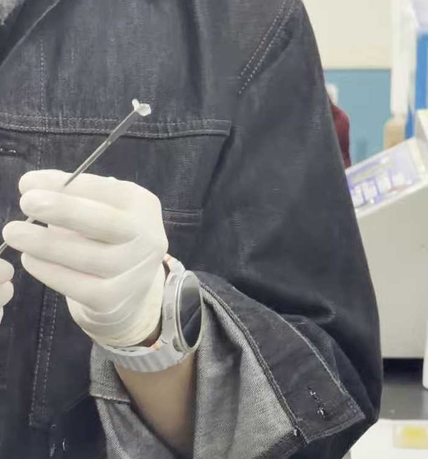
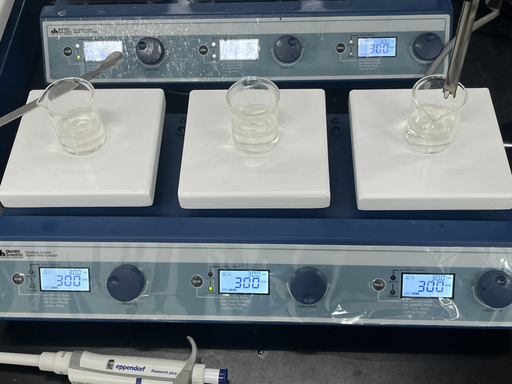
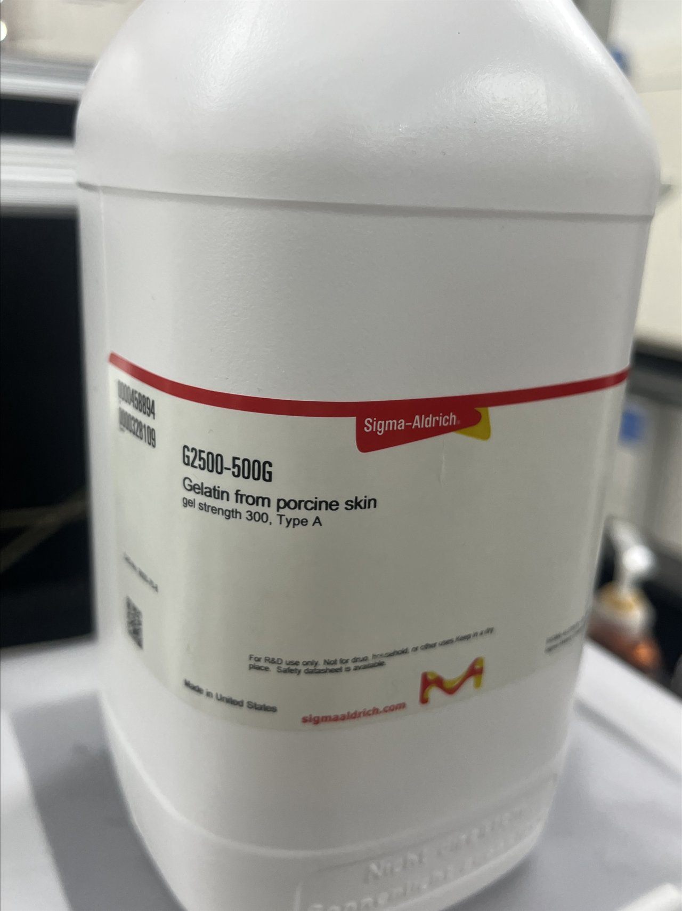

# 실습 07 — 젤라틴 나노입자: 고분자량 젤라틴 재용해와 pH 조절 (2026-11-12)

> 상태: 초안 (전사본 11-18 + 사진 6장·영상 11개 11-18) / 📷 캡처 자리 7개 중 5개 채움, 1개 부분, 1개 없음
> 사진은 주인 사진과 영상 캡처에서 골랐다. 다른 학생·진행자 얼굴이 나온 컷은 쓰지 않았다.
> 진행: 6회차와 같은 연구실 대학원생(입자 연구). 6회차에서 한 1차 탈용매화를 다시 하고, 그다음 단계(재용해 → pH 조절)까지 진행했다.
> 보고서: 조별 1부. 마감 **2026-11-19**. 분량 제한 없음, 양보다 질 `[수업]`. 제출 방식은 6회차(진행자 메일)와 같은지 ❓.
> 보고서 방향 `[수업]`: **pH 맞추는 부분을 중점으로**, 진행자가 단톡방에 올린 논문을 근거로 지난번보다 학술적으로, 세분화해서 정리한다. 논문에 "pH를 맞추는 것이 왜 중요한지"가 나와 있다.
> 논문: 주인이 다음에 전달 예정 → S4에서 반영.

## 1. 실습 목적

- `[수업]` 6회차에 1차 탈용매화를 눈으로만 봤다면, 이번에는 직접 얻은 고분자량 젤라틴으로 다음 단계를 하나 더 진행한다.
- `[수업]` 젤라틴 나노입자 합성은 며칠이 걸려 수업 시간에 전 과정을 다 보여 줄 수 없다. 할 수 있는 부분만 하나씩 보여 준다.
- `[수업]` 이번 회차의 핵심은 pH 조절이다. 전체 프로토콜에서 나노입자 합성의 성패를 가르는 가장 중요한 분기점 중 하나다.

## 2. 공통 주의사항

- `[수업]` 염산은 매우 위험한 물질이다. 고농도 산·염기는 항상 흄 후드 안에서 다룬다. (진행자 경험: 고농도 염산을 다루다 흡입해 병원에 간 적이 있음)
- `[수업]` 이번에 쓴 염산은 3 %로 묽혀 둔 것이라 아주 위험하지는 않지만, 손에 묻지 않도록 장갑을 끼고 다룬다.
- 사진 확인: 아세톤 병 라벨에 GHS 그림문자 세 개(인화성, 건강 유해성, 느낌표)와 "화기엄금"이 있다. 아세톤 병과 염산 튜브는 흄 후드 안에 두었다.

| 아세톤 병 라벨 (흄 후드 안) |
|---|
|  |

## 3. 장비·재료 한눈에

| 장비·재료 | 이번 실습에서 한 일 | 핵심 원리 |
|---|---|---|
| 젤라틴 (Sigma-Aldrich G2500, porcine skin, gel strength 300, **Type A**) | 1.25 g을 물 25 mL에 녹인 용액을 대량으로 만들어 25 mL씩 나눔 `[수업]` | Type A = 산 처리로 추출, 물에 녹이면 약산성 `[수업]` |
| 아세톤 | 젤라틴 용액에 1 : 1로 한 번에 부음 | 1차 탈용매화 (6회차) |
| 스패출러 | 가장자리 응집체를 긁어 보여 줌 | — |
| 핫플레이트 교반기 (DAIHAN, 3구) | 다시 녹인 젤라틴 용액을 300 rpm으로 저음 (사진) | — |
| pH 미터 (iSTEK NeoMet pH-200L) | 완충액으로 점검 → 젤라틴 용액 pH 측정 → pH 3.00 맞추기 | 전극으로 이온 농도를 재서 pH로 바꿈 `[수업]` |
| pH 표준 완충액 (4.01 / 7.00 / 10.00) | 7.00으로 점검(6.97). 3점 보정은 전날 해 둠 `[수업]` | 기준점 맞추기 (보정, calibration) |
| 전극 보관액 (istek Storage Solution R001000) | 측정하지 않을 때 전극을 담가 두는 용액 | 라벨 성분: KCl 15 %, 프탈산수소칼륨 0.5 %, 물 84.5 % (사진) |
| 묽은 염산 (HCl 3 %) | pH를 3.00까지 낮춤 | — |
| 수산화나트륨 (NaOH) | pH가 너무 내려가면 다시 올림 (시연 안 함) `[수업]` | — |
| 흄 후드 | 아세톤·염산 취급 | — |

## 4. 방법과 원리

### 4-1. 1차 탈용매화 다시 하기 + 가장자리 응집체 버리기

**사용 순서 `[수업]`**
1. 진행자가 젤라틴 1.25 g/물 25 mL 농도로 대량 용해해 둔 용액을 비커마다 25 mL씩 나눠 두었다.
2. 조마다 비커 세 개. 지난주에 직접 붓지 못한 사람이 먼저 부었다.
3. 아세톤을 1 : 1로 한 번에 빠르게, 과감하게 붓는다. 바로 탈용매화가 시작된다(우유색, 6회차와 같음).
4. 3~5분 기다리면 고분자량 젤라틴이 중력으로 바닥에 가라앉는다.
5. 비커 벽·가장자리에 젤처럼 뭉친 덩어리가 생겼으면 **버린다**.
6. 상등액을 따라 버리고 바닥의 고분자량 젤라틴만 남긴다.

**새로 나온 내용 — 가장자리 응집체(aggregation) `[수업]`**
- 실험을 하다 보면 비커 가장자리에 이미 뭉쳐서 젤 형태로 남은 덩어리가 생긴다. 많이 뭉쳐 있어서 고분자량처럼 보이지만 고분자량 젤라틴이 아니다.
- 생기는 이유(수업 비유): 땅에 기둥을 힘으로 박으면 그 부피만큼 흙이 옆으로 밀려난다. 아세톤을 한 번에 부으면 아세톤이 들어온 부피만큼 젤라틴 용액이 옆·위로 솟아오르면서 아세톤을 순간적으로 가둔다. 그러면 고분자량·저분자량이 섞인 용액이 그 자리에서 한꺼번에 응집한다.
- 결과: 무거운 분자만 가라앉혀 얻은 것이 아니라, 고분자량과 저분자량이 섞인 젤 구조 응집체다 (전사본 "쉘 구조"는 "젤 구조"의 오인식으로 추정 ❓).
- 이것도 젤라틴이라 물에 다시 녹긴 한다. 하지만 이걸로 다음 단계를 하면 나노입자가 절대 만들어지지 않는다. 진행자도 학부연구생 때 이걸 고분자량 젤라틴으로 알고 썼다가 실패했다. 나노입자로 모을 만큼 충분한 고분자량 젤라틴이 모이지 않은 상태였기 때문이다.
- 그래서 한 번에 빨리 붓되, 이 응집체가 최대한 생기지 않게 붓는 것도 필요하다. 생기면 바로 폐기한다.
- 한 번에 빨리 붓는 이유(6회차 복습): 급격히 탈용매화시켜 무거운 분자를 먼저 떨어뜨리기 위해서다. 가장자리 응집체는 이 방식의 부작용이다.

**사진으로 확인한 장면**
- 사진 확인 (영상): 아세톤을 부어 우유색이 된 비커의 가장자리를 스패출러로 긁어 보여 줬다. 스패출러 끝에 흰 젤 덩어리가 붙어 나왔다.
- 사진 확인 (영상): 상등액은 바닥의 폐액 통에 따라 버렸다.

| (a) 우유색 비커 가장자리를 긁음 | (b) 스패출러 끝의 흰 응집체 |
|---|---|
|  |  |
| (c) 상등액을 폐액 통에 버림 | |
|  | |

**원리 심화 `[보충]`** — S4에서 채움
- 가장자리 응집: 아세톤과 물이 고르게 섞이기 전, 아세톤이 국소적으로 몰린 곳(고농도 영역)에서 분자량 구분 없이 한꺼번에 침전하는 현상으로 해석 예정. 분별 침전은 비용매 농도가 고르게 올라가야 분자량별로 나뉜다는 6회차 [F1]과 연결.

- 📷 #1 가장자리 응집체 → 완료 (a)(b)

### 4-2. 고분자량 젤라틴을 다시 물에 녹이기

- `[수업]` 바닥에 남은 고분자량 젤라틴을 다시 물에 녹여 다음 단계를 준비한다. 녹는 동안 pH 미터 설명을 진행했다.
- 사진 확인: 다시 녹인 젤라틴 용액이 든 비커 세 개가 교반기 위에서 각각 300 rpm으로 돌고 있다. 용액은 맑고 옅은 노란빛이다. 오른쪽 비커에 pH 전극이 꽂혀 있다.
- 사진 확인: 흄 후드 안 교반기의 한 자리는 가열 모드 60.0 °C다. 다시 녹일 때 가열했는지는 수업에서 말하지 않았다 ❓. (문헌은 가열하며 녹임 [G2], 6회차 원액도 60 °C였음)
- 사진 확인: pH를 잴 때 화면 온도(ATC)가 29.8 °C였다. 상온보다 높아 데운 용액으로 보인다(추정).
- ❓ 다시 녹일 때 넣은 물의 양 (문헌은 25 mL [G2])

| 다시 녹인 젤라틴 용액 (300 rpm), 오른쪽 비커에 pH 전극 |
|---|
|  |

- 📷 #7 재용해 장면 → 완료

### 4-3. pH 미터 점검 (보정 확인)

**사용 순서 `[수업]`**
1. 전원을 켜고 **Meas** 버튼을 누르면 측정 상태가 된다.
2. 보관액에 담가 두었던 전극을 꺼내 pH 7.00 표준 완충액에 담근다.
3. 화면 값이 7에 가까운지, 아니라면 차이가 얼마인지 본다. 차이에 따라 오차를 조정한다.
4. 이번 측정값 **6.97**. 연구실 기준 허용 오차는 0.02~0.04 정도 `[수업]` → 정확하게 지시하는 상태로 판단.
5. 정석은 pH 7.00(중성), 4.01(산성), 10(염기성) 세 점으로 교차 검증하는 3점 보정(calibration)이다. 전날 미리 보정해 둬서 이번에는 7.00 확인만 했다.

- ❓ 6.97은 7.00과 0.03 차이로 진행자가 말한 허용 범위(0.02~0.04) 안이다. "0.02~0.04"가 허용 오차의 상한인지 범위인지는 전사본으로 애매하다.
- `[수업]` 원리: 전극으로 용액 속 이온의 양(농도)을 재서 그에 맞는 pH 값으로 바꿔 준다.
- `[수업]` 측정 단자를 "노드"라고 불렀으나 전극(probe)을 말한 것이다.

**사진으로 확인한 장비**
- 사진 확인: 본체는 iSTEK NeoMet pH-200L. 버튼 Meas·Cal·Select·Out·Mode·Setup·Memory·Slope. 화면에 측정값, ATC(자동 온도 보상) 온도, 날짜(26-11-12)가 나온다. → 2회차 ❓ "pH 미터 모델명" 해결.
- 사진 확인: 선반에 "Technical Buffer Solution pH 4.01"과 "pH 10.00 MADE IN SWITZERLAND" 병이 있다. → 2회차 ❓ "pH 10 쪽 표준용액 값"은 이 연구실 기준 10.00. 제조사는 라벨이 가려 확인 못 함 ❓.
- 사진 확인 (영상): pH 7.00 완충액은 초록색 액체이고, 파란 라벨 병에서 튜브에 덜어 전극을 담갔다.
- 사진 확인 (영상): 전극 보관액 라벨 — istek Storage Solution R001000, 475 mL, 5~25 °C 보관, 성분 프탈산수소칼륨 0.5 %·염화칼륨 15 %·물 84.5 %.
- 사진 확인: 전극은 검은 스탠드 팔에 고정해 비커에 내린다.
- 사진 확인: 선반에 "GNP" 라벨이 붙어 있다. Gelatin NanoParticle의 약자로 보인다(추정).

| (a) 작업대 전체 — 선반에 4.01·10.00 완충액, 전극 스탠드 | (b) pH 7.00 완충액(초록)에 전극을 담금 | (c) 전극 보관액 라벨 |
|---|---|---|
|  |  |  |

**원리 심화 `[보충]`** — S4에서 채움 (2회차 4-3 원리 재사용 + 보강)
- 유리전극·기준전극, 네른스트 기울기(25 °C 59.16 mV/pH), 온도에 따라 기울기가 바뀌는 이유 → ATC
- 보관액에 KCl을 쓰는 이유 (기준전극 내부액과 같은 성분, 유리막 수화층 유지)
- 3점 보정이 측정 범위(우리 목표 pH 3)를 감싸야 하는 이유 — 3.00은 4.01 밖이라 외삽이 된다

- 📷 #3 pH 미터·전극·완충액 → 완료 (a)(b)
- 📷 #4 pH 7.00에서 6.97 화면 → 없음 (영상 속 화면은 흐려서 숫자를 못 읽음)

### 4-4. 젤라틴 용액 pH 측정 → pH 3.00으로 맞추기

**사용 순서 `[수업]`**
1. 다시 녹인 고분자량 젤라틴 용액에 전극을 담가 pH를 잰다. 값이 바로 떨어지며 자리를 잡는다.
2. 처음 pH는 **5 후반**(5.5~5.6 정도)이 나오면 정상이다. (진행자가 처음 "4.5~5.5"라 했다가 "4.5까지는 안 가고 5~6 사이"로 고침)
3. 3 % 묽은 염산을 조금씩 떨어뜨려 pH를 **3.00**으로 맞춘다. pH 미터가 소수점 둘째 자리까지 보여 주므로 3.00에 최대한 맞춘다.
4. 너무 많이 넣어 2점대로 떨어지면 수산화나트륨(NaOH)을 넣어 다시 3점대로 올린다 (시연 안 함).

- `[수업]` 생물 분야에서는 0.001 단위까지 맞추기 어려워서 소수점 둘째 자리까지 맞추는 프로토콜을 쓴다.
- 사진 확인: 시연 중 pH 화면이 **2.08**(ATC 29.8 °C, 26-11-12 12:31)을 가리켰다. 전사본의 "제가 너무 많이 떨어지셨네요… 2점대로 떨어지면" 장면과 맞는다. 이후 3.00으로 되돌린 화면은 사진에 없다.
- 사진 확인: 흄 후드 안 튜브 거치대에 초록 뚜껑 원심관("HCL" 표기)과 pH 시험지 롤이 있다.
- 사진 확인 (영상): 흄 후드 안에서 초록 뚜껑 원심관과 피펫(1000 µL 계열)을 들고 비커 쪽에서 작업하는 장면이 있다. 염산을 덜어 넣는 장면으로 보이나, 비커 용액이 우유색이라 어느 단계 비커인지 확실하지 않다 ❓.

**젤라틴이 약산성인 이유 — Type A와 Type B `[수업]`**
- 젤라틴은 콜라겐을 가수분해해 추출한다. 가수분해 방식과 환경(산성/염기성)에 따라 젤라틴의 성질이 달라진다.
- 산성(acid) 조건에서 추출한 것이 **Type A**, 염기성(base) 조건에서 추출한 것이 **Type B**다.
- 우리가 쓴 제품은 Type A라서 물에 녹이면 약산성이다.
- 사진 확인: 제품 라벨 "Sigma-Aldrich G2500-500G, Gelatin from porcine skin, gel strength 300, Type A". → 6회차 ❓ "제품 번호·Type" 해결 (6회차 기록은 G1890을 근거로 달았음 → G2500으로 출처 교체 필요).

| (a) 젤라틴 제품 라벨 | (b) 흄 후드 — 아세톤 병, HCl 원심관, pH 시험지 | (c) 피펫으로 작업하는 장면 | (d) pH 2.08 화면 |
|---|---|---|---|
|  |  |  |  |

**왜 pH를 맞추나 `[수업]`** (이번 회차 핵심)
- 젤라틴 나노입자는 생체적합성·무독성·생분해성이 있고 조직·세포(동식물 모두)에 대한 접착력이 있으며 생체에 이미 있는 물질이라 쓰임새가 좋다. 그러려면 나노입자가 잘 합성되어야 하고, 그 합성에서 pH 조절이 가장 중요하다.
- 모든 젤라틴 분자는 고유한 전하량을 가진다. 전하량이 달라지면 분자 사이, 입자 사이의 거동과 결합 방식이 달라진다.
- **pH가 낮아져 전하량이 많아지면** (예: 모두 + 전하): 같은 전하끼리 밀어내 잘 결합하지 못한다. 입자 크기가 매우 작아지거나 아예 형성되지 않는다.
- **중성에 가까우면**: 강산성일 때보다 전하량이 훨씬 적다. 아세톤을 넣어 물과의 결합이 끊어지는 순간 분자끼리 와르르 뭉쳐 버린다 → 응집(aggregation). 눈에 보이는 순간 이미 나노입자가 아니다.
- 그래서 전하량이 너무 많지도 적지도 않은 **중간 조건**을 찾아야 나노 크기 입자가 생긴다. 그 조건이 이 프로토콜에서는 pH 3.00이다.
- pH를 정확히 맞춘 뒤 젤라틴 분자를 하나하나 결합시켜 가는 것이 나노입자 합성에서 가장 중요한 단계다. 자세한 내용은 공지 논문에 있다.

**수업 후 질의응답 `[수업]`**
- 질문: 나노입자를 만들려면 "중성 조건"을 맞춰야 한다고 이해했는데 왜 3으로 내리나?
- 답: 진행자가 말한 중성은 pH 7이다. 중성에 가까워질수록 응집이 더 잘 되는데, 응집되면 안 된다. 나노입자는 용액 안에서 나노입자 상태로 남아 있어야 이후 가교제 등으로 나노 크기에 고정할 수 있다. 응집은 눈에 보일 만큼(끈적한 덩어리 수준) 뭉치는 것이라 입자라고 부르기 어렵다.
- 논문 그래프(진행자 설명): pH 3을 기점으로 그래프가 뾰족하게 꺾인다. 3.0 → 4.0 쪽은 완만해서 괜찮고, 3.0 → 2.0 쪽은 급격히 떨어진다. 그래서 3.2는 괜찮고 2.8은 안 된다. 실험 결과에서 나온 프로토콜이다.
- ❓ 그래프의 세로축이 무엇인지(전하량, 합성 수율, 입자 크기 중 무엇인지) 전사본으로는 알 수 없다 → 논문으로 확인.

**원리 심화 `[보충]`** — S4에서 채움 (논문 + 원문 출처)
- 젤라틴의 등전점(pI): Type A는 높고 Type B는 낮다 → 진행자의 "중성에 가까우면 전하가 적다"는 Type A의 등전점이 중성 근처라서 성립하는 말로 정리 예정
- pH와 아미노기(–NH₃⁺)·카복실기(–COO⁻) 해리, 순전하(net charge)
- 정전기 반발과 탈용매화의 균형 → 입자 크기 (6회차: 아세톤으로 유전율이 낮아지면 같은 전하 사이 힘이 세짐)
- 왜 3 아래는 급격히 나빠지고 위는 완만한가 → 논문 데이터로
- 6회차 문헌([G1][G2])의 최적 pH 2.5 vs 이번 프로토콜 3.0 — 젤라틴 제품(Bloom·Type)이나 측정 지표 차이 등, 논문을 보고 비교

- 📷 #2 제품 라벨 → 완료 (a)
- 📷 #5 젤라틴 처음 pH(5 후반) 화면 → 없음
- 📷 #6 염산 떨어뜨리는 장면/최종 3.00 화면 → 부분 (b)(c)(d), 최종 3.00 화면은 없음

### 4-5. 전 과정에서 이번 단계의 위치

1. 1차 탈용매화 — 6회차, 이번에 반복
2. 고분자량 젤라틴 재용해 — **이번**
3. pH 조절 (3.00) — **이번**
4. 2차 탈용매화 — 아세톤을 천천히 넣어 나노입자 형성 (6회차 설명, 아직 실습 안 함)
5. 가교(글루타르알데하이드) → 6. 원심분리·건조

## 5. 결과

| 단계 | 수행 내용 | 관찰·측정값 | 근거 |
|---|---|---|---|
| 1차 탈용매화 | 젤라틴 1.25 g/25 mL 용액 + 아세톤 25 mL 한 번에 | 우유색, 바닥 침전. 가장자리에 흰 젤 응집체가 생겨 폐기 | 녹음, 영상 |
| 재용해 | 고분자량 젤라틴을 물에 다시 녹임 | 맑은 옅은 노란 용액, 300 rpm 교반 | 사진 |
| pH 미터 점검 | pH 7.00 완충액 측정 | 6.97 (허용 오차 0.02~0.04 안) | 녹음 |
| 젤라틴 pH | 재용해 용액 측정 | 5 후반 (약 5.5~5.6) | 녹음 |
| pH 조절 | 3 % HCl 적가 → 목표 3.00 | 과적가로 2.08까지 내려간 화면 확인(ATC 29.8 °C). 이후 NaOH로 되돌리는 과정은 시연 안 함 | 사진, 녹음 |

- ❓ 우리 조가 직접 한 범위 (아세톤 붓기는 했는지, pH 조절은 진행자 시연만인지)

## 6. 고찰 (메모)

- pH 조절의 의미: 전하로 반발력의 크기를 정해 두고, 2차 탈용매화에서 아세톤이 물을 걷어 낼 때 분자들이 "조금씩만" 모이게 하는 장치. 1차는 분자량을 고르는 단계, pH 조절은 2차의 뭉치는 속도를 정하는 단계.
- "중성 = 응집" 오해: Q&A에서 나온 쟁점. 응집이 일어나는 기준은 pH 7이 아니라 젤라틴의 등전점이다(S4에서 근거). Type B 젤라틴이었다면 같은 논리로 다른 pH를 골라야 한다.
- 2.08로 과적가된 장면: pH 3 아래가 급격히 나빠진다는 논문 설명과 연결 → 적가는 왜 조금씩, 왜 NaOH 되돌림이 필요한지. 다만 되돌리면 Na⁺·Cl⁻ 이온이 늘어난다(이온 세기 영향 — S4에서 근거 찾을 것, 없으면 뺌).
- 가장자리 응집체: "한 번에 빨리"와 "고르게 섞기" 사이의 균형. 6회차의 원리 4(왜 한 번에 붓나)를 보완하는 관찰.
- 한계 메모: 입자 크기·전하(제타 전위)를 직접 측정하지 않았다. pH 3.00 결과가 나노입자 크기에 주는 영향은 논문 데이터에 기대 판단한다. 2차 탈용매화 이후는 실습하지 않았다.

## 7. 확인 필요 목록

| # | 내용 | 결과를 바꾸나 |
|---|---|---|
| 1 | 공지 논문 PDF (pH 그래프 세로축, 최적 pH 근거) | **예** — 보고서 핵심 |
| 2 | 제출 방식 (6회차처럼 진행자 메일인지) | 형식만 |
| 3 | 우리 조가 직접 한 범위 | 아니오 (결과 표 문장) |
| 4 | 재용해할 때 가열 여부·물 양 | 아니오 (절차 한 줄) |
| 5 | 영상 속 흄 후드 피펫 장면이 HCl 적가인지 | 아니오 (사진 설명) |
| 6 | "쉘 구조" = "젤 구조"인지 | 아니오 |
| 7 | 완충액 제조사 | 아니오 |

## 전사 오인식 정정

탄용매화·산용매화·탄력회화 → 탈용매화 / 곱분자랑·뽑자량·호분량·구분자량·오분자랑 → 고분자량 / 단어파티들 → 나노파티클 / 피커 → 비커 / 구어·구워 → 부어 / 제일 형태 → 젤 형태 / 노드 → 전극(probe) / 매저 → Meas(측정) / 5차·차범위 → 오차·오차 범위 / pH 벡터·PH 터·pHm터 → pH 미터 / 침질 → 침지(담금) / 연기성 → 염기성 / 4성 → 산성 / 전화량 → 전하량 / 수산 아트리움 → 수산화나트륨 / 나눠 파티클 학성 → 나노파티클 합성 / 저착력 → 접착력 / 수음에게 → 수용액에서 / 고구소 → 보고서 / 최지T → ChatGPT / 탁구한 고생 → 학부연구생(추정)

## 참고 자료

- [G1] Coester, C. J. 외, 「Gelatin nanoparticles by two step desolvation — a new preparation method, surface modifications and cell uptake」, Journal of Microencapsulation 17(2), 2000, 187–193. https://doi.org/10.1080/026520400288427 (6회차에서 초록 확인)
- [G2] Azarmi, S. 외, 「Optimization of a two-step desolvation method for preparing gelatin nanoparticles and cell uptake studies in 143B osteosarcoma cancer cells」, J Pharm Pharmaceut Sci 9(1), 2006, 124–132. https://sites.ualberta.ca/~csps/JPPS9(1)/Loebenberg.R(2)/nanoparticles.htm (6회차 확인)
- [F1] Hadermann, A. F., 「Polymer fractionation」, US Patent 4,510,304. https://patents.google.com/patent/US4510304 (6회차 확인)
- (S4에서 추가) 공지 논문, Sigma-Aldrich G2500 제품 정보, 젤라틴 등전점 근거, pH 전극 원리(2회차 Metrohm·USGS 재확인)
