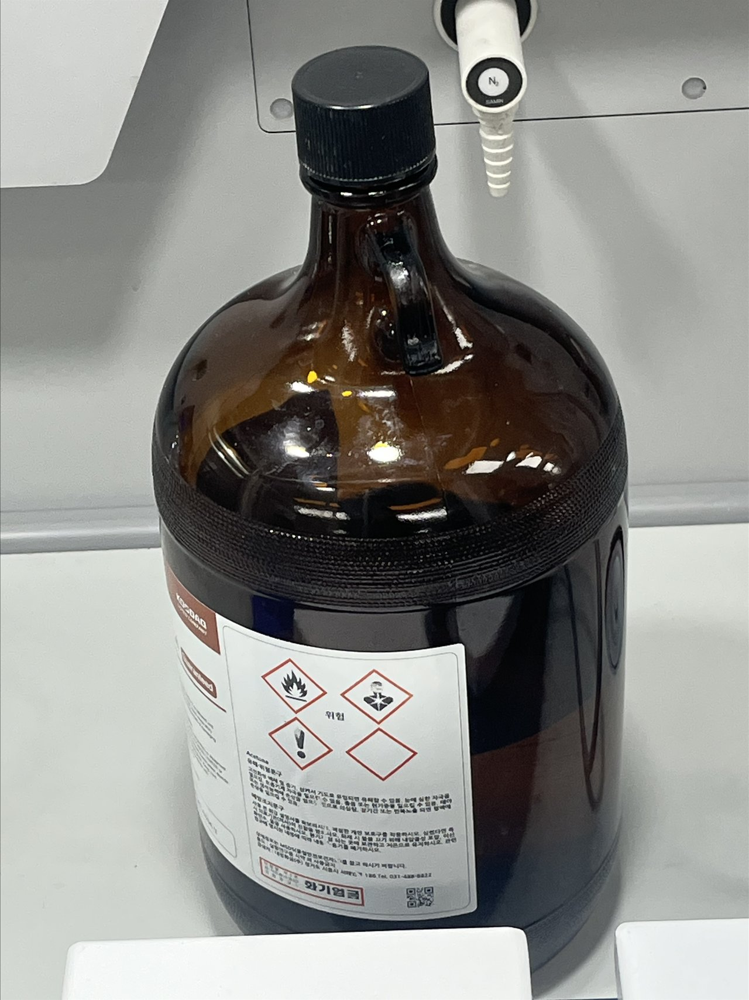
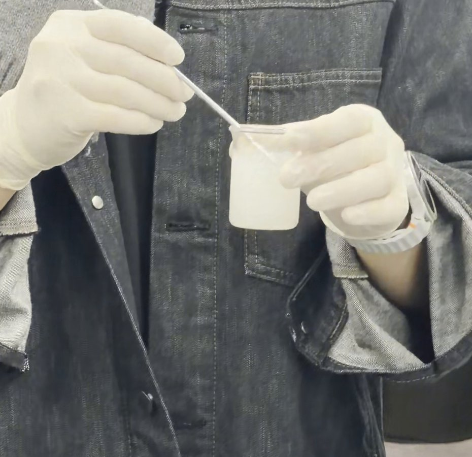
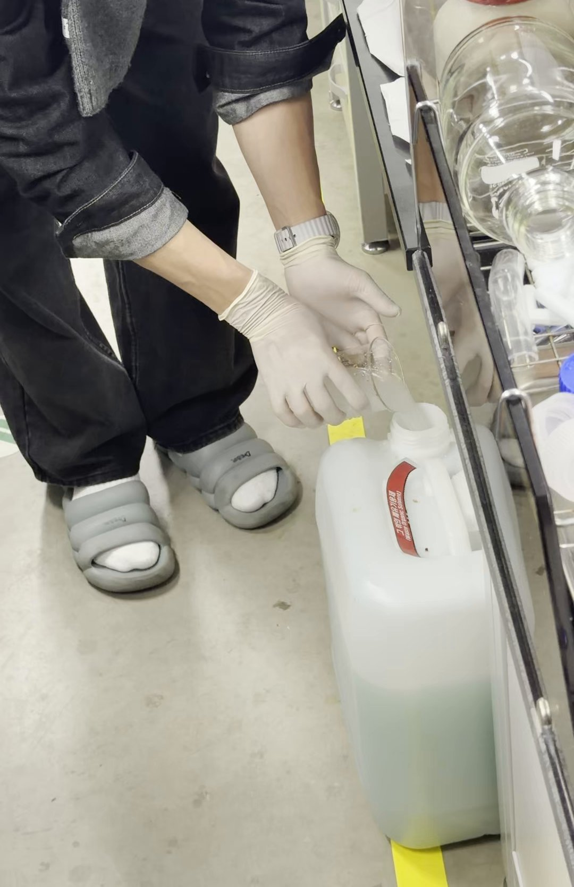
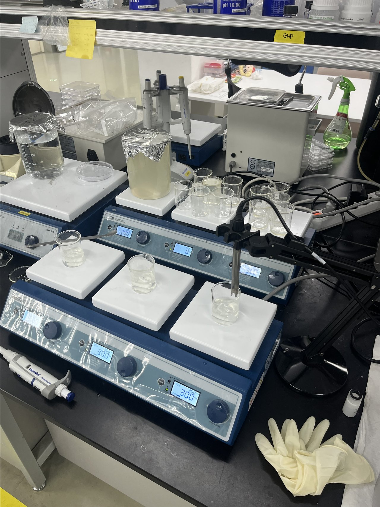
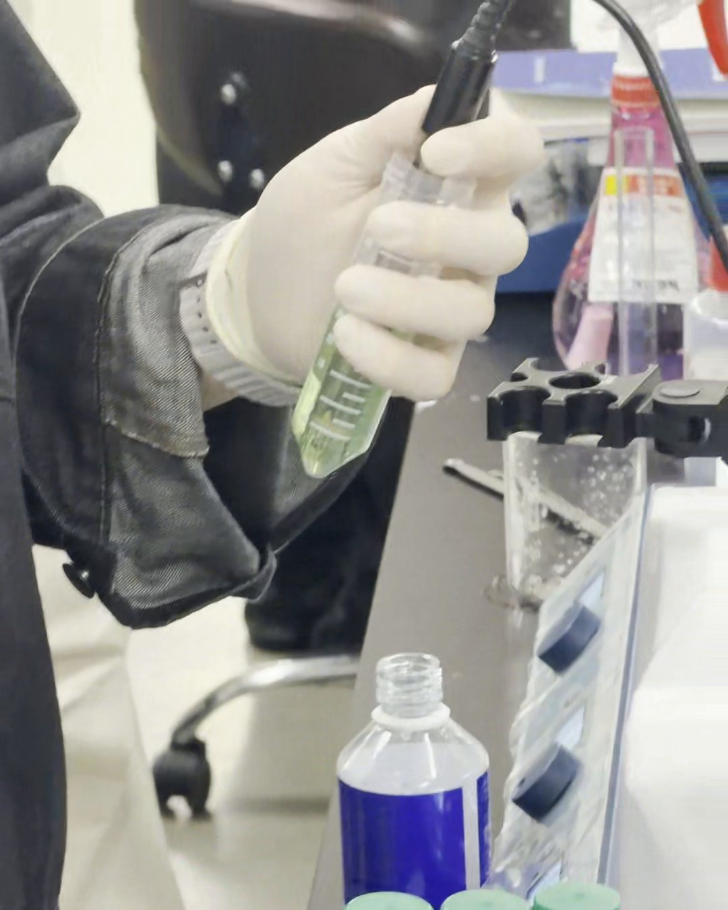
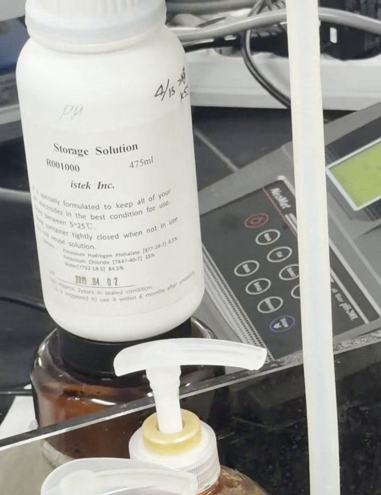
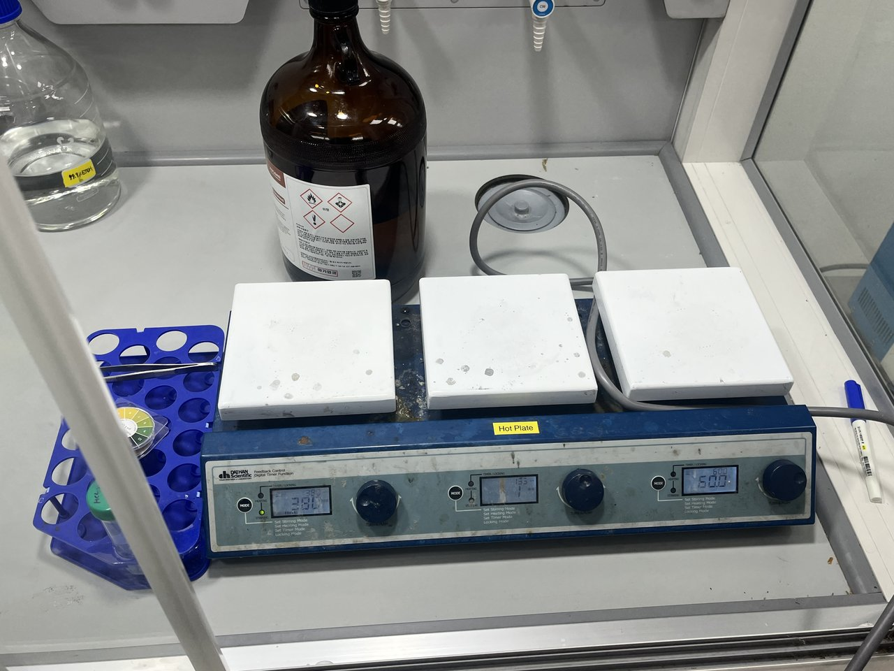
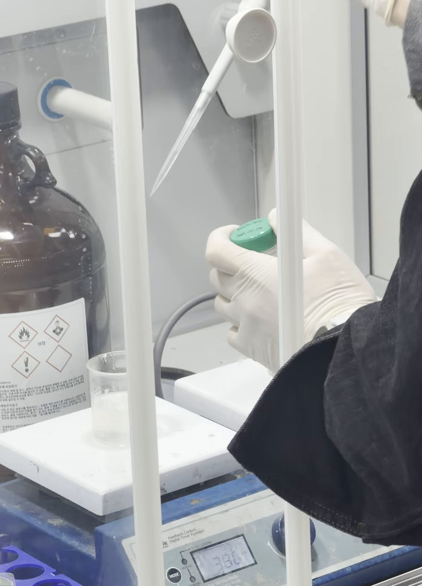
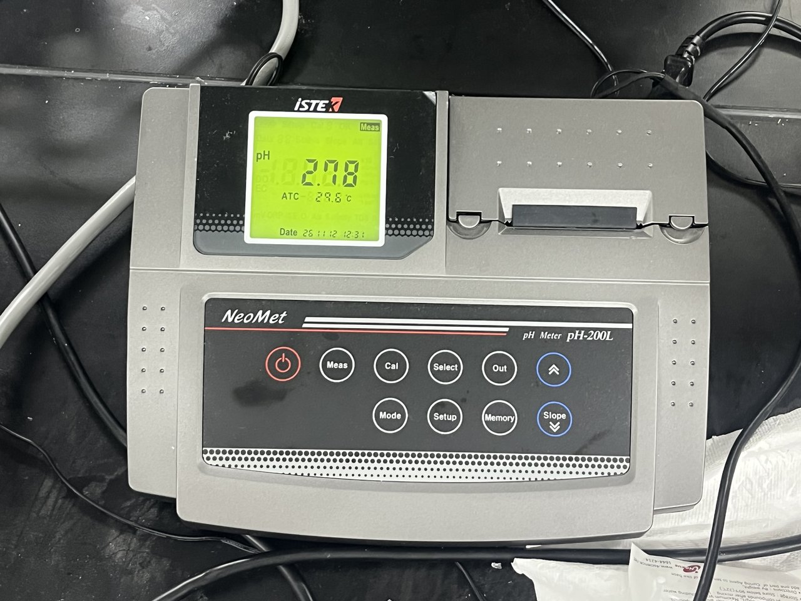

# 실습 07 — 젤라틴 나노입자: 고분자량 젤라틴 재용해와 pH 조절 (2026-11-12)

> 상태: 기록 + 원리 보충 완료, 보고서 빌드(11-18) — report/ (전사본·사진 6장·영상 11개·공지 논문 11-18) / 📷 캡처 자리 7개 중 5개 채움, 1개 부분, 1개 없음
> 사진은 주인 사진과 영상 캡처에서 골랐다. 다른 학생·진행자 얼굴이 나온 컷은 쓰지 않았다.
> 진행: 6회차와 같은 연구실 대학원생(입자 연구). 6회차에서 한 1차 탈용매화를 다시 하고, 그다음 단계(재용해 → pH 조절)까지 진행했다.
> 보고서: 조별 1부. 마감 **2026-11-19**. 분량 제한 없음, 양보다 질 `[수업]`. 6회차와 같은 진행자 메일로 제출(11-18 공지).
> 보고서 방향 `[수업]`: **pH 맞추는 부분을 중점으로**, 진행자가 단톡방에 올린 논문을 근거로 지난번보다 학술적으로, 세분화해서 정리한다. 논문에 "pH를 맞추는 것이 왜 중요한지"가 나와 있다.
> 논문(11-18 전달): Ahsan & Rao, 「The role of surface charge in the desolvation process of gelatin」, Int J Nanomedicine 12, 2017, 795–808 [A1]. 진행자 공지(11-18): 젤라틴 나노입자 합성에서 **pH 조절이 표면전하와 합성 결과에 어떤 영향을 미칠 수 있는지**를 주로 하여 작성. 분량 무관, 기존과 같은 메일로 제출.

## 1. 실습 목적

- `[수업]` 6회차에 1차 탈용매화를 눈으로만 봤다면, 이번에는 직접 얻은 고분자량 젤라틴으로 다음 단계를 하나 더 진행한다.
- `[수업]` 젤라틴 나노입자 합성은 며칠이 걸려 수업 시간에 전 과정을 다 보여 줄 수 없다. 할 수 있는 부분만 하나씩 보여 준다.
- `[수업]` 이번 회차의 핵심은 pH 조절이다. 전체 프로토콜에서 나노입자 합성의 성패를 가르는 가장 중요한 분기점 중 하나다.

## 2. 공통 주의사항

- `[수업]` 염산은 매우 위험한 물질이다. 고농도 산·염기는 항상 흄 후드 안에서 다룬다. (진행자 경험: 고농도 염산을 다루다 흡입해 병원에 간 적이 있음)
- `[수업]` 이번에 쓴 염산은 3 %로 묽혀 둔 것이라 아주 위험하지는 않지만, 손에 묻지 않도록 장갑을 끼고 다룬다.
- 사진 확인: 아세톤 병 라벨에 GHS 그림문자 세 개(인화성, 건강 유해성, 느낌표)와 "화기엄금"이 있다. 아세톤 병과 염산 튜브는 흄 후드 안에 두었다.

| 아세톤 병 라벨 (흄 후드 안) |
|---|
|  |

## 3. 장비·재료 한눈에

| 장비·재료 | 이번 실습에서 한 일 | 핵심 원리 |
|---|---|---|
| 젤라틴 (Sigma-Aldrich G2500, porcine skin, gel strength 300, **Type A**) | 1.25 g을 물 25 mL에 녹인 용액을 대량으로 만들어 25 mL씩 나눔 `[수업]` | Type A = 산 처리로 추출, 물에 녹이면 약산성 `[수업]` |
| 아세톤 | 젤라틴 용액에 1 : 1로 한 번에 부음 | 1차 탈용매화 (6회차) |
| 스패출러 | 가장자리 응집체를 긁어 보여 줌 | — |
| 핫플레이트 교반기 (DAIHAN, 3구) | 다시 녹인 젤라틴 용액을 300 rpm으로 저음 (사진) | — |
| pH 미터 (iSTEK NeoMet pH-200L) | 완충액으로 점검 → 젤라틴 용액 pH 측정 → pH 3.00 맞추기 | 전극으로 이온 농도를 재서 pH로 바꿈 `[수업]` |
| pH 표준 완충액 (4.01 / 7.00 / 10.00) | 7.00으로 점검(6.97). 3점 보정은 전날 해 둠 `[수업]` | 기준점 맞추기 (보정, calibration) |
| 전극 보관액 (istek Storage Solution R001000) | 측정하지 않을 때 전극을 담가 두는 용액 | 라벨 성분: KCl 15 %, 프탈산수소칼륨 0.5 %, 물 84.5 % (사진) |
| 묽은 염산 (HCl 3 %) | pH를 3.00까지 낮춤 | — |
| 수산화나트륨 (NaOH) | pH가 너무 내려가면 다시 올림 (시연 안 함) `[수업]` | — |
| 흄 후드 | 아세톤·염산 취급 | — |

## 4. 방법과 원리

### 4-1. 1차 탈용매화 다시 하기 + 가장자리 응집체 버리기

**사용 순서 `[수업]`**
1. 진행자가 젤라틴 1.25 g/물 25 mL 농도로 대량 용해해 둔 용액을 비커마다 25 mL씩 나눠 두었다.
2. 조마다 비커 세 개. 지난주에 직접 붓지 못한 사람이 먼저 부었다.
3. 아세톤을 1 : 1로 한 번에 빠르게, 과감하게 붓는다. 바로 탈용매화가 시작된다(우유색, 6회차와 같음).
4. 3~5분 기다리면 고분자량 젤라틴이 중력으로 바닥에 가라앉는다.
5. 비커 벽·가장자리에 젤처럼 뭉친 덩어리가 생겼으면 **버린다**.
6. 상등액을 따라 버리고 바닥의 고분자량 젤라틴만 남긴다.

**새로 나온 내용 — 가장자리 응집체(aggregation) `[수업]`**
- 실험을 하다 보면 비커 가장자리에 이미 뭉쳐서 젤 형태로 남은 덩어리가 생긴다. 많이 뭉쳐 있어서 고분자량처럼 보이지만 고분자량 젤라틴이 아니다.
- 생기는 이유(수업 비유): 땅에 기둥을 힘으로 박으면 그 부피만큼 흙이 옆으로 밀려난다. 아세톤을 한 번에 부으면 아세톤이 들어온 부피만큼 젤라틴 용액이 옆·위로 솟아오르면서 아세톤을 순간적으로 가둔다. 그러면 고분자량·저분자량이 섞인 용액이 그 자리에서 한꺼번에 응집한다.
- 결과: 무거운 분자만 가라앉혀 얻은 것이 아니라, 고분자량과 저분자량이 섞인 젤 구조 응집체다 (전사본 "쉘 구조"는 "젤 구조"의 오인식으로 추정 ❓).
- 이것도 젤라틴이라 물에 다시 녹긴 한다. 하지만 이걸로 다음 단계를 하면 나노입자가 절대 만들어지지 않는다. 진행자도 학부연구생 때 이걸 고분자량 젤라틴으로 알고 썼다가 실패했다. 나노입자로 모을 만큼 충분한 고분자량 젤라틴이 모이지 않은 상태였기 때문이다.
- 그래서 한 번에 빨리 붓되, 이 응집체가 최대한 생기지 않게 붓는 것도 필요하다. 생기면 바로 폐기한다.
- 한 번에 빨리 붓는 이유(6회차 복습): 급격히 탈용매화시켜 무거운 분자를 먼저 떨어뜨리기 위해서다. 가장자리 응집체는 이 방식의 부작용이다.

**사진으로 확인한 장면**
- 사진 확인 (영상): 아세톤을 부어 우유색이 된 비커의 가장자리를 스패출러로 긁어 보여 줬다. 스패출러 끝에 흰 젤 덩어리가 붙어 나왔다.
- 사진 확인 (영상): 상등액은 바닥의 폐액 통에 따라 버렸다.

| (a) 우유색 비커 가장자리를 긁음 | (b) 스패출러 끝의 흰 응집체 |
|---|---|
|  |  |
| (c) 상등액을 폐액 통에 버림 | |
|  | |

**원리 심화 `[보충]`**
- 논문 서론: 단백질을 빠르고 강제로 탈용매화하면 침전(precipitation)이 되고, 조절된 조건에서 탈용매화해야 크기 분포가 좁은 균일한 응집체(나노입자)가 된다 [A1].
- 분별 침전은 비용매를 넣을수록 분자량이 큰 것부터 차례로 침전하는 현상이다 [F1]. 그러려면 용액 전체의 아세톤 농도가 고르게 같아야 한다.
- 해석: 가장자리처럼 아세톤이 순간적으로 몰려 갇힌 곳은 국소 아세톤 농도가 1 : 1보다 훨씬 높아, 저분자량까지 한꺼번에 탈수·침전한 "강제 탈용매화" 상태로 볼 수 있다. 분자량으로 고르는 1차 탈용매화의 목적과 맞지 않으므로 버리는 것이 맞다. (수업 설명 + [A1][F1] 연결, 해석)

- 📷 #1 가장자리 응집체 → 완료 (a)(b)

### 4-2. 고분자량 젤라틴을 다시 물에 녹이기

- `[수업]` 바닥에 남은 고분자량 젤라틴을 다시 물에 녹여 다음 단계를 준비한다. 녹는 동안 pH 미터 설명을 진행했다.
- 사진 확인: 다시 녹인 젤라틴 용액이 든 비커 세 개가 교반기 위에서 각각 300 rpm으로 돌고 있다. 용액은 맑고 옅은 노란빛이다. 오른쪽 비커에 pH 전극이 꽂혀 있다.
- 사진 확인: 흄 후드 안 교반기의 한 자리는 가열 모드 60.0 °C다. 다시 녹일 때 가열했는지는 수업에서 말하지 않았고 주인도 모름. (문헌은 가열하며 녹임: [G2], 논문은 50 °C에서 부드럽게 가열 [A1]. 6회차 원액도 60 °C였음)
- `[보충]` 젤라틴은 찬물보다 뜨거운 물에 더 잘 녹는다 [S1].
- 사진 확인: pH를 잴 때 화면 온도(ATC)가 29.8 °C였다. 상온보다 높아 데운 용액으로 보인다(추정).
- ❓ 다시 녹일 때 넣은 물의 양 (문헌은 25 mL [G2])

| 다시 녹인 젤라틴 용액 (300 rpm), 오른쪽 비커에 pH 전극 |
|---|
|  |

- 📷 #7 재용해 장면 → 완료

### 4-3. pH 미터 점검 (보정 확인)

**사용 순서 `[수업]`**
1. 전원을 켜고 **Meas** 버튼을 누르면 측정 상태가 된다.
2. 보관액에 담가 두었던 전극을 꺼내 pH 7.00 표준 완충액에 담근다.
3. 화면 값이 7에 가까운지, 아니라면 차이가 얼마인지 본다. 차이에 따라 오차를 조정한다.
4. 이번 측정값 **6.97**. 연구실 기준 허용 오차는 0.02~0.04 정도 `[수업]` → 정확하게 지시하는 상태로 판단.
5. 정석은 pH 7.00(중성), 4.01(산성), 10(염기성) 세 점으로 교차 검증하는 3점 보정(calibration)이다. 전날 미리 보정해 둬서 이번에는 7.00 확인만 했다.

- ❓ 6.97은 7.00과 0.03 차이로 진행자가 말한 허용 범위(0.02~0.04) 안이다. "0.02~0.04"가 허용 오차의 상한인지 범위인지는 전사본으로 애매하다.
- `[수업]` 원리: 전극으로 용액 속 이온의 양(농도)을 재서 그에 맞는 pH 값으로 바꿔 준다.
- `[수업]` 측정 단자를 "노드"라고 불렀으나 전극(probe)을 말한 것이다.

**사진으로 확인한 장비**
- 사진 확인: 본체는 iSTEK NeoMet pH-200L. 버튼 Meas·Cal·Select·Out·Mode·Setup·Memory·Slope. 화면에 측정값, ATC(자동 온도 보상) 온도, 날짜(26-11-12)가 나온다. → 2회차 ❓ "pH 미터 모델명" 해결.
- 사진 확인: 선반에 "Technical Buffer Solution pH 4.01"과 "pH 10.00 MADE IN SWITZERLAND" 병이 있다. → 2회차 ❓ "pH 10 쪽 표준용액 값"은 이 연구실 기준 10.00. 제조사는 라벨이 가려 확인 못 함 ❓.
- 사진 확인 (영상): pH 7.00 완충액은 초록색 액체이고, 파란 라벨 병에서 튜브에 덜어 전극을 담갔다.
- 사진 확인 (영상): 전극 보관액 라벨 — istek Storage Solution R001000, 475 mL, 5~25 °C 보관, 성분 프탈산수소칼륨 0.5 %·염화칼륨 15 %·물 84.5 %.
- 사진 확인: 전극은 검은 스탠드 팔에 고정해 비커에 내린다.
- 사진 확인: 선반에 "GNP" 라벨이 붙어 있다. Gelatin NanoParticle의 약자로 보인다(추정).

| (a) 작업대 전체 — 선반에 4.01·10.00 완충액, 전극 스탠드 | (b) pH 7.00 완충액(초록)에 전극을 담금 | (c) 전극 보관액 라벨 |
|---|---|---|
|  |  |  |

**원리 심화 `[보충]`**
- 유리전극 끝의 얇은 유리막은 물과 닿아 얇은 수화층(겔층)을 만들고, 이 층이 있어야 H⁺에 반응해 전압이 생긴다 [E2]. 이 전압을 기준전극과 비교해 pH로 바꾼다 (2회차 4-3 정리 재사용).
- 네른스트 기울기 = 2.303RT/F (계산): 0 °C 54.20, 25 °C 59.16, 29.8 °C 60.11, 37 °C 61.54 mV/pH. 온도가 높을수록 기울기가 가파르고, 최신 pH 미터는 보정·측정 온도가 다르면 기울기를 보정한다 [E1]. 화면의 ATC(자동 온도 보상)가 이 기능이다. 다만 시료 자체의 pH가 온도에 따라 변하는 것은 보정하지 못하므로 같은 온도에서 재는 것이 원칙이다 [E1]. → 우리 용액은 29.8 °C로 데운 상태에서 쟀다.
- 보정 기준: 기울기 95~103 %, pH(0) 6.8~7.2(±15 mV) [E1]. 시료 pH가 보정 범위 안에 있어야 한다 [E1]. → 우리 목표 3.00은 4.01–7.00–10.00 보정 범위 밖(4.01 아래)이다. 외삽 구간이라 정확도가 보정 범위 안보다 떨어질 수 있다(해석). 3점 보정을 pH 4.01 대신 더 낮은 완충액(예: pH 2)으로 하면 범위 안에 들어온다.
- 보관액: 결합형 전극은 전극 내부 기준 전해액과 비슷한 3 M KCl에 보관하는 것이 가장 좋다 [E3]. 우리 연구실 보관액도 KCl 15 % 기반이다(사진). 증류수·탈이온수 보관은 권하지 않는다 [E2].
- 7.00 확인값 6.97: 7.00과 0.03 차이. 기울기 59.16 mV/pH로 환산하면 약 1.8 mV 차이로, 제조사 권장 영점 범위(±15 mV)보다 훨씬 작다(계산).

- 📷 #3 pH 미터·전극·완충액 → 완료 (a)(b)
- 📷 #4 pH 7.00에서 6.97 화면 → 없음 (영상 속 화면은 흐려서 숫자를 못 읽음)

### 4-4. 젤라틴 용액 pH 측정 → pH 3.00으로 맞추기

**사용 순서 `[수업]`**
1. 다시 녹인 고분자량 젤라틴 용액에 전극을 담가 pH를 잰다. 값이 바로 떨어지며 자리를 잡는다.
2. 처음 pH는 **5 후반**(5.5~5.6 정도)이 나오면 정상이다. (진행자가 처음 "4.5~5.5"라 했다가 "4.5까지는 안 가고 5~6 사이"로 고침)
3. 3 % 묽은 염산을 조금씩 떨어뜨려 pH를 **3.00**으로 맞춘다. pH 미터가 소수점 둘째 자리까지 보여 주므로 3.00에 최대한 맞춘다.
4. 너무 많이 넣어 2점대로 떨어지면 수산화나트륨(NaOH)을 넣어 다시 3점대로 올린다 (시연 안 함).

- `[수업]` 생물 분야에서는 0.001 단위까지 맞추기 어려워서 소수점 둘째 자리까지 맞추는 프로토콜을 쓴다.
- 사진 확인: 시연 중 pH 화면이 **2.08**(ATC 29.8 °C, 26-11-12 12:31)을 가리켰다. 전사본의 "제가 너무 많이 떨어지셨네요… 2점대로 떨어지면" 장면과 맞는다. 이후 3.00으로 되돌린 화면은 사진에 없다.
- 사진 확인: 흄 후드 안 튜브 거치대에 초록 뚜껑 원심관("HCL" 표기)과 pH 시험지 롤이 있다.
- 사진 확인 (영상): 흄 후드 안에서 초록 뚜껑 원심관과 피펫(1000 µL 계열)을 들고 비커 쪽에서 작업하는 장면이 있다. 염산을 덜어 넣는 장면으로 보이나, 비커 용액이 우유색이라 어느 단계 비커인지 확실하지 않다 ❓.

**젤라틴이 약산성인 이유 — Type A와 Type B `[수업]`**
- 젤라틴은 콜라겐을 가수분해해 추출한다. 가수분해 방식과 환경(산성/염기성)에 따라 젤라틴의 성질이 달라진다.
- 산성(acid) 조건에서 추출한 것이 **Type A**, 염기성(base) 조건에서 추출한 것이 **Type B**다.
- 우리가 쓴 제품은 Type A라서 물에 녹이면 약산성이다.
- 사진 확인: 제품 라벨 "Sigma-Aldrich G2500-500G, Gelatin from porcine skin, gel strength 300, Type A". → 6회차 ❓ "제품 번호·Type" 해결 (6회차 기록은 G1890을 근거로 달았음).
- `[보충]` 제조사: Type A는 산 처리(acid-cured) 조직, Type B는 석회(염기) 처리 조직에서 얻는다. Type A는 유리 카복실기가 단백질 100 g당 78~80 mmol, 등전점 7.0~9.5. Type B는 100~115 mmol, 등전점 4.7~5.3. 1.5 % 용액(25 °C)의 pH는 Type A 3.8~5.5, Type B 5.0~7.5 [S1]. G2500은 Bloom 약 300 [S1][S2].
- 해석: 우리 용액의 처음 pH(5 후반)는 Type A 1.5 % 용액 범위(3.8~5.5)의 위쪽 끝 근처다. 고분자량만 골라 다시 녹인 용액이고 농도·온도가 달라 정확히 비교할 수는 없다.
- 해석: Type B가 등전점이 낮은 것은 산성기(카복실기)가 더 많기 때문이다(위 mmol 수치). 수업의 "A는 산성 조건, B는 염기성 조건 추출"이 제조사 설명과 맞다.

| (a) 젤라틴 제품 라벨 | (b) 흄 후드 — 아세톤 병, HCl 원심관, pH 시험지 | (c) 피펫으로 작업하는 장면 | (d) pH 2.08 화면 |
|---|---|---|---|
|  |  |  |  |

**왜 pH를 맞추나 `[수업]`** (이번 회차 핵심)
- 젤라틴 나노입자는 생체적합성·무독성·생분해성이 있고 조직·세포(동식물 모두)에 대한 접착력이 있으며 생체에 이미 있는 물질이라 쓰임새가 좋다. 그러려면 나노입자가 잘 합성되어야 하고, 그 합성에서 pH 조절이 가장 중요하다.
- 모든 젤라틴 분자는 고유한 전하량을 가진다. 전하량이 달라지면 분자 사이, 입자 사이의 거동과 결합 방식이 달라진다.
- **pH가 낮아져 전하량이 많아지면** (예: 모두 + 전하): 같은 전하끼리 밀어내 잘 결합하지 못한다. 입자 크기가 매우 작아지거나 아예 형성되지 않는다.
- **중성에 가까우면**: 강산성일 때보다 전하량이 훨씬 적다. 아세톤을 넣어 물과의 결합이 끊어지는 순간 분자끼리 와르르 뭉쳐 버린다 → 응집(aggregation). 눈에 보이는 순간 이미 나노입자가 아니다.
- 그래서 전하량이 너무 많지도 적지도 않은 **중간 조건**을 찾아야 나노 크기 입자가 생긴다. 그 조건이 이 프로토콜에서는 pH 3.00이다.
- pH를 정확히 맞춘 뒤 젤라틴 분자를 하나하나 결합시켜 가는 것이 나노입자 합성에서 가장 중요한 단계다. 자세한 내용은 공지 논문에 있다.

**수업 후 질의응답 `[수업]`**
- 질문: 나노입자를 만들려면 "중성 조건"을 맞춰야 한다고 이해했는데 왜 3으로 내리나?
- 답: 진행자가 말한 중성은 pH 7이다. 중성에 가까워질수록 응집이 더 잘 되는데, 응집되면 안 된다. 나노입자는 용액 안에서 나노입자 상태로 남아 있어야 이후 가교제 등으로 나노 크기에 고정할 수 있다. 응집은 눈에 보일 만큼(끈적한 덩어리 수준) 뭉치는 것이라 입자라고 부르기 어렵다.
- 논문 그래프(진행자 설명): pH 3을 기점으로 그래프가 뾰족하게 꺾인다. 3.0 → 4.0 쪽은 완만해서 괜찮고, 3.0 → 2.0 쪽은 급격히 떨어진다. 그래서 3.2는 괜찮고 2.8은 안 된다. 실험 결과에서 나온 프로토콜이다.
- 해결: 그래프는 논문 그림 1A(Type A 젤라틴의 pH별 제타 전위)다 [A1]. 아래 원리 심화 2 참고.

**원리 심화 `[보충]` — 공지 논문 [A1] 정리**

논문 개요: 젤라틴의 탈용매화 과정에서 pH와 탈용매화제(아세톤)의 역할을 조사. 2단계 탈용매화(Coester 법)를 따르되 2차 단계 젤라틴 1 %(0.1 g/10 mL, 50 °C 용해, 0.22 µm 여과), pH는 0.1 N HCl·NaOH로 조절, 아세톤을 500 rpm 교반하며 적가, 25 % 글루타르알데하이드 가교. 주 실험은 **Type B**(소가죽, Bloom 225), 제타 전위·입자 크기는 Type A도 측정 [A1].

1. 탈용매화 = 물을 빼는 힘과 전하 반발의 균형. pH를 맞추지 않고 아세톤을 넣으면 그냥 침전한다. pH로 순전하를 만든 뒤 넣으면 양전하 반발이 침전을 견제해 "조절된 침전"이 되어 균일한 나노입자가 생긴다(Scheme 1). 표면 전하가 크면 반발로 안정한 분산, 작으면 침전 [A1].
2. pH와 제타 전위(그림 1, 10 mg/mL, 25 °C). 등전점에서 pH를 낮추면 제타 전위가 커진다. 등전점은 Type A 7~9, Type B 4.7~5.2. pH 4 아래에서 아스파르트산·글루탐산(pKa 3.9, 4.3)이 양성자화해 최댓값이 된다. 본문은 최댓값을 Type A pH 4, Type B pH 3.5 부근이라 적었다. 그 아래에서는 오히려 감소하는데, 모든 곁사슬이 이미 최대로 양성자화된 상태라 이온화로는 설명되지 않고, pH를 낮추려 넣은 HCl의 Cl⁻이 이온쌍을 만들고 Debye–Hückel 차폐를 일으켜서라고 본다 [A1]. Nile Red 결과 표면 소수성은 pH에 따라 변하지 않았다 [A1].
   - 그림 읽기(근삿값, 계산 아님): 그림 1A(Type A)는 pH 3에서 약 20 mV로 가장 높고, 3.5·4.0이 약 17 mV, 2.5가 약 15 mV, 2.0이 약 8 mV, 5.5가 약 5 mV다. 그림 1B(Type B)는 pH 3에서 약 17.6 mV로 가장 높다. 본문의 "최댓값 pH 4/3.5"와 그림의 최고점(pH 3)이 조금 다르다 — pH 3~4가 높은 고원이고 3 아래에서 급하게 떨어진다고 읽는 것이 안전하다.
   - → **진행자가 말한 "3을 기점으로 뾰족, 3→4 완만, 3→2 급격히 떨어짐" 그래프는 그림 1A(Type A 제타 전위)와 모양이 같다.** ❓"세로축이 무엇인지" 해결: 제타 전위(표면 전하).
3. pH와 필요한 아세톤 양(그림 2A, Type B). 등전점 가까운 pH 4에서는 약 55 %, 멀어진 pH 3.25에서는 약 73 % 아세톤이 있어야 침전이 시작된다. 낮은 pH에서 젤라틴의 물 보유력(수화망)이 더 넓고 강해지는 것도 원인으로 본다 [A1]. (그림 읽기: pH 3.0 약 78 %, 3.5 약 71.5 %, 4.0 약 53.5 %)
4. pH와 입자 크기(그림 2B·C). 등전점 근처에서 만든 입자는 크고 불안정하며 응집하려 한다. pH 4 아래에서는 작고 안정하며 다분산지수(PDI)가 낮다. 크기는 pH를 낮출수록 줄다가 Type A pH 4, Type B pH 3.25에서 가장 작고, 그 아래에서는 다시 커진다(제타 전위 감소 → 반발 감소). 1 % 젤라틴에서는 Type A pH 3.5 미만, Type B pH 3.0 미만에서 아세톤을 아무리 넣어도 입자가 생기지 않았다. 다만 Type A를 pH 2.5에서 만든 보고(Coester 등)도 있는데, 젤라틴 농도가 훨씬 높아 분자 밀집(molecular crowding)과 점도 증가로 형성이 가능했던 것으로 본다 [A1]. (그림 읽기: Type A 3.5 약 141, 4.0 약 120, 4.5 약 157, 5.0 약 176 nm / Type B 3.0 약 154, 3.25 약 127, 4.0 약 178 nm)
5. pH가 형성 경로를 바꾼다(그림 3·4, Type B). pH 4: 아세톤 50~55 %에서 침전 시작, 아세톤이 늘수록 크기가 커지다(~60 %) 멈춤 → 촘촘한 핵 위에 젤라틴이 붙는 경로, 높은 매트릭스 밀도(HMD). pH 3.25: 처음엔 물을 덜 빼앗긴 큰 입자가 생기고 아세톤이 늘수록 오그라들어 작아짐 → 낮은 매트릭스 밀도(LMD). 크기 pH 3.25 185.2±5.2 nm, pH 4 235.5±2.2 nm, PDI 0.2 미만. 단백질 접힘의 탈용매화 장벽 모델로 설명: 나노입자는 수화 상태와 침전 상태 사이 장벽 위의 덜 안정한 상태이고 글루타르알데하이드 가교가 이를 붙잡아 둔다 [A1].
6. 응용 — 약물 방출 조절. LMD는 단백질 분해효소(pronase)에 더 빨리 분해된다. 효소 없을 때 첫 30분 방출 LMD 44.6 % vs HMD 31.7 %, pronase 100 ng/mL에서 72.3 % vs 53.1 %, HMD는 18시간에 걸쳐 천천히 98.0 %까지 방출(LMD는 첫 6시간에 95.5 %). 대식세포(RAW 264.7) 안에서도 LMD가 더 빨리 분해. 분해효소 농도가 병의 심한 정도에 따라 달라지는 공격적인 암, 각막염 같은 경우에 방출 속도를 맞추는 데 쓸 수 있다고 제안 [A1].

**우리 실습 조건과 연결 (해석)**
- 우리 젤라틴은 Type A, 목표 pH 3.00. 그림 1A에서 pH 3은 제타 전위가 가장 높은 지점(약 20 mV)이다. 처음 pH 5.6 부근은 약 5 mV, 과적가 2.08 부근은 약 8 mV 수준이다(그림 근삿값에 우리 pH를 대 본 것, 측정 아님).
- 그런데 논문은 1 % Type A에서 pH 3.5 미만이면 입자가 안 생긴다고 했다. 우리 프로토콜은 1차 탈용매화를 1.25 g/25 mL(5 %)로 해서 얻은 고분자량 젤라틴을 녹이므로 논문 2차 단계(1 %)보다 농도가 높을 가능성이 크다(재용해 물 양 미확인). 논문이 든 "고농도에서는 pH 2.5에서도 형성" 설명과 같은 방향으로, 우리 3.0은 1 %의 한계(3.5)와 고농도 문헌값(2.5) 사이에 있다.
- 2.08까지 내려간 것은 H⁺ 농도로 pH 3.00의 약 8.3배(10^0.92, 계산)다. NaOH로 되돌리면 pH는 3으로 돌아와도 중화로 생긴 Na⁺·Cl⁻이 용액에 남는다. 논문이 최댓값 아래 제타 전위 감소의 원인으로 든 Cl⁻ 차폐를 생각하면, 과적가 후 되돌린 용액은 처음부터 3.00에 맞춘 용액과 이온 세기가 다를 수 있다(해석, 미측정). 그래서 적가는 조금씩 해야 한다.
- 수업의 "pH가 낮아져 전하량이 많아지면 결합 못 해 입자가 작아지거나 안 생긴다": 등전점 → pH 3~4 구간에서는 논문과 같다(전하 증가 → 크기 감소). 그보다 낮은 구간에서 입자가 안 생기는 이유를 논문은 전하 증가가 아니라 강해진 수화망(물 보유력)과 Cl⁻ 차폐로 설명한다. 결과(너무 낮으면 안 생김)는 같고 이유가 다르게 해석된다.
- Q&A의 "중성이면 응집": 응집의 기준은 pH 7이 아니라 등전점이다. Type A는 등전점이 7~9(제조사 7.0~9.5)라 중성 근처와 거의 겹쳐 진행자 설명이 맞는다. Type B(4.7~5.2)였다면 pH 5 근처가 응집 위험 구간이다.

- 📷 #2 제품 라벨 → 완료 (a)
- 📷 #5 젤라틴 처음 pH(5 후반) 화면 → 없음
- 📷 #6 염산 떨어뜨리는 장면/최종 3.00 화면 → 부분 (b)(c)(d), 최종 3.00 화면은 없음

### 4-5. 전 과정에서 이번 단계의 위치

1. 1차 탈용매화 — 6회차, 이번에 반복
2. 고분자량 젤라틴 재용해 — **이번**
3. pH 조절 (3.00) — **이번**
4. 2차 탈용매화 — 아세톤을 천천히 넣어 나노입자 형성 (6회차 설명, 아직 실습 안 함)
5. 가교(글루타르알데하이드) → 6. 원심분리·건조

## 5. 결과

| 단계 | 수행 내용 | 관찰·측정값 | 근거 |
|---|---|---|---|
| 1차 탈용매화 | 젤라틴 1.25 g/25 mL 용액 + 아세톤 25 mL 한 번에 | 우유색, 바닥 침전. 가장자리에 흰 젤 응집체가 생겨 폐기 | 녹음, 영상 |
| 재용해 | 고분자량 젤라틴을 물에 다시 녹임 | 맑은 옅은 노란 용액, 300 rpm 교반 | 사진 |
| pH 미터 점검 | pH 7.00 완충액 측정 | 6.97 (허용 오차 0.02~0.04 안) | 녹음 |
| 젤라틴 pH | 재용해 용액 측정 | 5 후반 (약 5.5~5.6) | 녹음 |
| pH 조절 | 3 % HCl 적가 → 목표 3.00 | 과적가로 2.08까지 내려간 화면 확인(ATC 29.8 °C). 이후 NaOH로 되돌리는 과정은 시연 안 함 | 사진, 녹음 |

- 우리 조는 아세톤 붓기(1차 탈용매화)까지 직접 하고, pH 미터 점검·pH 조절은 진행자 시연을 봤다 (주인 확인 11-18).

## 6. 고찰 (메모)

- pH 조절의 의미: 전하로 반발력의 크기를 정해 두고, 2차 탈용매화에서 아세톤이 물을 걷어 낼 때 분자들이 "조금씩만" 모이게 하는 장치. 1차는 분자량을 고르는 단계, pH 조절은 2차의 뭉치는 속도를 정하는 단계.
- "중성 = 응집" 오해: Q&A에서 나온 쟁점. 응집이 일어나는 기준은 pH 7이 아니라 젤라틴의 등전점이다 [A1][S1]. Type B 젤라틴이었다면 같은 논리로 다른 pH를 골라야 한다.
- 2.08로 과적가된 장면: pH 3 아래가 급격히 나빠진다는 논문 설명과 연결 → 적가는 왜 조금씩, 왜 NaOH 되돌림이 필요한지. 다만 되돌리면 Na⁺·Cl⁻ 이온이 늘어난다(논문의 Cl⁻ 차폐 설명 [A1]과 연결, 우리 용액에서는 미측정).
- 가장자리 응집체: "한 번에 빨리"와 "고르게 섞기" 사이의 균형. 6회차의 원리 4(왜 한 번에 붓나)를 보완하는 관찰.
- 논문과 우리 조건의 차이: 논문 주 실험은 Type B·1 %, 우리는 Type A·더 높은 농도(추정). pH 3.0이 Type A 1 % 한계(3.5) 아래인데도 우리 프로토콜이 쓰는 이유는 농도(분자 밀집) 쪽으로 해석.
- 한계 메모: 입자 크기·전하(제타 전위)를 직접 측정하지 않았다. pH 3.00 결과가 나노입자 크기에 주는 영향은 논문 데이터에 기대 판단한다. 2차 탈용매화 이후는 실습하지 않았다. 목표 pH 3.00이 pH 미터 보정 범위(4.01~10.00) 밖이다.

## 7. 확인 필요 목록

| # | 내용 | 결과를 바꾸나 |
|---|---|---|
| 1 | ~~공지 논문~~ → [A1] 받음, 그래프 = 그림 1A 제타 전위 | 해결 |
| 2 | ~~제출 방식~~ → 진행자 메일 (11-18 공지) | 해결 |
| 3 | ~~우리 조가 직접 한 범위~~ → 아세톤 붓기까지, pH 조절은 시연 | 해결 |
| 4 | 재용해할 때 가열 여부·물 양 (주인 모름) | 아니오 — 농도 비교는 "추정"으로 씀 |
| 5 | 영상 속 흄 후드 피펫 장면이 HCl 적가인지 (주인 모름) | 아니오 (사진 설명) |
| 6 | "쉘 구조" = "젤 구조"인지 | 아니오 |
| 7 | 완충액 제조사 | 아니오 |
| 8 | 6회차 기록의 젤라틴 출처 G1890 → G2500 (6회차는 이미 제출, 기록만 메모) | 아니오 |

## 팀원 고찰 검토 (11-18)

팀원이 준 고찰 3편을 하나씩 논문·원문과 대조했다. 보고서에는 맞는 것 중 보고서에 없던 내용 2가지만 넣었다.

| 제안 | 검증 | 반영 |
|---|---|---|
| 고찰1: Type B는 염기 처리 중 Gln·Asn 아미드기가 카복실기로 바뀌어(탈아미드화) 등전점이 낮다 | 제조사 GELITA 자료에 같은 설명이 있다 [G3]. "친핵성 부가-탈리" 반응 메커니즘까지는 이번 주제(pH–전하) 밖이고 출처가 없다 | 3.1절에 한 문장 추가 [G3] |
| 고찰1: 등전점 정의, pH↓ → 양전하·제타 전위↑ → 반발, 아세톤 탈수와의 균형(제어된 침전), pH 조절 없이 넣으면 비제어 침전 | 논문과 일치 [A1] | 이미 3·4장에 있음 — 추가 없음 |
| 고찰1: 가장자리 응집체를 막으려면 완충용액으로 정밀한 pH 보정·적정이 필요하다 | 가장자리 응집체는 pH를 맞추기 전인 1차 탈용매화 단계에서 생긴다. pH 보정과 관계없음 | 반영 안 함 |
| 고찰2: HMD/LMD, pH 4는 약 57 %, pH 3.25는 약 73 % 아세톤 | 논문 방법 절의 합성 조건(57 %, 73 %)과 일치. 결과 절의 "침전 시작"은 pH 4 약 55 % | 이미 있음(침전 시작 기준 55·73 %) — 추가 없음 |
| 고찰2: Type A·B의 수화 능력 차이로 최적 아세톤·경로가 달라진다 | 논문의 아세톤–경로 실험은 Type B만 했다. Type A로 일반화한 것은 근거 없음 | 반영 안 함 |
| 고찰2: 고농도 아세톤으로 급격히 탈용매화하면 다공성(LMD), 수화망이 단단하면 조밀한 코어(HMD) | 논문과 반대. 논문은 pH 3.25에서 물 보유력이 커서 물이 덜 빠진 큰 입자가 먼저 생기고 나중에 오그라든다고 설명(LMD). 조밀한 핵은 pH 4 쪽 | 반영 안 함 |
| 고찰2: LMD는 다공성이 높아 초기 방출이 크다 | 논문이 효소 없을 때 LMD 초기 방출이 큰 이유로 높은 다공성(과 약한 초음파 처리)을 든다 [A1] | 4.4절에 한 문장 추가 |
| 고찰2: HMD는 효소의 침투 경로가 제한되어 분해가 느리다 | 논문은 분해 속도 차이만 보였고 침투 경로 설명은 없다. 그럴듯하지만 해석 | 반영 안 함 (본문은 결과만) |
| 고찰3: 글루타르알데하이드–리신 아민 가교, 가교 밀도와 팽윤·방출 | 이번 실습에서 하지 않은 단계이고 공지 주제(pH–표면 전하) 밖. 가교 밀도·팽윤 주장은 출처 없음. 논문도 가교제 양은 변수로 다루지 않음 | 반영 안 함 (필요하면 가교 회차에서) |

## 전사 오인식 정정

탄용매화·산용매화·탄력회화 → 탈용매화 / 곱분자랑·뽑자량·호분량·구분자량·오분자랑 → 고분자량 / 단어파티들 → 나노파티클 / 피커 → 비커 / 구어·구워 → 부어 / 제일 형태 → 젤 형태 / 노드 → 전극(probe) / 매저 → Meas(측정) / 5차·차범위 → 오차·오차 범위 / pH 벡터·PH 터·pHm터 → pH 미터 / 침질 → 침지(담금) / 연기성 → 염기성 / 4성 → 산성 / 전화량 → 전하량 / 수산 아트리움 → 수산화나트륨 / 나눠 파티클 학성 → 나노파티클 합성 / 저착력 → 접착력 / 수음에게 → 수용액에서 / 고구소 → 보고서 / 최지T → ChatGPT / 탁구한 고생 → 학부연구생(추정)

## 참고 자료

- [A1] Ahsan, S. M., Rao, C. M., 「The role of surface charge in the desolvation process of gelatin: implications in nanoparticle synthesis and modulation of drug release」, International Journal of Nanomedicine 12, Dove Medical Press, 2017, 795–808. https://doi.org/10.2147/IJN.S124938 (진행자 공지 PDF 원문 확인 2026-11-18, CC BY-NC 3.0)
- [S1] Sigma-Aldrich, 「Product Information: Gelatin (G6650, …, G2500, …), Rev 05/21」, https://b2b.sigmaaldrich.com/deepweb/assets/sigmaaldrich/product/documents/321/783/g6650pis-ms.pdf (2026-11-18 확인) — 등전점, 용액 pH, Type A/B 처리
- [S2] Sigma-Aldrich, 「Gelatin from porcine skin, gel strength 300, Type A (G2500)」, https://www.sigmaaldrich.com/KR/ko/product/sigma/g2500 (2026-11-18 확인)
- [E1] Metrohm, 「How to calibrate a pH meter」, https://www.metrohm.com/en/discover/blog/2024/calibrate-pH-meter.html (2026-11-18 재확인) — 다점 보정, 시료가 보정 범위 안, 온도와 기울기, 기울기 95~103 %
- [E2] Hanna Instruments, 「Why does my pH electrode need to be hydrated?」, https://knowledge.hannainst.com/en/knowledge/ph-maintenance-troubleshooting-why-does-my-ph-electrode-need-to-be-hydrated (2026-11-18 확인) — 유리 겔층, 증류수 대신 보관액
- [E3] Hamilton Company, 「pH Sensor Storage」, https://www.hamiltoncompany.com/knowledge-base/article/ph-sensor-storage (2026-11-18 확인) — 3 M KCl 보관
- [G3] GELITA, 「Interface properties」, https://gelita.com/en/node/76 (2026-11-18 확인) — 염기 전처리 중 Gln·Asn 탈아미드화 → Type B 등전점 4.8~5.4
- [G1] Coester, C. J. 외, 「Gelatin nanoparticles by two step desolvation — a new preparation method, surface modifications and cell uptake」, Journal of Microencapsulation 17(2), 2000, 187–193. https://doi.org/10.1080/026520400288427 (6회차에서 초록 확인)
- [G2] Azarmi, S. 외, 「Optimization of a two-step desolvation method for preparing gelatin nanoparticles and cell uptake studies in 143B osteosarcoma cancer cells」, J Pharm Pharmaceut Sci 9(1), 2006, 124–132. https://sites.ualberta.ca/~csps/JPPS9(1)/Loebenberg.R(2)/nanoparticles.htm (6회차 확인)
- [F1] Hadermann, A. F., 「Polymer fractionation」, US Patent 4,510,304. https://patents.google.com/patent/US4510304 (6회차 확인)
